<div align="center">


# WRO 2026 Future Engineers — Team X67

## 🚗 *Enner Valencia*

**An autonomous car built from a custom PCB, a 3D-printed rack-and-pinion chassis, laser distance sensors, a gyroscope and our own on-board computer vision**

*Colegio Americano de Guayaquil · Ecuador*

<a href="https://www.youtube.com/@SJVL67"></a>
<a href="https://oshwlab.com/edu560/project_ehytvvog"></a>
<a href="docs/ENGINEERING_JOURNAL.md"></a>
<a href="models/README.md"></a>

<br><br>
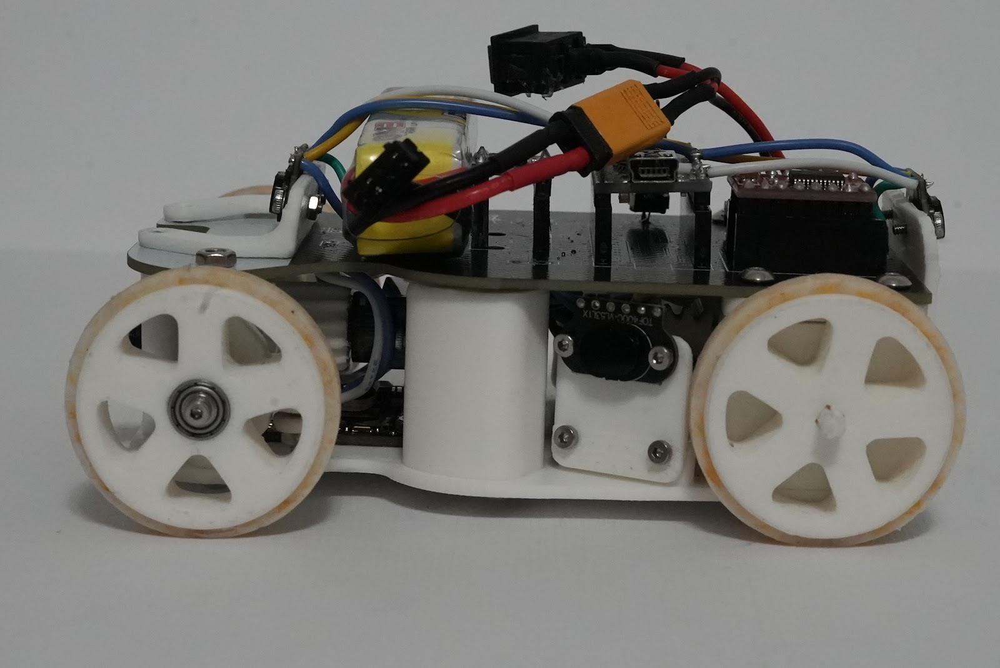

</div>

---

This repository documents the car that Team X67 built for the **World Robot Olympiad 2026, Future Engineers** category. The car must drive three laps of a track whose inner walls move every round (**Open Challenge**). In the **Obstacle Challenge** it must also pass red pillars on their right and green pillars on their left, and finish by parallel parking.

Here you will find the full engineering process (what we tried, what failed, the data, and why we changed it), the electrical design with its PCB and power budget, all the source code, and instructions to build, compile and upload everything. All documentation and code are in English.

| | |
|---|---|
| **Size / mass** | 13 × 9.5 × 6 cm · 270 g (limits: 30 × 20 × 30 cm, 1.5 kg) |
| **Main controller** | Arduino Nano (ATmega328P) |
| **Vision** | ESP32-S3-CAM (OV2640) running our own colour-detection pipeline at ~25 fps |
| **Sensors** | 4 × TOF400C laser distance sensors (VL53L1X), BMI160 gyroscope, motor encoder |
| **Drive / steering** | One N20 12 V 1000 rpm motor with encoder → 1 : 1 rear differential · parallel **rack-and-pinion** steering (module 1 mm) with an MG90 servo |
| **Chassis** | 3D-printed PLA base (v3, all joints screwed) carrying a custom PCB (EasyEDA → JLCPCB) · cast silicone tyres |
| **Power** | 3S HV LiPo 11.4 V 380 mAh · CN3903 5 V / 3 A buck converter |

---

## Contents

1. [Repository structure](#1-repository-structure)
2. [The team](#2-the-team)
3. [The challenge](#3-the-challenge)
4. [Vehicle photos and videos](#4-vehicle-photos-and-videos)
5. [Mobility and mechanical design](#5-mobility-and-mechanical-design)
6. [Power and sensor architecture](#6-power-and-sensor-architecture)
7. [Software architecture](#7-software-architecture)
8. [Open Challenge strategy](#8-open-challenge-strategy)
9. [Obstacle Challenge strategy](#9-obstacle-challenge-strategy)
10. [Systems thinking: constraints, trade-offs and risks](#10-systems-thinking-constraints-trade-offs-and-risks)
11. [Testing workflow and metrics](#11-testing-workflow-and-metrics)
12. [How to build, compile and upload](#12-how-to-build-compile-and-upload)
13. [Current status and next steps](#13-current-status-and-next-steps)
14. [Versions and release notes](#14-versions-and-release-notes)

---

## 1. Repository structure

```
.
├── README.md                ← this file: complete overview of the car
├── CHANGELOG.md             ← versions and release notes
├── docs/
│   ├── ENGINEERING_JOURNAL.md  ← day-by-day engineering process: 32 problems, data and decisions
│   └── images/                 ← plots used in the journal
├── schemes/                 ← schematic, wiring diagram, PCB, power budget, BOM, datasheets
├── src/                     ← all source code (see src/README.md)
│   ├── hardware-tests/         ← one sketch per component
│   ├── obstacle-challenge/     ← pillar detection + Pillar Vision Lab web tool
│   └── tools/scenario-roulette/← generates official WRO 2026 track scenarios to test on
├── models/                  ← 25 STL files of every printed part, renders, CAD v1–v3, tyre moulding
├── t-photos/                ← team photos (official and fun)
├── v-photos/                ← the six official views of the vehicle + all parts laid out
├── video/                   ← links to the driving videos
└── other/                   ← component pictures, PCB manufacturing, tyre casting, build process, retired parts
```

| Folder | Detailed documentation |
|---|---|
| ⚡ Electrical system, PCB, power budget, BOM | [schemes/README.md](schemes/README.md) |
| 💾 Source code, every sketch explained | [src/README.md](src/README.md) |
| 📓 Engineering process | [docs/ENGINEERING_JOURNAL.md](docs/ENGINEERING_JOURNAL.md) |
| 🚗 Vehicle photos | [v-photos/README.md](v-photos/README.md) |
| 👥 Team photos | [t-photos/README.md](t-photos/README.md) |
| 🎥 Videos | [video/video.md](video/video.md) |
| ⚙️ 3D models (25 STL), CAD iterations, tyre casting | [models/README.md](models/README.md) |
| 🧰 Build process, retired parts | [other/README.md](other/README.md) |

---

## 2. The team

<div align="center">
  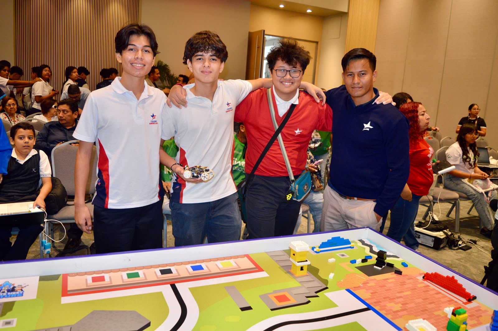
  <br><em>Team X67 and our coach at the WRO 2026 Ecuador national final.</em>
</div>

This is our **first year** in the Future Engineers category. We are students of the Colegio Americano de Guayaquil robotics club.

| Member | Role |
|---|---|
| **Eduardo Rivadeneira** | Electronics and PCB design, mechanical design, strategy integration. Robotics club since 2022 |
| **Henry Riera Loza** | Software, sensors and computer vision, engineering journal and this repository. Robotics club since 2023 |
| **Geovanny Li** | Computer vision research, software, strategy. Robotics club since 2023 |
| **Henry Cercado** (coach) | Computer Science teacher and Computer Science engineer |

### Our names

- **Team X67.** "67" started as a joke, so we decided to give it a meaning: *if you fall 6 times, you get up 7*. The **X** is a variable: anyone can live by it.
- **The car is called *Enner Valencia***, after the striker of Ecuador's national football team. Like him, through every drop in performance (three broken servos, a burnt board, two chassis redesigns) it always comes back, no matter how many times it falls.

<div align="center">
  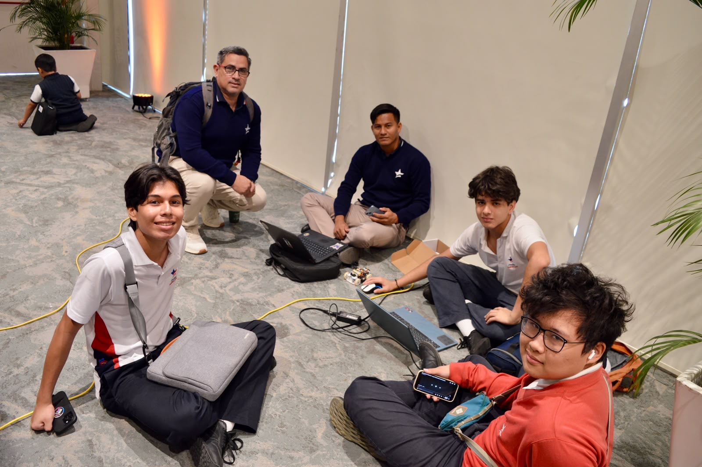
  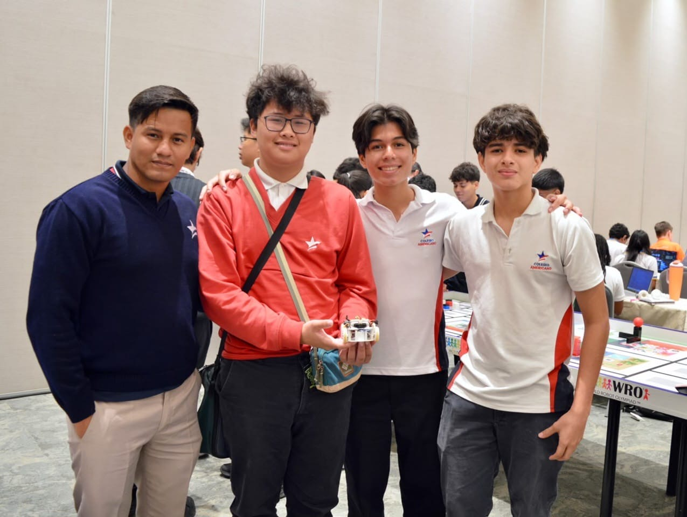
  <br><em>Debugging between rounds, and the team with the car at the national final.</em>
</div>

---

## 3. The challenge

| Challenge | Task |
|---|---|
| **Open Challenge** | Drive **3 laps** on a 3 × 3 m field. The inner walls are placed randomly every round, so each corridor is either 100 cm or 60 cm wide, and the driving direction (clockwise or counter-clockwise) is also random |
| **Obstacle Challenge** | Drive **3 laps** while obeying traffic signs: 🟥 **red** pillar → pass on its **right**; 🟩 **green** pillar → pass on its **left**. Then find the magenta parking lot and **parallel park** |
| **Documentation** | Public GitHub repository and engineering journal, scored with five criteria (mobility, power and sensors, software, systems thinking, reproducibility) |

Constraints that shaped our design (from the [official rules](https://wro-association.org/)): maximum size 30 × 20 × 30 cm, maximum mass 1.5 kg, one drive axle with mechanically connected wheels, a steering system, one start button and one power switch, no wireless communication during the run.

---

## 4. Vehicle photos and videos

| Front | Back | Top |
|---|---|---|
| 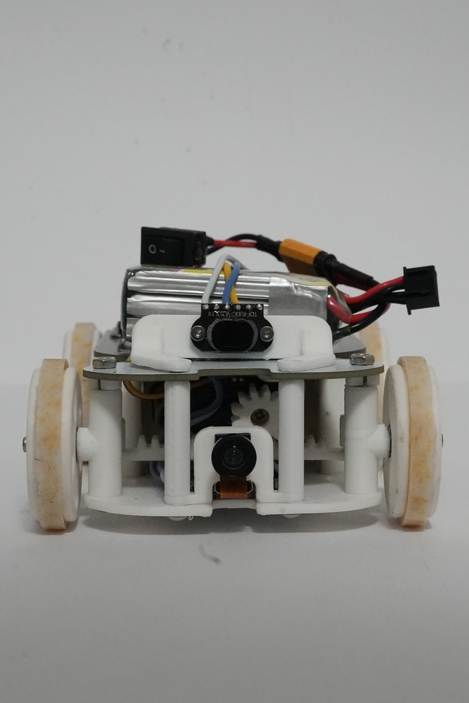 | 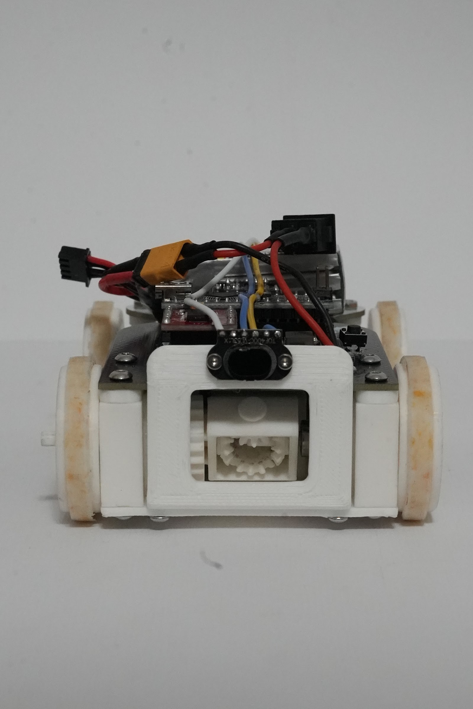 | 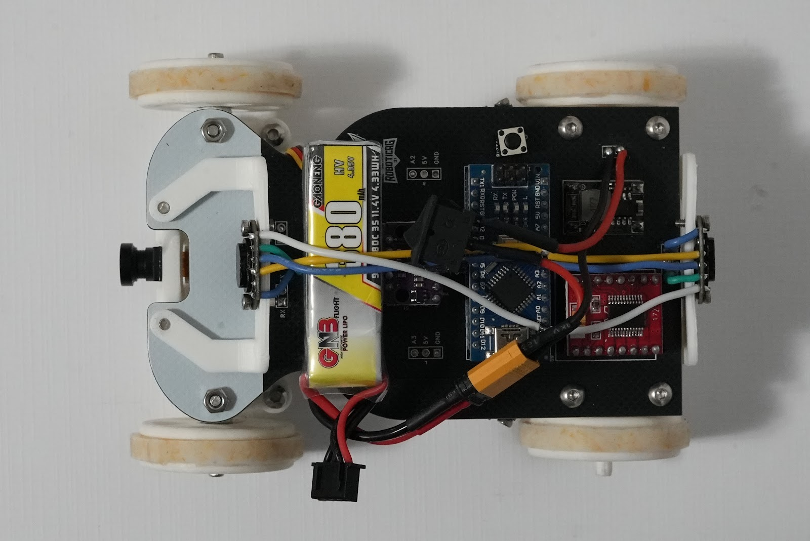 |
| **Left** | **Right** | **Bottom** |
|  | 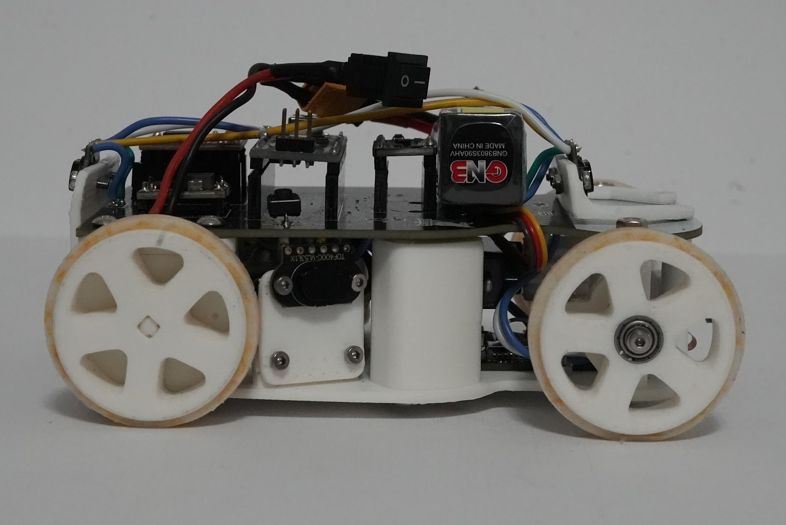 | 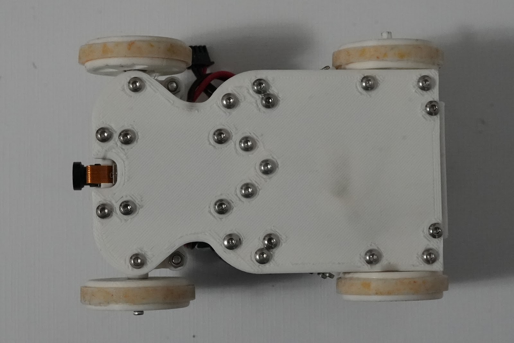 |

- All vehicle photos with descriptions: [v-photos](v-photos/README.md)
- Driving videos: [video/video.md](video/video.md) — [autonomous driving on YouTube](https://www.youtube.com/watch?v=J5yrJuZZ5P8)

---

## 5. Mobility and mechanical design

All printed parts (25 STL files), the full STEP assembly, the CAD of every iteration and the tyre-casting process are in [models/README.md](models/README.md).

<div align="center">
  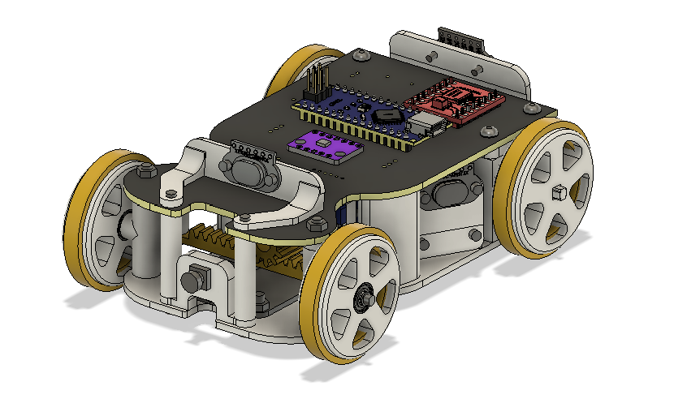
  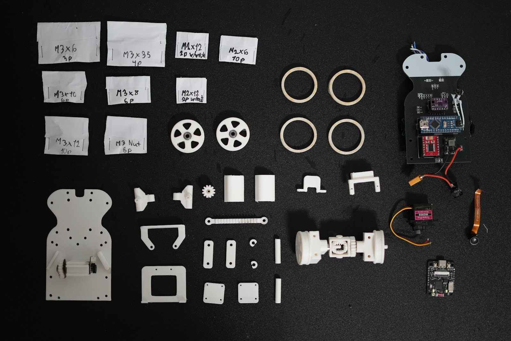
  <br><em>CAD assembly of chassis v3, and every part of the real car laid out before assembly.</em>
</div>

### 5.1 Chassis

- **Two layers:** a **3D-printed PLA base** (120 × 70 mm) carries the drive train at the rear and the steering at the front; the **custom PCB** sits on printed supports above it and carries all the electronics. The 3S battery lies flat on the PCB.
- **Size and mass:** 13 cm long, 9.5 cm wide, 6 cm high, **270 g**. That is less than half of the allowed length and width and under 20 % of the allowed mass.
- **Why so small:** the narrowest corridor is 60 cm. A short, narrow car has more free space on each side to correct its path and to pass pillars, and a short wheelbase turns in a smaller radius.
- **Stability:** the car is only 6 cm high and the heaviest parts (battery, motor, PCB) are in its lower half, so the centre of mass is low and the car does not roll in turns. The PCB is 1.6 mm FR-4 and is screwed to the base, which makes the whole chassis stiff.
- **Everything is screwed:** in chassis v2 some parts were held with tape, which showed the design was incomplete. In v3 every joint is a screw, so the geometry does not change after a crash or after taking the car apart.

### 5.2 Drive

- **One N20 12 V, 1000 rpm motor with a Hall encoder** drives both rear wheels through a **differential with a 1 : 1 gear ratio** (motor gear and differential gear both 22 mm). A single motor on one axle follows the rules (driving wheels must be mechanically connected), and the differential lets the inner and outer wheels turn at different speeds in corners, so the tyres do not scrub and the car follows the steering angle precisely.
- **Speed reasoning:** with 41 mm wheels, each wheel revolution moves the car π × 41 mm ≈ 129 mm, so 1000 rpm at 1 : 1 gives a theoretical top speed of ≈ 129 mm × 1000 / 60 ≈ **2.1 m/s**. That is far more than we need: our control loop is designed for ≈ 0.3–0.6 m/s, where the TOF sensors (one reading every 100 ms) see a new value every 3–6 cm. We drive the motor with a PWM duty cycle well below 100 %, which also leaves torque available for acceleration.
- **Torque reasoning:** to accelerate the 270 g car at 1 m/s² against rolling resistance (rolling coefficient ≈ 0.05), the wheels need F = m · (a + C<sub>rr</sub> · g) ≈ 0.27 × (1 + 0.05 × 9.81) ≈ **0.40 N**, which at a 20.5 mm wheel radius is only **≈ 8 mN·m (≈ 0.08 kg·cm)** at the wheel. The light chassis is what makes a 1 : 1 transmission possible: the N20's built-in gearbox already gives enough torque, so no extra reduction (and no extra printed gears that could slip) is needed.
- **Why 1 : 1:** a reduction would give more torque that we do not need and less top speed; a step-up would make low speeds harder to control. 1 : 1 also means both gears are the same printed part size, which is simple to print and to replace.
- **Braking:** the TB6612FNG short-brake mode (both inputs HIGH) stops the motor actively, much faster and more repeatably than coasting. The motor only drives forward during a run: a sudden reverse made one gear of the drive train skip (journal Problem 34).

### 5.3 Steering

<div align="center">
  
  
  
  <br><em>Steering iterations in CAD: v1 Ackermann, v2 Ackermann with a steering rack, v3 parallel rack and pinion (final).</em>
</div>

**Final mechanism (v3):** the MG90 servo turns a **12-tooth pinion with module 1 mm**, which moves a **module 1 mm rack** that pushes both steering knuckles together (parallel steering).

- **Geometry:** the pitch diameter of the pinion is m × z = 1 × 12 = **12 mm**, so each degree of servo rotation moves the rack π × 12 / 360 ≈ **0.105 mm**. The relation between servo angle and rack position is linear and has no dead zone, so the angle we command is the angle we get.
- **Why we left Ackermann:** in theory Ackermann is better, because the inner wheel turns more than the outer one and neither tyre slips. In practice our Ackermann linkages (v1 and v2) had too many printed joints and too much friction: the servo could not complete its travel (journal Problem 29) and **three servos were damaged** pushing against the linkage (journal Problems 17 and 33).
- **Trade-off we accepted:** with parallel steering both front wheels turn the same angle, so in a turn the inner wheel slips a little. On a 270 g car at 0.3–0.6 m/s that slip is small, and the 1 : 1 differential at the rear already removes the larger scrubbing of the driven wheels. We traded a small geometric error for a mechanism that is **reliable, easy to print and does not break servos**.
- **Servo mount:** the servo bracket of v3 holds the servo with screws, so its case cannot move (the problem of the first SG90 mount, journal Problem 8). Centre and limits are always **measured, not assumed**, with `servo_calibration` after any mechanical change (on v3: centre 120°, left limit 180°, right limit 50°, provisional).

### 5.4 Wheels and tyres

The four 36 mm hubs are printed, and the **tyres are cast on them with C25 silicone rubber** in printed moulds (≈ 41 mm outside diameter). Silicone grips the field mat much better than printed plastic, which reduces slipping when the car accelerates, brakes and turns, so the encoder distance and the gyro turns stay accurate.

| Moulds | Mix | Pour | Result |
|---|---|---|---|
| 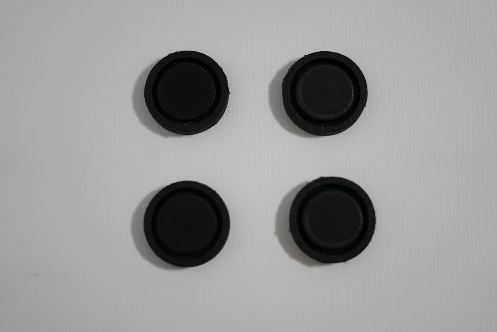 |  |  |  |

Recipe: **30 g of part A + 23 drops of part B**, from the formula **B = ¾ · A** (drops of catalyst per gram of base), mixed until most bubbles are gone, poured and cured **5–6 hours**. Using a fixed formula makes every batch cure the same, so the four tyres have the same hardness. Full step-by-step with photos: [models/README.md §4](models/README.md#4-custom-silicone-tyres).

### 5.5 Iterations that changed the mechanics

| Version | Change | Reason (data / test) |
|---|---|---|
| Chassis 1 → 2 | Side TOF sensors raised **1.5 cm** | The beam passed over the 10 cm wall and read the far side of the field (journal Problem 16). After the change the walls are detected reliably |
| Chassis 1 → 2 | SG90 → MG90 servo | Servo moved inside its mount (journal Problem 8) |
| v1 → v2 | Ackermann with tie rods → Ackermann driven by a steering rack | First step toward moving both wheels from a single rack |
| v2 → v3 | Ackermann → **parallel rack and pinion** (12 teeth, module 1 mm) | The linkage was too tight; three servos were damaged (journal Problems 17, 29, 33) |
| v2 → v3 | Tolerances corrected in the CAD | Moving parts were either loose or stuck |
| v2 → v3 | Sizes adapted in the CAD instead of improvised fixes; new camera and servo mounts | v2 needed hand adaptations and tape |
| v2 → v3 | Tape removed, every joint screwed | Tape showed the design was not complete and let the geometry change |
| Printed → cast | Silicone tyres | More grip on the mat; repeatable recipe |

<div align="center">
  
  
  
  <br><em>Printed chassis v1, v2 and v3.</em>
</div>

---

## 6. Power and sensor architecture

The full electrical documentation is in [schemes/README.md](schemes/README.md): schematic, wiring diagram, BOM with the reason for every component, power budget, PCB manufacturing and datasheets.

### 6.1 Power

```
 3S HV LiPo 11.4 V ──[switch]──┬──► TB6612FNG ──► N20 drive motor
                               ├──► Arduino Nano (VIN) ──► 3.3 V pin ──► 4 × TOF400C
                               └──► CN3903 buck 5 V / 3 A ──► camera board, BMI160, servo, encoder
```

| | Typical | Peak |
|---|---|---|
| Current from the battery | ≈ 0.22 A | ≈ 0.96 A |
| Power | ≈ 2.5 W | ≈ 11.0 W |
| Run time on one charge | ≈ 1.4 h | ≈ 19 min |

The motor uses the battery voltage directly (it is a 12 V motor); everything else uses a **switching** 5 V regulator, because a linear one would waste more power as heat than all the electronics consume. The 3 A buck has a wide margin over the ~1 A peak of the 5 V rail, so a servo stall cannot reset the camera.

**The TOF sensors take 3.3 V from the Nano**, not from the 5 V buck rail. Their laser pulses are then on a different rail from the servo, so a servo current peak cannot disturb a distance reading. The cost: four sensors peak near 80 mA, which is more than the small 3.3 V regulator of a classic Nano is rated for. We check the 3.3 V pin with a multimeter while all four sensors are ranging; if it sags, the TOF400C modules can go back to the 5 V rail with no other change (they accept 3.3–5 V). Full budget and failure analysis: [schemes/README.md §4](schemes/README.md#4-power-system).

### 6.2 Wiring / pin map (Arduino Nano)

The PCB was designed for the Nano ESP32; after that board was damaged (journal Problem 31) we use a **classic Arduino Nano (ATmega328P)**, which has the same pin positions, so the PCB did not change.

| Device | Signal | Pin |
|---|---|---|
| Camera board | UART RX / TX | D0 / D1 |
| Encoder | C1 / C2 | D3 / D2 |
| TB6612FNG | PWMA / AIN1 / AIN2 | D6 / D7 / D8 |
| TB6612FNG | STBY | tied to +5 V on the PCB (always enabled) |
| Steering servo | Signal | D9 |
| Start button | Input | D10 |
| I²C bus (4 × TOF + BMI160) | SDA / SCL | A4 / A5 |
| TOF BACK / FRONT / RIGHT / LEFT | XSHUT | A0 / A1 / A2 / A3 |

All four TOF sensors share one I²C bus with the gyroscope. At start-up every sensor is switched off with its XSHUT pin, then switched on one at a time and given its own address (LEFT 0x30, RIGHT 0x31, BACK 0x32, FRONT 0x33).

**ESP32-S3-CAM** (camera pins = ESP32S3_EYE layout): SDA 4, SCL 5, XCLK 15, VSYNC 6, HREF 7, PCLK 13, Y2–Y9 = 11, 9, 8, 10, 12, 18, 17, 16. UART to the Nano on GPIO43 / GPIO44.

### 6.3 Sensors: selection, placement and calibration

| Sensor | Placement | Why |
|---|---|---|
| **TOF FRONT** | Front centre | Distance to the wall ahead (safety check and parking) |
| **TOF LEFT / RIGHT** | Both sides, perpendicular | Distance to each wall; a sudden jump means the wall ended → corner. Raised **1.5 cm** so the beam does not pass over the 10 cm wall |
| **TOF BACK** | Rear centre | Position along a straight section |
| **BMI160** | Flat on the PCB | Yaw (Z axis) for straight driving and exact 90° turns |
| **Camera** | Front, slightly down | Sees the pillars of the next section |

**Why TOF and not infrared or ultrasonic:** our first sensors were Sharp infrared sensors. Their output is non-linear, so noise grows with distance, and our tests showed they were unreliable beyond 50–60 cm, less than one corridor width (journal Problem 3). We also proved that the standard deviation of their readings could not tell a wall from an open side (journal Problem 2). Ultrasonic sensors have a wide cone that sees the floor and the neighbouring walls. The VL53L1X measures up to 4 m and lets us narrow its measurement area (ROI) in software.

**Calibration**

- **TOF ROI chosen by experiment** (journal §8.2): we measured the same wall with several ROI heights and kept the one where the beam no longer saw the floor or passed over the wall (ROI 1 × 6). Per-sensor offset and a median filter of the last 5 valid readings.
- **Gyroscope:** 200 samples at rest before every run; their mean is the offset.
- **Steering:** centre and limits found with the interactive `servo_calibration` sketch, with 2–3° of margin before each mechanical stop.
- **Camera colours:** HSV thresholds tuned live under the real lighting with Pillar Vision Lab (section 9).

**Noise and interference we considered:** sunlight and strong lamps raise the TOF ambient-light level (we print the ambient value in the diagnostic sketch); dark or shiny walls lower the return signal (we accept "signal fail" readings only if their value is valid); objects outside the field (people, flags) can look like pillars to the camera, so only a horizontal band of the image is searched.

---

## 7. Software architecture

### 7.1 Two boards, each doing what it is best at

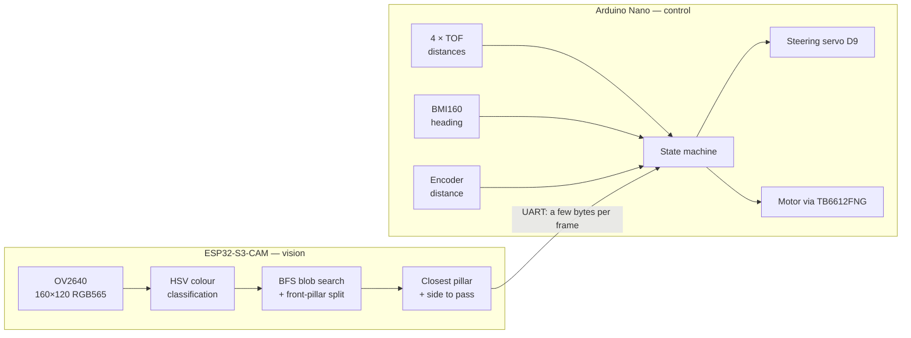

- **Camera board:** all image processing. It sends only a few bytes per picture (colour of the closest pillar, its position, whether it is already on the correct side), so the link stays fast.
- **Arduino Nano:** sensors, control loops and actuators. It never processes images, so its loop timing stays fast and predictable.

### 7.2 Modules

| Module | Board | What it does | Code |
|---|---|---|---|
| TOF driver | Nano | Address assignment through XSHUT, continuous ranging, ROI, median filter, offsets | [`tof_sensors_test`](src/hardware-tests/tof_sensors_test) |
| Gyro driver | Nano | BMI160 read through I²C registers (no library), offset calibration, yaw integration (`yaw += rate × dt`) | [`gyro_yaw_test`](src/hardware-tests/gyro_yaw_test) |
| Motor control | Nano | TB6612FNG forward / reverse / coast / short brake with PWM | [`rear_motor_loop_test`](src/hardware-tests/rear_motor_loop_test) |
| Steering | Nano | `Servo.h` on the classic Nano (500–2500 µs at 50 Hz); on the Nano ESP32 the pulse was generated by hand. Calibrated centre and limits | [`servo_simple`](src/hardware-tests/servo_simple), [`servo_calibration`](src/hardware-tests/servo_calibration), [`servo_only_test`](src/hardware-tests/servo_only_test) |
| Wall keeping | Nano | PID that keeps the start distances to both walls, or to the nearest wall | [`wall_keep_both_pid`](src/hardware-tests/wall_keep_both_pid), [`wall_follow_nearest_pid`](src/hardware-tests/wall_follow_nearest_pid) |
| First drive test | Nano | Drive straight and brake when the left wall ends | [`drive_until_left_open`](src/hardware-tests/drive_until_left_open) |
| Pillar detection | Camera | HSV → blobs → closest pillar → side to pass; streams picture and mask over USB | [`pillar_viewer.ino`](src/obstacle-challenge/pillar_viewer) |
| Pillar Vision Lab | PC browser | Shows what the camera sees, runs the same algorithm in JavaScript and checks it matches, live parameter tuning | [`viewer.html`](src/obstacle-challenge/pillar_viewer/viewer.html) |
| Scenario Roulette | PC browser | Draws valid official track layouts to test on and scores Open Challenge attempts | [`index.html`](src/tools/scenario-roulette/index.html) |

**Why we wrote our own drivers:** the BMI160 library we tried only returned zeros without reporting any error (journal Problem 14), and the servo libraries did not work with the Nano ESP32 core (journal Problem 6; on the classic Nano the standard `Servo.h` works). Our register-level and hand-pulse versions are short, fully understood and faster.

**Why our own vision code instead of OpenCV:** OpenCV does not run on a microcontroller without an operating system; a Raspberry Pi would add weight, a second battery and a long boot time to a 30 × 20 cm car; and colour detection does not need a neural network. Our pipeline runs at ~25 fps and was verified pixel by pixel against its JavaScript copy. The full comparison (OpenMV, Pixy2, HuskyLens, Raspberry Pi) is in [journal §6.2](docs/ENGINEERING_JOURNAL.md#62-why-we-wrote-the-vision-ourselves-instead-of-using-opencv).

---

## 8. Open Challenge strategy

### 8.1 Idea

The car learns its distances to the walls at the start, keeps those distances all the way so it never drifts, and detects each corner as a **sudden jump** in a side distance: the inner wall has ended, so the car turns toward that side until the gyroscope says it has rotated exactly 90°. A counter stops the car after the 12th corner (3 laps × 4 corners).

### 8.2 State machine

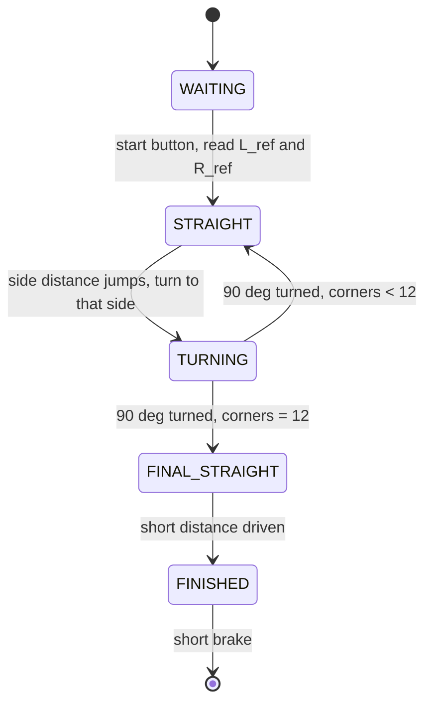

| State | What the car does |
|---|---|
| **WAITING** | Calibrates the gyroscope at rest (200 samples → offset). When the start button is pressed, it averages several readings of the LEFT and RIGHT TOF sensors and stores them as the **reference distances** `L_ref` and `R_ref` |
| **STRAIGHT** | Motor forward. The steering keeps the heading of the current straight (a multiple of 90° from the gyro) **and** keeps the side distance equal to its reference with a PD controller. Every cycle it compares each side reading with the previous one to look for a sudden jump |
| **TURNING** | Servo to its limit on the corner side, motor running. The car turns until the gyro heading has changed **exactly 90°** from the heading of the previous straight. Then the servo returns to its measured centre and `corners` increases by one |
| **FINAL_STRAIGHT** | After the 12th corner the car drives straight a short, tuned distance (measured with the encoder) so the whole car is inside the starting section |
| **FINISHED** | Motor short brake (both TB6612FNG inputs HIGH); the car stays stopped |

### 8.3 Keeping the same distance to the walls

- `L_ref` and `R_ref` are measured **once, at the start**, where the car is placed parallel to the walls.
- In STRAIGHT the lateral error is `error = distance − reference` and the steering correction is `Kp · error + Kd · d(error)/dt`, added to the gyro heading correction (initial values Kp = 0.8, Kd = 0.3, to be tuned on the track).
- **Which wall is followed:** before the first corner, both side walls are used. The first jump tells the turning direction of the round. From then on the car follows the **outer wall** at its reference distance, because the outer wall of the field is at the same position in all four sections, while the inner wall can be at a different distance in each section (corridors of 100 cm or 60 cm). Keeping the same distance to the outer wall therefore keeps the car on the same path in every section and every lap, without drifting.
- **Why a PD controller with the gyro:** the gyro alone keeps the car parallel to the walls but cannot see a slow sideways drift; the distance alone reacts late to a change of angle. Together, the gyro holds the angle and the distance term removes the drift. The derivative term reacts to how fast the error is changing, which damps the zig-zag that a proportional-only controller tends to produce because the steering always reacts with some delay.

### 8.4 Corner detection: sudden jump

- Every cycle (TOF period 100 ms), each side reading is compared with the previous one. If a side distance **increases by more than `JUMP_THRESHOLD`** (initial value 150 mm), that wall has ended: the car is at a corner and turns toward that side.
- The sensors use the measurement area we chose by experiment, **ROI_WIDTH = 1 and ROI_HEIGHT = 6** (journal §8.2). With this ROI the difference between "wall at 60 cm" and "no wall" was the largest of all the heights tested (64 vs 1–57 for the others), so the jump at the end of a wall is clear and the beam does not pass over the 10 cm wall.
- **Why a jump and not the front wall:** the side wall ends before the front wall gets close, so the car can start its turn earlier and with more room. The jump also tells which way to turn, so the car does not need to know in advance whether the round is clockwise or counter-clockwise. This method was developed with hand tests and validated (journal §2.4); comparing absolute left/right distances gave false decisions beyond 50 cm (journal §2.3).

### 8.5 Turning by gyro angle

The turn ends when the heading has changed exactly 90°, not after a fixed time. A turn by time would change with the battery voltage and the speed; a turn by angle is the same every time. The target heading is absolute (0°, 90°, 180°, 270°, …), so small errors in one corner do not accumulate over the 12 corners.

### 8.6 Edge cases

| Case | Handling |
|---|---|
| Car starts at any position inside the starting section | `L_ref` / `R_ref` are measured at the start, never assumed |
| Corridor of 60 cm instead of 100 cm | After the first corner the car follows the outer wall, whose position never changes |
| False jump right after a turn (the sensor sees past the end of the inner wall while the car straightens) | Jump detection is ignored for a short distance after each turn |
| A single noisy TOF reading looks like a jump | Median filter of the last 5 valid readings before comparing |
| Gyro drift over 3 laps | Offset calibration at rest before every run; absolute heading targets |
| Stopping inside the starting section | After the 12th turn the car drives a tuned, encoder-measured distance and brakes actively |

---

## 9. Obstacle Challenge strategy

### 9.1 Idea

The car steers so that the closest pillar ends up in the **correct third of the camera image**, keeps driving, and uses the **orange and blue floor lines** to know when it has reached a corner: it turns 90° with the gyroscope and increases the corner counter. Parking is still being designed.

### 9.2 Pillar detection (finished and tested on the robot)

1. Take a 160 × 120 RGB565 picture, about 25 times per second.
2. Convert each pixel to **HSV** and classify it as RED (hue ≥ 340° or ≤ 15°), GREEN (hue 80–160°) or nothing, with minimum saturation and brightness so the white walls and the grey mat are rejected.
3. Group pixels into blobs with a **BFS flood fill**; blobs under 30 pixels are noise; a shape filter keeps only blobs taller than wide.
4. If two pillars of the same colour touch in the picture, split them and keep the **front** one.
5. The **closest pillar** is the one whose base is lowest in the picture.

Only rows 53–78 of the picture are searched: the camera's wide view can see red or green objects outside the field and read them as pillars.

### 9.3 Passing pillars: the "correct third" rule

The 160-pixel-wide image is divided into three equal thirds (≈ 53 px each).

| Closest pillar | Rule | Target in the image |
|---|---|---|
| 🟥 Red | Pass on its **right** → the pillar must stay on the car's left | **Left third** |
| 🟩 Green | Pass on its **left** → the pillar must stay on the car's right | **Right third** |

- While the pillar is **not** in its target third, the servo steers the car away from it (red → steer right, green → steer left).
- Once the pillar is **inside** the target third, the servo returns toward the centre and the car keeps driving straight past it.
- When the pillar leaves the bottom of the image (it has been passed), the next closest pillar becomes the target; if there is none, the car returns to the heading of the current straight.

**Why this rule:** the horizontal position of the pillar in the image is directly the angle between the car's direction and the pillar, so no distance estimation or camera calibration is needed. Keeping a red pillar in the left third means the car's path passes to its right with lateral clearance, and the same for green on the other side. The rule matches the "correct side" check already built and tested in the detection code (central zone ±28 px ≈ the middle third). It is also simple enough to tune and explain, which matters with the time left before the competition.

**Safety rule:** the side TOF sensors have priority over the pillar rule. If a side wall is closer than a minimum distance, the car steers away from the wall even if the pillar is not yet in its third.

### 9.4 Corners: floor lines and counter

- Each corner of the field has an orange line and a blue line on the floor. The camera detects them with the same HSV method as the pillars.
- When the **first line of a corner** is detected, the car turns until the gyro heading has changed 90° (same turning method as the Open Challenge) and increases the corner counter. The second line of the same corner is ignored.
- The turning direction is learned at the first corner, from the side that is open, and kept for the rest of the round.
- **Why lines and not the TOF jump used in the Open Challenge:** in this challenge the side TOF sensors can also see pillars, which would create false jumps. The floor lines are fixed by the rules, always at the corners, and the camera is already looking at the floor in front of the car.

### 9.5 After 12 corners: parking

After the 12th corner the three laps are complete. **The parking manoeuvre is still being designed**; the options we are studying (finding the magenta parking-lot walls with the camera and the side TOF sensors) will be documented here and in the engineering journal once they are tested.

### 9.6 Pillar Vision Lab

<a href="https://henryalejandrorieraloza-sudo.github.io/WRO-2026-Future-Engineers-Journal/src/obstacle-challenge/pillar_viewer/viewer.html">Pillar Vision Lab</a> is the calibration tool we built: a web page that receives every picture over USB (Web Serial), draws the colour mask on top, runs the same algorithm in JavaScript, checks that its result matches the camera board, and lets us tune every parameter live. It turned threshold tuning from guessing into measuring, and it is how we will tune the floor-line colours too.

---

## 10. Systems thinking: constraints, trade-offs and risks

### 10.1 How the subsystems depend on each other

| Decision | Affects | Example |
|---|---|---|
| Camera on its own board | Software, power | Nano loop stays fast; costs ~0.5 W more and a UART link |
| PCB as chassis | Mechanics, electronics, time | Very compact and reliable, but every revision takes ~2 weeks to arrive from China |
| TOF height on the chassis | Sensors, software | 1.5 cm higher fixed the readings over the wall without any code change |
| Steering mechanism | Mechanics, electronics, software | Ackermann friction broke three servos; rack and pinion protects the servo and makes angle → wheel position linear |
| Car size and mass (13 × 9.5 cm, 270 g) | Mechanics, power, strategy | Light enough for a 1 : 1 drive and a 380 mAh battery; narrow enough to have room on both sides in a 60 cm corridor |
| TOF on the Nano's 3.3 V pin | Power, sensors | Isolated from servo peaks, but limited by the Nano's small regulator |
| Servo mount angle | Mechanics, software | Steering centre must be measured in software after every mechanical change |
| Battery voltage directly to the motor | Power, control | Speed changes as the battery discharges, so turns are controlled by gyro angle, not time |

### 10.2 "We chose X instead of Y because…"

| We chose | Instead of | Because (data or test) |
|---|---|---|
| TOF400C (VL53L1X) | Sharp infrared | Sharp unreliable beyond 50–60 cm in our tests (journal Problem 3) |
| Binary "wall / open" and jump detection | Comparing left vs right distances | Comparing magnitudes beyond 50 cm gave false decisions (journal §2.3) |
| Moving reference for jump detection | Fixed reference | The fixed version tested worse on the track (journal Problem 4) |
| Following the outer wall at its start distance | Centring between the walls | The inner walls move every round, so the centre changes; the outer wall never moves |
| Floor lines for corners in the Obstacle Challenge | Side TOF jumps | Pillars near the walls could create false jumps; the lines are fixed by the rules |
| "Correct third" of the image to pass pillars | Estimating pillar distance and planning a path | Bearing is read directly from the image, no calibration needed, simple to tune and explain |
| Our own BMI160 driver | DFRobot library | The library returned only zeros, without errors (journal Problem 14) |
| Hand-generated servo pulse (on the Nano ESP32) | ESP32Servo / LEDC | Libraries did not work with that board core (journal Problem 6) |
| MG90 metal-gear servo | SG90 | SG90 moved in its mount (journal Problem 8) |
| Parallel rack-and-pinion steering | Ackermann linkage | Ackermann friction stopped the servo and damaged three servos (journal Problems 17, 29, 33); the small slip of parallel steering is acceptable at our mass and speed |
| 1 : 1 differential | Extra gear reduction | The 270 g car needs only ≈ 8 mN·m at the wheel; 1 : 1 keeps top speed and uses identical, easy-to-print gears |
| Cast silicone tyres | Printed or O-ring tyres | More grip on the mat; repeatable recipe (B = ¾ A) gives four identical tyres |
| Screws on every joint | Tape and hand fixes | Geometry stays the same after crashes and disassembly |
| Classic Arduino Nano | New Nano ESP32 | Same footprint (no new PCB); standard `Servo.h` works; available immediately after the ESP32 was damaged |
| Own vision on ESP32-S3 | OpenCV on Raspberry Pi, Pixy2, HuskyLens | Weight, boot time, second battery, and we can explain and tune every step (journal §6.2) |
| Custom PCB | Perforated prototype board | Prototype board too bulky; PCB is cleaner and doubles as the chassis |
| Buck converter | Linear regulator | A linear regulator would waste ~3 W as heat |

### 10.3 Risks and mitigation

| Risk | Mitigation |
|---|---|
| Main board damaged by a wrong voltage (journal Problem 31: the Nano ESP32 was lost) | Battery only reaches VIN, VM and the buck; code is uploaded with the battery **off** |
| TOF sensors draw more than the Nano's 3.3 V pin can give | Measure the 3.3 V pin under load; fallback: TOF VIN to the 5 V buck rail |
| Classic Nano (5 V) TX into the camera's 3.3 V RX | Resistor divider on that line before the camera link is connected |
| Servo blocked by the steering mechanism | Rack and pinion with low friction; limits measured with 2–3° margin |
| Drive gear skips on a sudden reverse (journal Problem 34) | Motor only drives forward during a run; stops with short brake |
| I²C bus freezes and hangs the program (journal Problem 12) | `Wire.setTimeOut(50)`; check connectors; each sensor tested alone first |
| Loose sensor wire (journal Problem 30) | Locking connectors on the PCB; hardware tests before every session |
| Lighting at the venue differs from home | Colour thresholds re-tuned on site with Pillar Vision Lab in minutes |
| Camera sees objects outside the field | Search only a horizontal band of the image |
| Steering not centred after a mechanical change | Re-run `servo_calibration` after any change to the steering |

The complete list of the **39 problems** we found, with their causes and solutions, is in [journal §12](docs/ENGINEERING_JOURNAL.md#12-summary-of-problems-and-solutions).

---

## 11. Testing workflow and metrics

Every component is tested alone before it is joined to the rest:

1. **Hardware tests** ([src/hardware-tests](src/hardware-tests)): one sketch per component, printing its readings to the Serial Monitor.
2. **Hand tests:** the car or its sensors are moved by hand to check the decision logic before the car drives itself. This let us develop the algorithm while the chassis was still being built.
3. **Measured experiments** to choose parameters: TOF ROI height (journal §8.2), HSV thresholds in Pillar Vision Lab.
4. **Driving tests on realistic layouts** generated by Scenario Roulette with the official procedure.

| Metric | How we measure it |
|---|---|
| Vision frame rate | fps printed by the camera board (~25 fps) |
| Vision correctness | Board result vs JavaScript result, compared on the same picture in Pillar Vision Lab |
| TOF quality | Reading vs tape-measure distance; standard deviation of repeated readings |
| Gyro drift | Heading change with the car at rest over time |
| Turn accuracy | Heading error after each 90° turn |
| Open Challenge score | Laps completed and official points, logged per attempt in Scenario Roulette |
| Scenario generator correctness | 600 generated scenarios checked automatically, 0 rule violations (journal §7) |

---

## 12. How to build, compile and upload

### 12.1 Hardware

1. Order the PCB from the [OSHWLab project](https://oshwlab.com/edu560/project_ehytvvog) (1.6 mm).
2. Buy the components in the [BOM](schemes/README.md#1-bill-of-materials-bom).
3. Print the 25 parts in [models/stl](models/stl) (PLA) and cast the four silicone tyres ([recipe](models/README.md#4-custom-silicone-tyres)).
4. Assemble the drive train, the steering and the sensor brackets on the printed base following the [assembly order](models/README.md#5-assembly-order).
5. Solder headers and connectors on the PCB, mount it on its supports and wire the external components following the [wiring diagram](schemes/README.md#3-wiring-diagram).
6. Run the [hardware tests](src/hardware-tests) one by one, then `servo_calibration` to measure the steering centre.

### 12.2 Software

- **Arduino IDE 2.x**
- Board packages (*Tools → Board → Boards Manager*): **Arduino AVR Boards** (built in) for the Arduino Nano; **esp32** (by Espressif) for the ESP32-S3-CAM.
- Library (*Sketch → Include Library → Manage Libraries*): **VL53L1X** by **Pololu**. `Servo.h` and `Wire.h` come with the IDE; the BMI160 needs no library (own driver).

### 12.3 Upload to the Arduino Nano

1. Open the sketch (*File → Open*, choose the `.ino`). Each sketch is in a folder with its own name, as the Arduino IDE requires.
2. *Tools → Board → Arduino AVR Boards → **Arduino Nano***; *Tools → Processor → **ATmega328P*** (choose **ATmega328P (Old Bootloader)** if the upload fails with `not in sync`); choose the port.
3. **Battery off**, USB connected. Click *Upload*.
4. Serial Monitor at **115200** baud.

### 12.4 Upload to the ESP32-S3-CAM

| Tools option | Value |
|---|---|
| Board | ESP32S3 Dev Module |
| USB CDC On Boot | Enabled |
| Flash Size | 8MB (64Mb) |
| Partition Scheme | 8M with spiffs (3MB APP/1.5MB SPIFFS) |
| PSRAM | **OPI PSRAM** (without it: `frame buffer malloc failed`) |

If the upload stays at `Connecting...`: hold **BOOT**, press and release **RESET**, release **BOOT**. Only one program can use the port at a time: close the Serial Monitor or Pillar Vision Lab before uploading.

### 12.5 Pillar Vision Lab

Upload `pillar_viewer.ino` to the camera board, open `viewer.html` in **Chrome or Edge** (Web Serial is needed), press **Connect** and choose the camera port.

---

## 13. Current status and next steps

| Part | Status |
|---|---|
| Custom PCB and wiring | ✅ Manufactured and working |
| TOF sensors (×4), unique addresses, ROI, filtering | ✅ Working |
| Gyroscope heading | ✅ Working (own driver) |
| Drive motor through TB6612FNG | ✅ Tested |
| Pillar detection | ✅ Finished and tested on the robot |
| Chassis v3: printed base, rack-and-pinion steering, silicone tyres | ✅ Built (25 STL files published) |
| Steering calibration on v3 | 🔄 Provisional centre 120°, limits 180° / 50° |
| Wall-keeping PID on v3 | 🔄 Tuning (`wall_keep_both_pid`) |
| Open Challenge program on chassis v3 | 🔄 Integration |
| Open Challenge final-straight and stop after 12 corners | 🔄 Integration |
| Obstacle: correct-third steering, floor-line corners | ⏳ Next |
| Camera → Nano UART link | ⏳ Next |
| Parking | 🧠 Being designed |

---

## 14. Versions and release notes

See [CHANGELOG.md](CHANGELOG.md) for the history of the repository and the car.

---

<div align="center">
<sub>Team X67 · WRO 2026 Future Engineers · Colegio Americano de Guayaquil, Ecuador</sub>
</div>
