<div align="center">

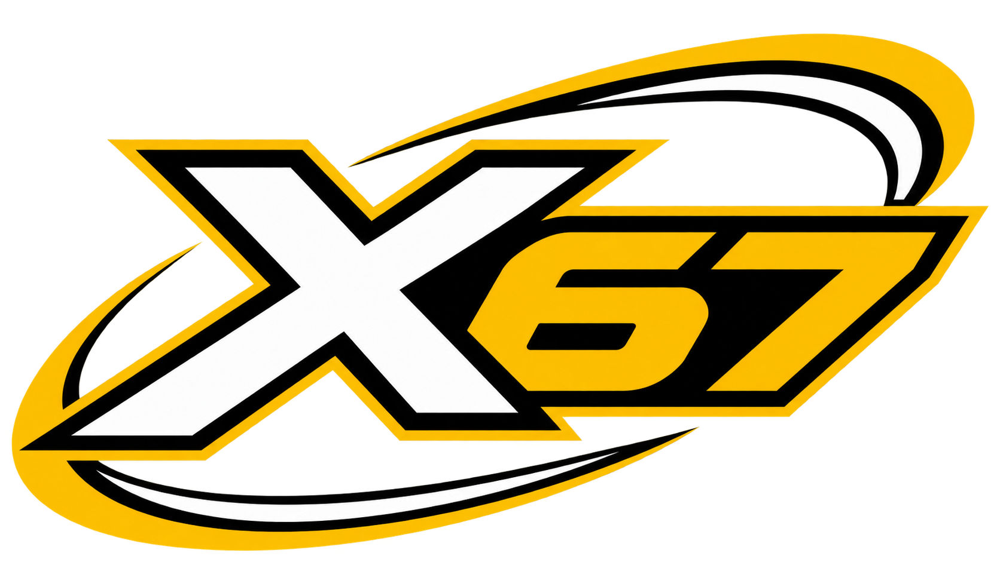

# WRO 2026 Future Engineers — Team X67

## *Enner Valencia*

**An autonomous car built from a custom PCB, a 3D-printed rack-and-pinion chassis, laser distance sensors, a gyroscope and our own on-board computer vision**

*Colegio Americano de Guayaquil · Ecuador*

<a href="https://www.youtube.com/@SJVL67"></a>
<a href="https://oshwlab.com/edu560/project_ehytvvog"></a>
<a href="docs/ENGINEERING_JOURNAL.md"></a>
<a href="models/README.md"></a>

<br><br>
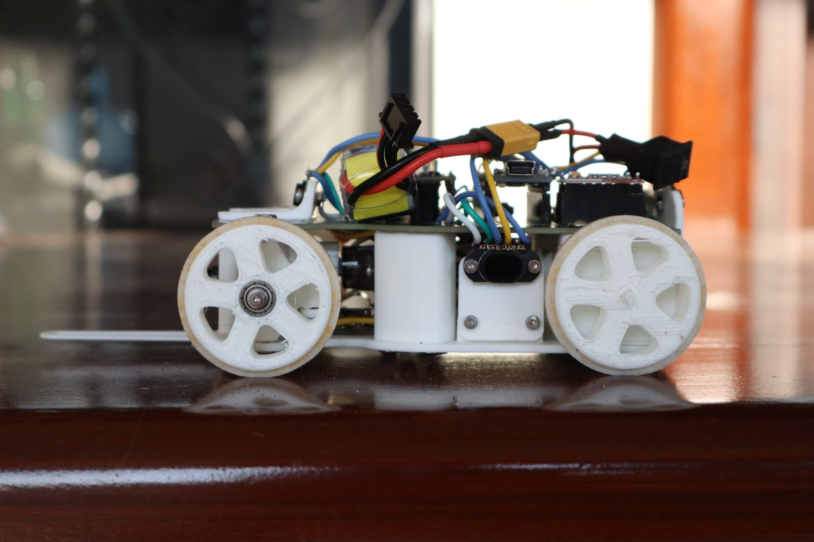

</div>

---

This repository documents the car that Team X67 built for the **World Robot Olympiad 2026, Future Engineers** category. The car must drive three laps of a track whose inner walls move every round (**Open Challenge**). In the **Obstacle Challenge** it must also pass red pillars on their right and green pillars on their left, and finish by parallel parking.

Here you will find the full engineering process (what we tried, what failed, the data, and why we changed it), the electrical design with its PCB and power budget, all the source code, and instructions to build, compile and upload everything. All documentation and code are in English.

| | |
|---|---|
| **Size / mass** | 17.5 × 9 × 6 cm · 248 g (limits: 30 × 20 × 30 cm, 1.5 kg) |
| **Main controller** | Arduino Nano (ATmega328P) |
| **Vision** | ESP32-S3-CAM (OV2640) running our own colour-detection pipeline (160 × 120 in the competition code, v3.2; the frame rate at this size is printed by the sketch and is to be recorded) |
| **Sensors** | 4 × TOF400C laser distance sensors (VL53L1X), BMI160 gyroscope, motor encoder |
| **Drive / steering** | One N20 12 V 1000 rpm motor with encoder → 1 : 1 rear differential · parallel **rack-and-pinion** steering (module 1 mm) with an MG90 servo |
| **Chassis** | 3D-printed PLA base (v3, all joints screwed) carrying a custom PCB (EasyEDA → JLCPCB) · cast silicone tyres |
| **Power** | 3S HV LiPo 11.4 V 380 mAh · CN3903 5 V / 3 A buck converter |

---

## Contents

1. [Repository structure](#1-repository-structure)
2. [The team](#2-the-team)
3. [The challenge](#3-the-challenge)
4. [Vehicle photos and videos](#4-vehicle-photos-and-videos)
5. [Mobility and mechanical design](#5-mobility-and-mechanical-design)
6. [Power and sensor architecture](#6-power-and-sensor-architecture)
7. [Software architecture](#7-software-architecture)
8. [Open Challenge strategy](#8-open-challenge-strategy)
9. [Obstacle Challenge strategy](#9-obstacle-challenge-strategy)
10. [Systems thinking: constraints, trade-offs and risks](#10-systems-thinking-constraints-trade-offs-and-risks)
11. [Testing workflow and metrics](#11-testing-workflow-and-metrics)
12. [How to build, compile and upload](#12-how-to-build-compile-and-upload)
13. [Current status and next steps](#13-current-status-and-next-steps)
14. [Versions and release notes](#14-versions-and-release-notes)

---

## How this repository answers the documentation rubric

For the evaluators: where to find each criterion of the *Future Engineers 2026 Documentation Rubric*.

| Rubric criterion | What it asks for | Where it is |
|---|---|---|
| **1. Mobility and mechanical design** | Chassis, steering and drive justification, torque / speed reasoning, stability, diagrams, reproducible | [§5](#5-mobility-and-mechanical-design) (torque and speed calculations in §5.2, steering trade-off in §5.3, iterations in §5.5) · [models/](models/README.md) (28 STL — 26 printed parts including the front protrusion + 2 tyre moulds, full STEP assembly, CAD v1–v3, assembly order) |
| **2. Power and sensor architecture** | Power layout and current budget, sensor choice and placement, calibration, wiring diagrams, failure points | [§6](#6-power-and-sensor-architecture) · [schemes/README.md](schemes/README.md) (BOM, schematic, wiring diagram, power budget §4.2, failure points §4.3, PCB) |
| **3. Software architecture and obstacle strategy** | Modules, state machines and flowcharts, lane following and obstacle logic, algorithm justification, edge cases, tuning and metrics | [§7](#7-software-architecture) (modules ↔ code) · [§8](#8-open-challenge-strategy) (state machine, safety rules, edge cases) · [§9](#9-obstacle-challenge-strategy) (flowchart, vision, map, steering law) · [§11](#11-testing-workflow-and-metrics) · [src/README.md](src/README.md) |
| **4. Systems thinking and engineering decisions** | How subsystems interact, constraints, trade-offs, iteration, risk | [§10](#10-systems-thinking-constraints-trade-offs-and-risks) (dependencies, "we chose X instead of Y because…", risks, every setting justified) · [docs/ENGINEERING_JOURNAL.md](docs/ENGINEERING_JOURNAL.md) (68 problems with data) |
| **5. Reproducibility and GitHub quality** | Structure, ≥ 3 commits, README ≥ 5000 characters, CAD / wiring / code included, can another team rebuild it | [§1](#1-repository-structure) structure · [§12](#12-how-to-build-compile-and-upload) build, compile, upload · [§14](#14-versions-and-release-notes) + [CHANGELOG.md](CHANGELOG.md) release notes · 144 commits with descriptive messages |

---


## Summary

- **Vehicle:** 17.5 × 9 × 6 cm, 248 g. Rear drive motor with encoder, rack-and-pinion steering, a custom PCB, laser distance sensors and a gyroscope.
- **Controllers:** Arduino Nano for driving; ESP32S3-CAM for camera vision, which sends pillar detections to the Nano over UART.
- **Open Challenge:** `open_challenge` drives three laps and stops at the starting position (§8.0).
- **Obstacle Challenge:** the camera detects red and green pillars; the Nano drives around them. The parking start is in the code and still being tested (§7, §9).
- **Repository:** 144 commits on `main`. Commit history and the 1/5 rule are in [docs/COMMITS.md](docs/COMMITS.md). Open items and deadlines are in §14.1. AI use is in §15.

## 1. Repository structure

```
.
├── README.md                ← this file: complete overview of the car
├── CHANGELOG.md             ← versions and release notes
├── docs/
│   ├── ENGINEERING_JOURNAL.md  ← day-by-day engineering process: 68 problems, data and decisions
│   └── images/                 ← plots used in the journal
├── schemes/                 ← schematic, wiring diagram, PCB, power budget, BOM, datasheets
├── src/                     ← all source code (see src/README.md)
│   ├── hardware-tests/         ← one test per component: motor + encoder, steering servo, 4 TOF + gyroscope
│   ├── open-challenge/         ← open_challenge: the Open Challenge program (3 laps, stops at the start position)
│   ├── obstacle-challenge/     ← the Obstacle Challenge: driving program, camera vision (v3.2), parking start
│   └── tools/                  ← browser tools: camera_viewer (test the camera), scenario-roulette (track layouts)
│   (earlier Open Challenge sketches and older hardware tests: kept in the git history — see src/README.md)
├── models/                  ← 28 STL files (26 printed parts including the front protrusion + 2 tyre moulds), renders, full STEP assembly, CAD history v1–v3 and the final v4 assembly
├── t-photos/                ← team photos (official and fun)
├── v-photos/                ← the six official views of the vehicle + all parts laid out
├── video/                   ← links to the driving videos
└── other/                   ← component pictures, PCB manufacturing, tyre casting, build process, retired parts
```

| Topic | Detailed documentation |
|---|---|
| Electrical system, PCB, power budget, BOM | [schemes/README.md](schemes/README.md) |
| Source code, every sketch explained | [src/README.md](src/README.md) |
| Engineering process | [docs/ENGINEERING_JOURNAL.md](docs/ENGINEERING_JOURNAL.md) |
| Vehicle photos | [v-photos/README.md](v-photos/README.md) |
| Team photos | [t-photos/README.md](t-photos/README.md) |
| Videos | [video/video.md](video/video.md) |
| 3D models (28 STL), full STEP assembly, CAD iterations, tyre casting | [models/README.md](models/README.md) |
| Build process, retired parts | [other/README.md](other/README.md) |

---

## 2. The team

<div align="center">
  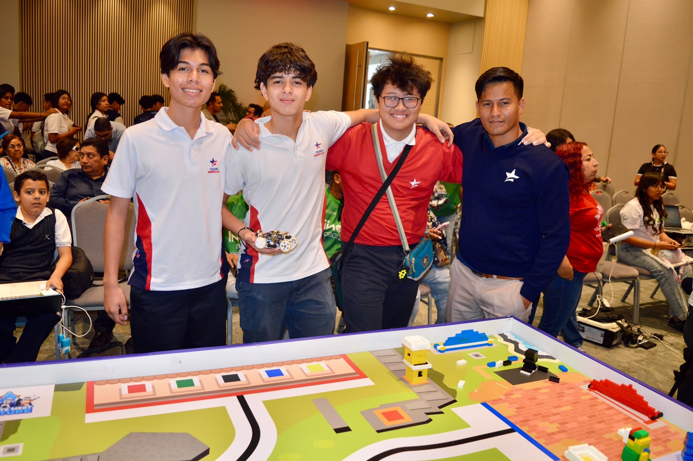
  <br><em>Team X67 and our coach at the WRO 2026 Ecuador national final.</em>
</div>

This is our **first year** in the Future Engineers category. We are students of the Colegio Americano de Guayaquil robotics club.

| Member | Role |
|---|---|
| **Eduardo Rivadeneira** | Electronics and PCB design, mechanical design, strategy integration. Robotics club since 2022 |
| **Henry Riera Loza** | Software, sensors and computer vision, engineering journal and this repository. Robotics club since 2023 |
| **Geovanny Li** | Computer vision research, software, strategy. Robotics club since 2023 |
| **Henry Cercado** (coach) | Computer Science teacher and Computer Science engineer |

### Our names

- **Team X67.** "67" started as a joke, so we decided to give it a meaning: *if you fall 6 times, you get up 7*. The **X** is a variable: anyone can live by it.
- **The car is called *Enner Valencia***, after the striker of Ecuador's national football team. Like him, through every drop in performance (three broken servos, a burnt board, two chassis redesigns) it always comes back, no matter how many times it falls.

<div align="center">
  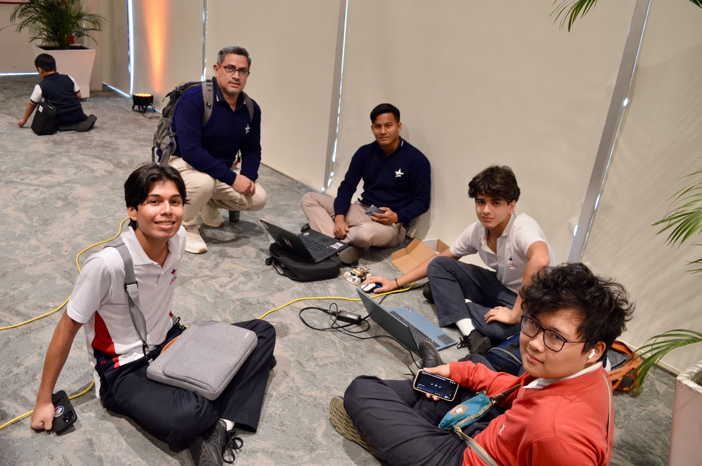
  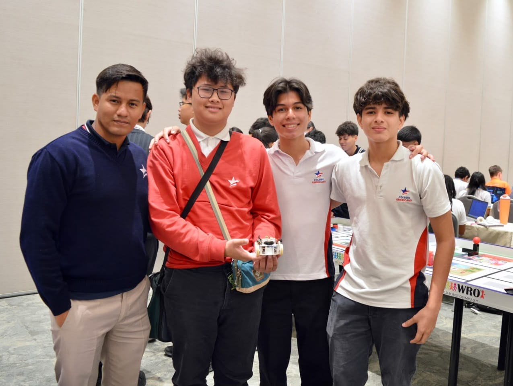
  <br><em>Debugging between rounds, and the team with the car at the national final.</em>
</div>

---

## 3. The challenge

| Challenge | Task |
|---|---|
| **Open Challenge** | Drive **3 laps** (3 minutes maximum) on a 3 × 3 m field with 10 cm black walls. The inner walls are placed randomly every round, so each corridor is either 1000 mm or 600 mm wide (± 100 mm at the International Final); the starting section, starting zone and driving direction (clockwise or counter-clockwise) are also random. After 3 laps the car must stop by itself inside the starting section. The car **may not touch the outer wall** |
| **Obstacle Challenge** | Drive **3 laps** (3 minutes maximum, corridors always 1000 mm) while obeying traffic signs: **red** pillar → pass on its **right**; **green** pillar → pass on its **left**. Then find the magenta parking lot (always in the starting section, length 1.5 × car length) and **parallel park** without touching its limits |
| **Documentation** | Public GitHub repository and engineering journal, scored with five criteria (mobility, power and sensors, software, systems thinking, reproducibility) |

Constraints that shaped our design (from the [official rules](https://wro-association.org/)): maximum size 30 × 20 × 30 cm, maximum mass 1.5 kg, one drive axle with mechanically connected wheels, a steering system, one start button and one power switch, no wireless communication during the run.

### 3.1 Rules compliance

How the car and this repository meet each rule of the *WRO 2026 Future Engineers General Rules* (version 15 January 2026) that affects our design:

| Rule | Requirement | How we comply |
|---|---|---|
| 9.17 / 11.1 | Max 300 × 200 × 300 mm | 175 × 95 × 60 mm |
| 11.2 | Max 1.5 kg | 248 g |
| 11.3 / 11.4 | 4 wheels, one driving axle, one steering actuator; no omni or ball wheels; no differential-drive robot | 4 wheels, rear-wheel drive, one MG90 servo on a rack and pinion |
| 11.5 / 11.13 | Max 2 driving motors, connected to the axle (no motor per side) | One N20 motor → 1 : 1 mechanical differential on the rear axle |
| 11.6 / 11.10 / 11.17 | Autonomous; no radio, Bluetooth or Wi-Fi during rounds; only wired links between components | The Nano has no radio. The camera board's Wi-Fi is **never started** in the competition code (the camera talks to the Nano by UART cable). `camera_webserver_emakefun` uses Wi-Fi and is a **bench test only** |
| 9.6 / 9.10 / 9.11 / 9.14 | Placed switched off; one power switch; waiting state; one start button; pressing it starts the run | Power switch → program calibrates the gyro and waits in `WAIT`; one push button on D10 starts the run |
| 9.9 / 11.7 | No data entered by switches, part positions or sensor calibration before the round; no signals during the run | The program reads nothing from the team: the gyro offset is measured **automatically** by the program at power-on with the car still, and the turn direction and wall positions are detected by the sensors during the run |
| 9.16 / 9.21 / App. A.4 | Drive in the round direction; reverse only within the section where it changed direction and the next one | Open Challenge: direction detected at the first corner, no reverse gear. Obstacle Challenge: the direction is set by the first floor line, and **every corner is turned in reverse gear** (front TOF at 40 cm → back up while steering → rear TOF at 20 cm). This reverse move happens inside the corner section, the same section where the car changes direction, so it complies with 9.21 / App. A.4: the rule allows driving against the round direction in that section and the neighbouring one (cases 1, 2 and 4), case 6 allows back-to-front driving, and the back-up never reaches the second neighbouring section (case 3). The rear TOF stop (20 cm) and `MAX_REVERSE_MS` keep it short |
| 9.18 | Do not move walls; in the Open Challenge do not touch the outer wall | The car follows the **inner** wall at a short distance, so it stays away from the outer wall; front safety brake |
| 9.22 / 9.24.2 / 9.24.3 / App. A.2–A.3 | After 3 laps stop completely inside the starting section (no movement after 15 s; judged after 30 s still); passing into the next corner ends the round without the stop points | After the **12th** turn: short tuned straight, then **active brake for 1 s** (both TB6612FNG inputs HIGH), then the motor is switched off (§10.4) |
| 9.23 | One repair per round; no program upload, no data entry | Nothing to configure: after a repair the car is switched on and started with the same button |
| 8 (Obstacle) / 1.8.1 | Parking-lot start points only if a full lap is completed | Start position decided by the team before the round; parking still being designed |
| 3.3 / 3.7 | Own work by the team | The team designed the solution, tested it on the car and can explain the code. Part of the code and documents was written with AI assistance; see [§15](#15-use-of-ai-tools). The commit history shows the origin of each change |
| 7 | Public GitHub repository in English; README ≥ 5000 characters (modules, link to electromechanical components, build / compile / upload); commented code; photos of every side, top and bottom; team photo; one YouTube video per challenge with ≥ 30 s of autonomous driving; ≥ 3 commits on time; repository public for 12 months after the event; hard copy at the International Final | See [§14.1 Submission checklist](#141-submission-checklist) |

---

## 4. Vehicle photos and videos

| Front | Back | Top |
|---|---|---|
| 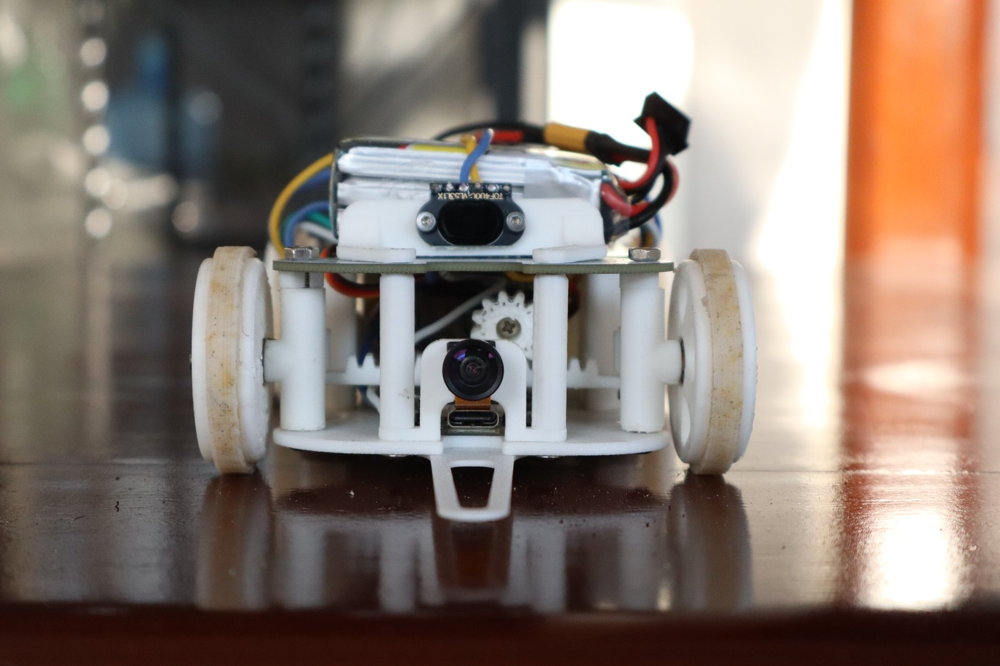 | 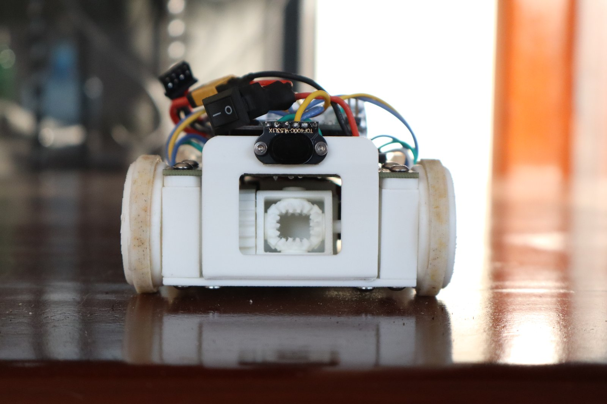 | 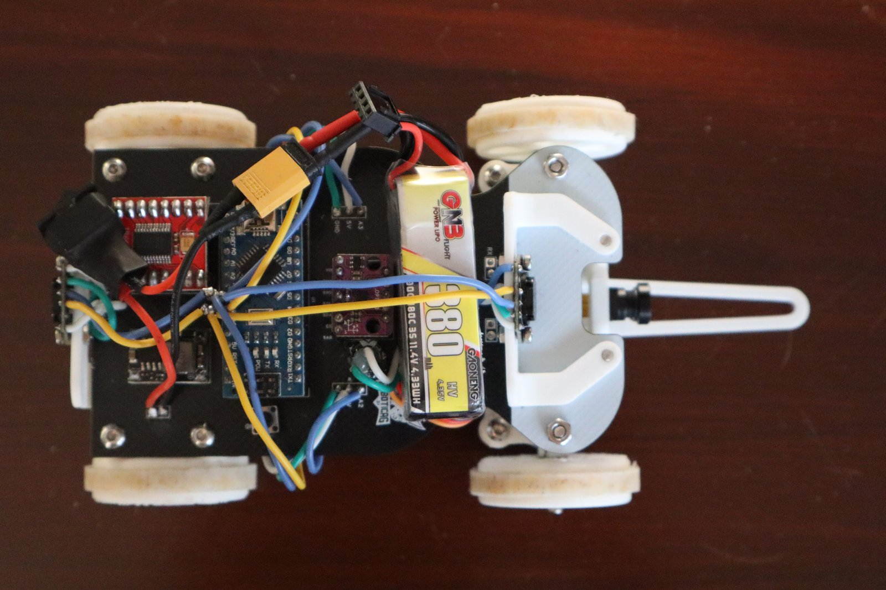 |
| **Left** | **Right** | **Bottom** |
|  | 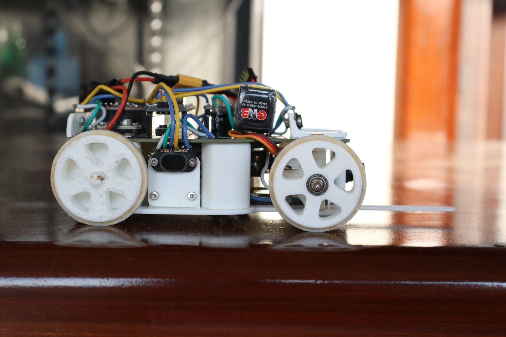 | 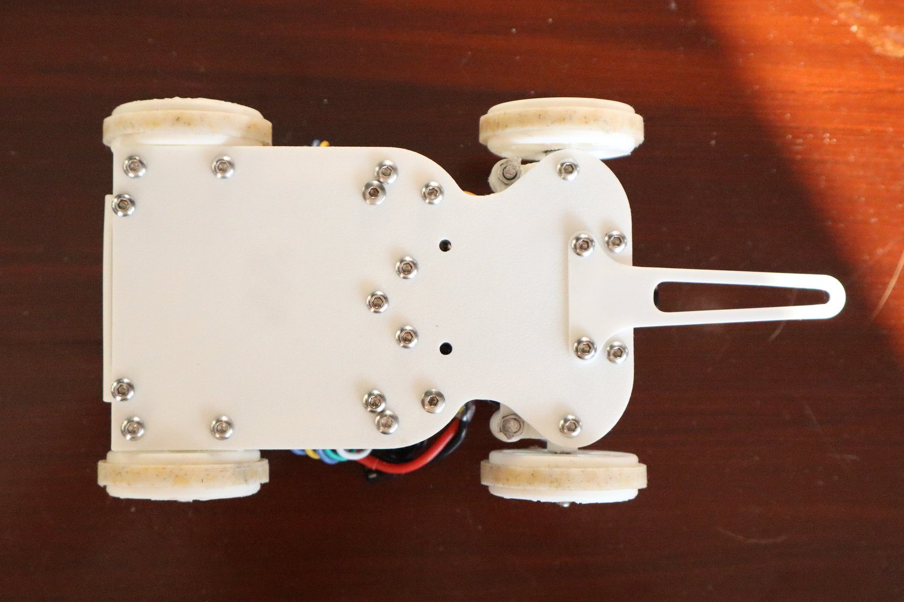 |

- All vehicle photos with descriptions: [v-photos](v-photos/README.md)
- Driving videos: [video/video.md](video/video.md) — **Open Challenge:** [youtube.com/watch?v=4p94mWkXhsk](https://www.youtube.com/watch?v=4p94mWkXhsk) · **Obstacle Challenge:** [youtube.com/watch?v=ccAdp2c7_7Y](https://www.youtube.com/watch?v=ccAdp2c7_7Y) · earlier autonomous driving: [youtube.com/watch?v=J5yrJuZZ5P8](https://www.youtube.com/watch?v=J5yrJuZZ5P8). The rules ask for **one video per challenge** (Open and Obstacle), each with at least 30 s of autonomous driving; the list in `video.md` shows which ones are ready.

---

## 5. Mobility and mechanical design

All 28 STL files (26 printed parts and 2 tyre moulds), the full STEP assembly, the CAD of every iteration and the tyre-casting process are in [models/README.md](models/README.md).

<div align="center">

| CAD | Real |
|---|---|
| 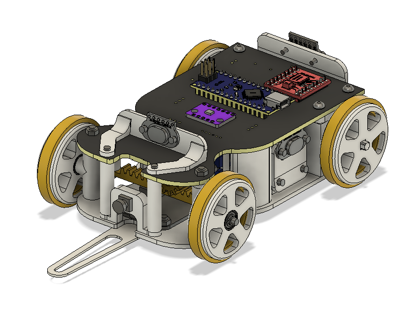 | 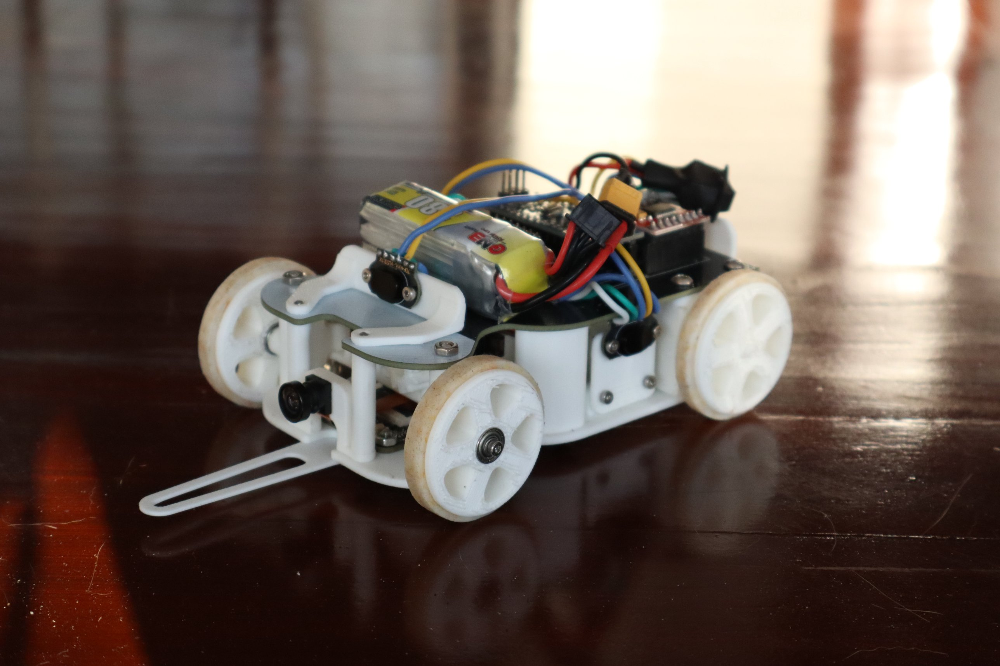 |

<em>Chassis v4, CAD assembly vs. the finished, printed and assembled car. The front protrusion (§5.1) is visible on both: a narrow plate screwed to the base that adds to the car's declared length without moving the camera or anything that affects manoeuvring.</em>
</div>

### 5.1 Chassis

- **Two layers:** a **3D-printed PLA base** (120 × 70 mm) carries the drive train at the rear and the steering at the front; the **custom PCB** sits on printed supports above it and carries all the electronics. The 3S battery lies flat on the PCB.
- **Size and mass:** 17.5 cm long, 9 cm wide, 6 cm high, **248 g** (weighed on 23 Nov 2026, see `docs/TESTS.md`; chassis v4: the 120 mm base plus the front protrusion, which brings the total to 17.5 cm to enlarge the parking-lot space — see §5.1). That is still less than two-thirds of the allowed length and less than half of the allowed width, and under 20 % of the allowed mass.
- **Why so small:** the narrowest corridor is 60 cm. A short, narrow car has more free space on each side to correct its path and to pass pillars, and a short wheelbase turns in a smaller radius.
- **Stability:** the car is only 6 cm high and the heaviest parts (battery, motor, PCB) are in its lower half, so the centre of mass is low and the car does not roll in turns. The PCB is 1.6 mm FR-4 and is screwed to the base, which makes the whole chassis stiff.
- **Everything is screwed:** in chassis v2 some parts were held with tape, which showed the design was incomplete. In v3 every joint is a screw, so the geometry does not change after a crash or after taking the car apart.
- **Front protrusion (parking-lot rule):** the front protrusion is a separate narrow printed plate (31 × 65 × 1 mm) that is screwed to the front of the 120 mm base and extends it forward, purely to add length. It does **not** carry or move the camera: the camera's position relative to the rear (encoder) axle, `CAM_FWD_CM = 11.7 cm` in the odometry code, is fixed by where the camera board sits and is unaffected by how far the tab sticks out. The real purpose is the Obstacle Challenge parking-lot rule (rules §5, Figure 4): the lot is 20 cm wide and 1.5 × the car's declared length long. Without the protrusion the car measures ≈ 13.5 cm (the 12 cm base plus the small overhang of the camera), giving a ≈ 20.25 cm lot; with it the car measures 17.5 cm, giving a ≈ 26.25 cm lot — about 6 extra cm of manoeuvring room inside the parking walls. That margin costs nothing in manoeuvrability, because neither the wheelbase (9 cm) nor the maximum steering angle (30°) — the two things that actually decide how tight the car can turn to park — change at all. The only trade-off is a few extra centimetres of overall length, which we accepted because the car is still well under the 30 cm limit (§5.1 above) and the tab is narrow enough not to interfere with the front TOF sensor's field of view.

<div align="center">
  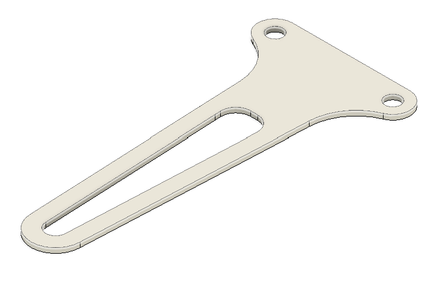
  <br><em>Close-up of the front protrusion described above.</em>
</div>

### 5.2 Drive

- **One N20 12 V, 1000 rpm motor with a Hall encoder** drives both rear wheels through a **differential with a 1 : 1 gear ratio** (motor gear and differential gear both 22 mm). A single motor on one axle follows the rules (driving wheels must be mechanically connected), and the differential lets the inner and outer wheels turn at different speeds in corners, so the tyres do not scrub and the car follows the steering angle precisely.
- **Speed reasoning:** with 41 mm wheels, each wheel revolution moves the car π × 41 mm ≈ 129 mm. The team reports that one lap takes about 25 s when all corners are narrow, which is about 0.3 m/s on a lap of about 8 m (§9.9). That is the speed the 0.3–0.4 m/s control design uses, and it is well above the ≈ 13 cm/s that a three-lap round needs in 3 minutes. The team's calculated no-load speed (about 12.6 cm/s, from 1000 rpm and a 17.1 : 1 ratio implied by the encoder count) does not match this report. Either the ratio, the pulses per wheel turn or the nominal speed used in that calculation is wrong, so the calculation is not used as a result. The stopwatch test over 1 m in `docs/TESTS.md` is still the way to confirm the speed.
- **Torque reasoning:** to accelerate the 248 g car at 1 m/s² against rolling resistance (rolling coefficient ≈ 0.05), the wheels need F = m · (a + C<sub>rr</sub> · g) ≈ 0.248 × (1 + 0.05 × 9.81) ≈ **0.37 N**, which at a 20.5 mm wheel radius is only **≈ 8 mN·m (≈ 0.08 kg·cm)** at the wheel. The light chassis is what makes a 1 : 1 transmission possible: the N20's built-in gearbox already gives enough torque, so no extra reduction (and no extra printed gears that could slip) is needed. Against the datasheet of the same motor family, the rated torque of 0.16 kg·cm (≈ 16 mN·m) gives a margin of about 2× and the stall torque of 0.43 kg·cm (≈ 42 mN·m) about 5×. The 2.4 kg·cm stall torque in earlier notes came from other sellers and is no longer used.
- **Motor data status (23 Nov):** the Amazon listing gives no gear ratio and no stall values. The datasheet of the same family gives 1:30, but that ratio is not proven: 1000 rpm at 1:30 would mean about 30 000 rpm at the motor, and the measured 9.27 ticks per cm (about 119 ticks per wheel turn) matches neither 1:30 with 7 PPR (210, 420 or 840 ticks) nor a simple count. The ratio and the stall current are to be measured (`schemes/datasheets/N20_12V_1000RPM_specs.md`).
- **Why 1 : 1:** a reduction would give more torque that we do not need and less top speed; a step-up would make low speeds harder to control. 1 : 1 also means both gears are the same printed part size, which is simple to print and to replace.
- **Braking:** the TB6612FNG short-brake mode (both inputs HIGH) stops the motor actively, much faster and more repeatably than coasting. In the Open Challenge the motor only drives forward. In the Obstacle Challenge each corner is taken in reverse gear (PWM 70, ramped with `RAMP_STEP`), and the rear ToF stops the back-up at 20 cm (§9.6). A sudden reverse made one gear of the drive train skip (journal Problem 34), which is why the reverse is ramped.

### 5.3 Steering

<div align="center">
  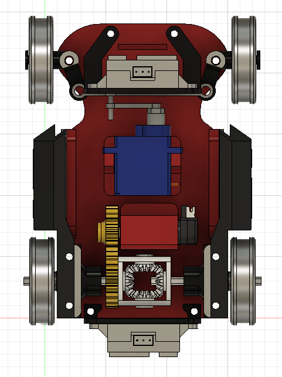
  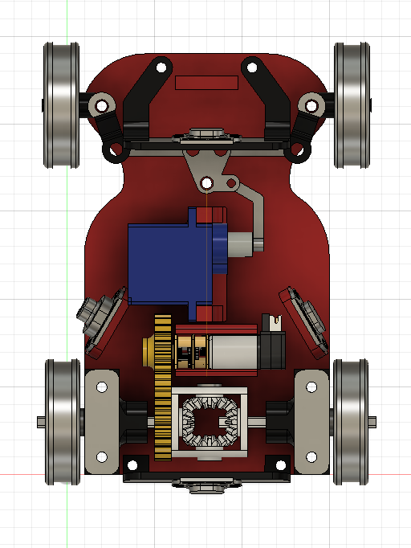
  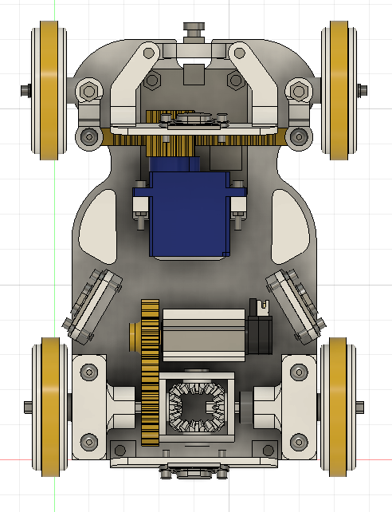
  <br><em>Steering iterations in CAD: v1 Ackermann, v2 Ackermann with a steering rack, v3 parallel rack and pinion (final).</em>
</div>

**Final mechanism (v3):** the MG90 servo turns a **12-tooth pinion with module 1 mm**, which moves a **module 1 mm rack** that pushes both steering knuckles together (parallel steering).

- **Geometry:** the pitch diameter of the pinion is m × z = 1 × 12 = **12 mm**, so each degree of servo rotation moves the rack π × 12 / 360 ≈ **0.105 mm**. The relation between servo angle and rack position is linear and has no dead zone, so the angle we command is the angle we get.
- **Why we left Ackermann:** in theory Ackermann is better, because the inner wheel turns more than the outer one and neither tyre slips. In practice our Ackermann linkages (v1 and v2) had too many printed joints and too much friction: the servo could not complete its travel (journal Problem 29) and **three servos were damaged** pushing against the linkage (journal Problems 17 and 33).
- **Trade-off we accepted:** with parallel steering both front wheels turn the same angle, so in a turn the inner wheel slips a little. On a 248 g car at 0.3–0.6 m/s that slip is small, and the 1 : 1 differential at the rear already removes the larger scrubbing of the driven wheels. We traded a small geometric error for a mechanism that is **reliable, easy to print and does not break servos**.
- **Servo mount:** the servo bracket of v3 holds the servo with screws, so its case cannot move (the problem of the first SG90 mount, journal Problem 8). Centre and limits are always **measured, not assumed**, with `servo_calibration` after any mechanical change (on v3, measured on 21 Nov: centre 85, left limit 10, right limit 170, in servo units; a smaller angle steers left, as in the code).

### 5.4 Wheels and tyres

The four 36 mm hubs are printed, and the **tyres are cast on them with C25 silicone rubber** in printed moulds (≈ 41 mm outside diameter). Silicone grips the field mat much better than printed plastic, which reduces slipping when the car accelerates, brakes and turns, so the gyro turns and the wall distances stay accurate (and, once used, the encoder distance).

| Moulds | Mix | Pour | Result |
|---|---|---|---|
| 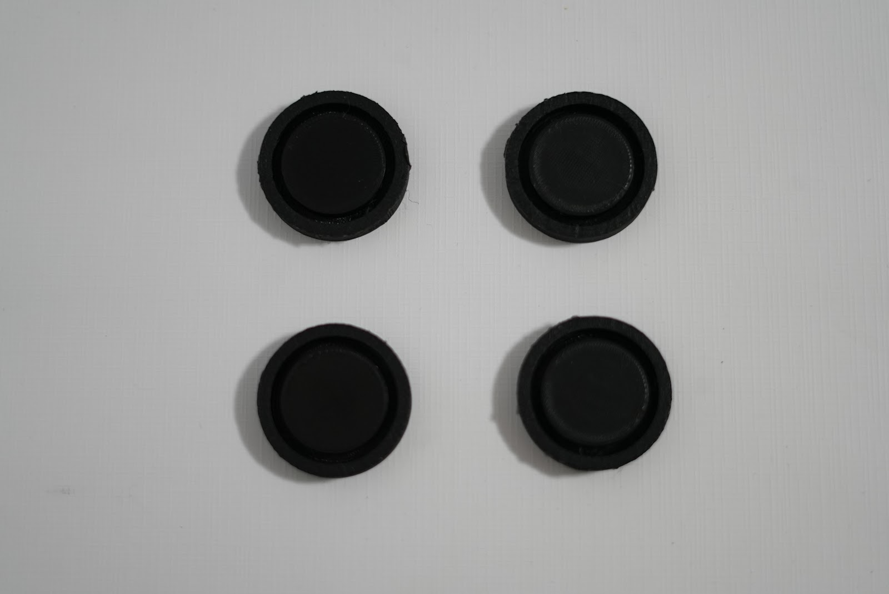 | 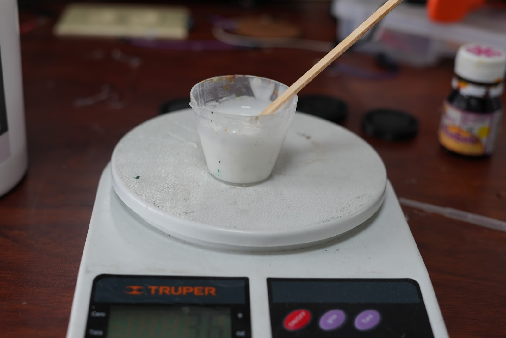 | 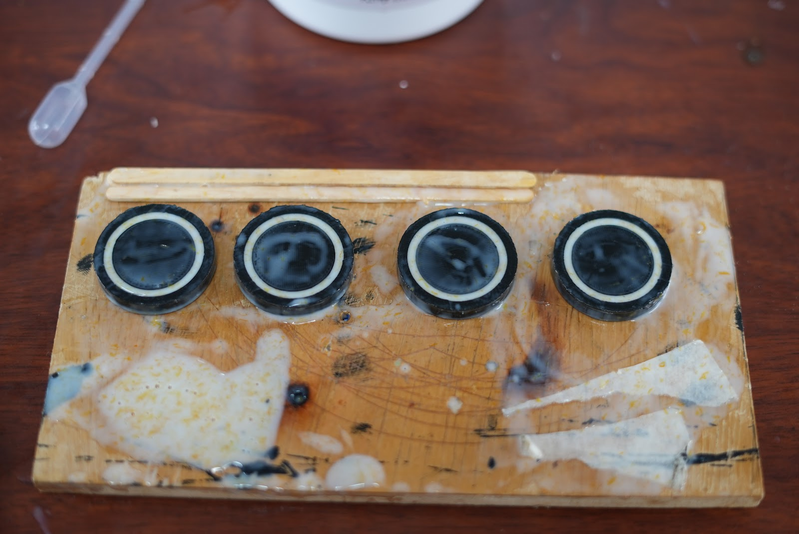 |  |

Recipe: **30 g of part A + 23 drops of part B**, from the formula **B = ¾ · A** (drops of catalyst per gram of base), mixed until most bubbles are gone, poured and cured **5–6 hours**. Using a fixed formula makes every batch cure the same, so the four tyres have the same hardness. Full step-by-step with photos: [models/README.md §4](models/README.md#4-custom-silicone-tyres).

### 5.5 Iterations that changed the mechanics

| Version | Change | Reason (data / test) |
|---|---|---|
| Chassis 1 → 2 | Side TOF sensors raised **1.5 cm** | The beam passed over the 10 cm wall and read the far side of the field (journal Problem 16). After the change the walls are detected reliably |
| Chassis 1 → 2 | SG90 → MG90 servo | Servo moved inside its mount (journal Problem 8) |
| v1 → v2 | Ackermann with tie rods → Ackermann driven by a steering rack | Goal: move both wheels from one part (the rack) instead of two separate tie rods. It did not remove the friction of the Ackermann arms (journal Problems 29, 33), which led to v3 |
| v2 → v3 | Ackermann → **parallel rack and pinion** (12 teeth, module 1 mm) | The linkage was too tight; three servos were damaged (journal Problems 17, 29, 33) |
| v2 → v3 | Tolerances corrected in the CAD | Moving parts were either loose or stuck |
| v2 → v3 | Sizes adapted in the CAD instead of improvised fixes; new camera and servo mounts | v2 needed hand adaptations and tape |
| v2 → v3 | Tape removed, every joint screwed | Tape showed the design was not complete and let the geometry change |
| Printed → cast | Silicone tyres | More grip on the mat; repeatable recipe |

<div align="center">
  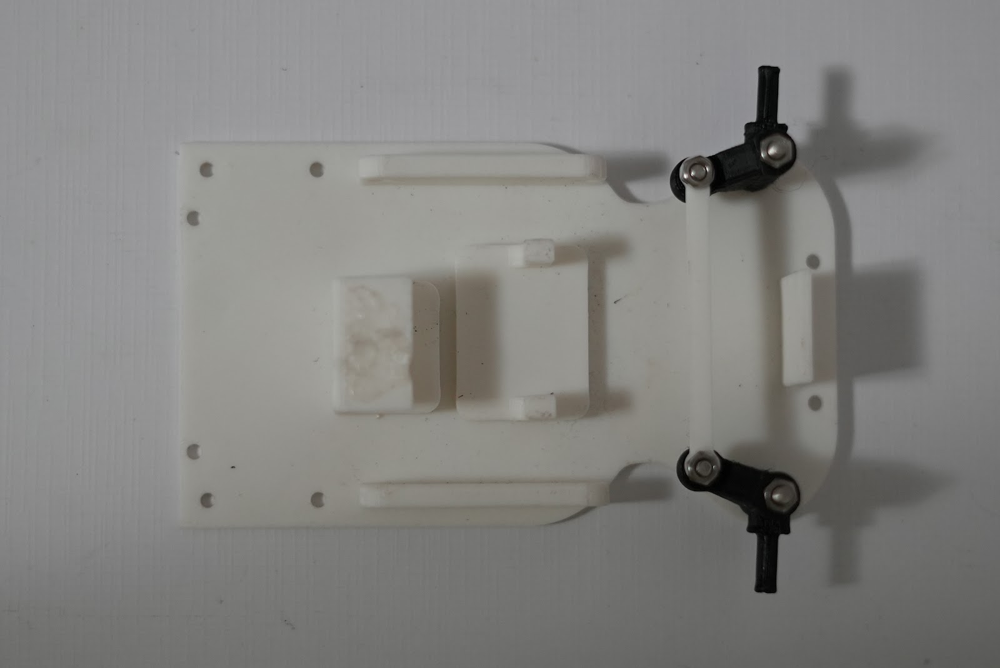
  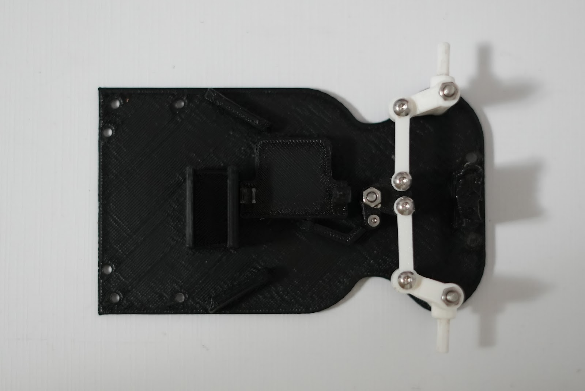
  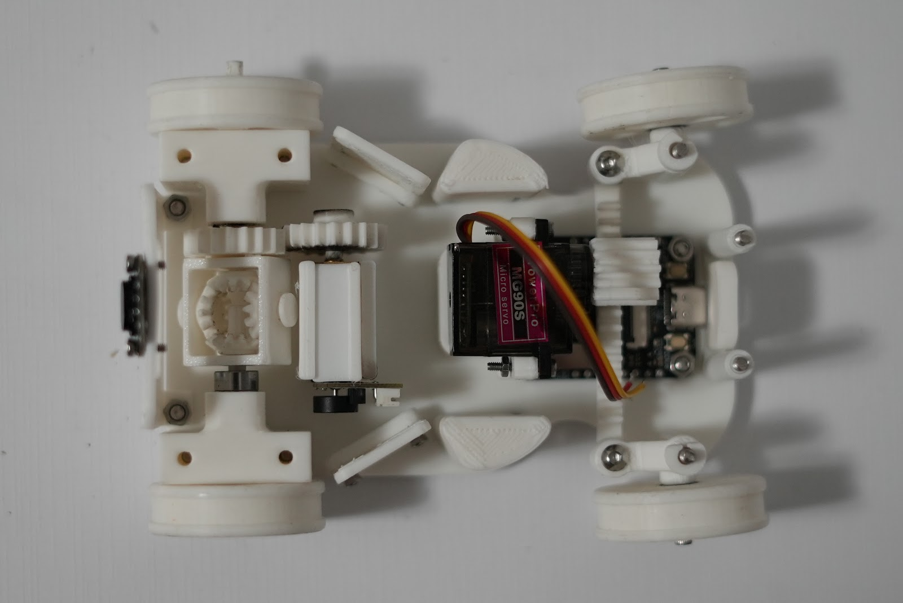
  <br><em>Printed chassis v1, v2 and v3.</em>
</div>

---

## 6. Power and sensor architecture

The full electrical documentation is in [schemes/README.md](schemes/README.md): schematic, wiring diagram, BOM with the reason for every component, power budget, PCB manufacturing and datasheets.

### 6.1 Power

```
 3S HV LiPo 11.4 V ──[switch]──┬──► TB6612FNG ──► N20 drive motor
                               ├──► Arduino Nano (VIN)
                               └──► CN3903 buck 5 V / 3 A ──► camera board, BMI160, servo, encoder, 4 × TOF400C
```

| | Typical | Peak |
|---|---|---|
| Current from the battery | ≈ 0.20 A | ≈ 0.92 A |
| Power | ≈ 2.2 W | ≈ 10.5 W |
| Run time on one charge | ≈ 1.6 h | ≈ 14 min |

The motor uses the battery voltage directly (it is a 12 V motor); everything else uses a **switching** 5 V regulator, because a linear one would waste more power as heat than all the electronics consume. The 3 A buck has a wide margin over the ~1.05 A peak of the 5 V rail, so a servo stall cannot reset the camera.

**The TOF sensors take 5 V from the buck rail**, like the other sensors and the camera. The classic Nano works with 5 V logic, so the 5 V sensors talk to it directly. The cost: the servo's current peaks now share the rail with the sensors. The 3 A buck margin keeps that rail steady, and we check it with a multimeter during a servo stall while the sensors are ranging. Full budget and failure analysis: [schemes/README.md §4](schemes/README.md#4-power-system).

### 6.2 Wiring / pin map (Arduino Nano)

The PCB was designed for the Nano ESP32; after that board was damaged (journal Problem 31) we use a **classic Arduino Nano (ATmega328P)**, which has the same pin positions, so the PCB did not change.

| Device | Signal | Pin |
|---|---|---|
| Camera board (one-way link) | UART: camera TX → Nano RX | D0 only (the Nano sends nothing to the camera) |
| Encoder | C1 / C2 | D3 / D2 |
| TB6612FNG | PWMA / AIN1 / AIN2 | D6 / D7 / D8 |
| TB6612FNG | STBY | tied to +5 V on the PCB (always enabled) |
| Steering servo | Signal | D9 |
| Start button | Input | D10 |
| I²C bus (4 × TOF + BMI160) | SDA / SCL | A4 / A5 |
| TOF BACK / FRONT / RIGHT / LEFT | XSHUT | A0 / A1 / A2 / A3 |

All four TOF sensors share one I²C bus with the gyroscope. At start-up every sensor is switched off with its XSHUT pin, then switched on one at a time and given its own address (driving programs: LEFT 0x2A, RIGHT 0x2B, REAR 0x2C, FRONT 0x2D; `open_challenge` only uses LEFT and RIGHT and keeps the other two in reset; the hardware test `tof_and_gyro_test` uses 0x30–0x33).

**ESP32-S3-CAM** (camera pins = ESP32S3_EYE layout): SDA 4, SCL 5, XCLK 15, VSYNC 6, HREF 7, PCLK 13, Y2–Y9 = 11, 9, 8, 10, 12, 18, 17, 16. UART to the Nano: GPIO43 (TX) → Nano D0 only. GPIO44 is not used (`NANO_RX_PIN = -1`: the camera never listens to the Nano).

### 6.3 Sensors: selection, placement and calibration

| Sensor | Placement | Why |
|---|---|---|
| **TOF FRONT** | Front centre | Safety brake if a wall is too close in any phase; FRONT vs BACK check after the first turn; parking later |
| **TOF LEFT / RIGHT** | Both sides, **straight (0°), facing the wall squarely**, centre at ~5 cm from the floor (half of the 10 cm wall), level | Distance to the wall being followed; when the wall ends, the readings become invalid → corner. We first angled them 30° forward to see corners earlier, but on the black wall the angled beam returned almost no light (journal Phase 10) |
| **TOF BACK** | Rear centre | FRONT vs BACK check after the first turn: after a correct turn the back faces the near outer wall of the corner and the front the long straight |
| **BMI160** | Flat on the PCB | Yaw (Z axis) for straight driving and exact 90° turns |
| **Camera** | Front, slightly down | Sees the pillars of the next section |

**Why TOF and not infrared or ultrasonic:** our first sensors were Sharp infrared sensors. Their output is non-linear, so noise grows with distance, and our tests showed they were unreliable beyond 50–60 cm, less than one corridor width (journal Problem 3). We also proved that the standard deviation of their readings could not tell a wall from an open side (journal Problem 2). Ultrasonic sensors have a wide cone that sees the floor and the neighbouring walls. The VL53L1X measures up to 4 m and lets us narrow its measurement area (ROI) in software.

**Calibration**

- **TOF ROI chosen by experiment, twice.** First (journal §8.2) we chose ROI 1 × 6 because it gave the biggest difference between "wall" and "no wall". Later tests with a tape measure (journal Phase 10) showed that with the sensor at 30° on the black wall it read **~2 m at every distance** (30, 40, 50, 60 cm and no wall) — the difference was real, but the distance was not. With the sensor **straight** and **ROI 16 × 8**, the black wall at 40 cm reads 38.1 cm, 30/30 valid readings, spread < 1 cm. Reliable range: about 45 cm.

  | Black wall at 30 cm | ROI 1×6 | ROI 8×8 | ROI 16×16 |
  |---|---|---|---|
  | Sensor at 30° | ~198 cm (wrong) | ~112 cm (wrong) | invalid |
  | Sensor at 30°, white sheet on the wall (control) | invalid (33 ms) / 35.6 (correct) (50 ms) | 34.4 (correct) | 35.4 (correct) |
  | **Sensor straight** | invalid | 33.4 (correct) (50 ms) | **32.0 (correct)** |

- **Reading filter in the current code:** a side reading counts when it is 1–3999 mm; 0 or ≥ 4000 mm is stored as "no wall" (4000 mm). The range-status flag is not checked. "Signal fail" readings gave believable but wrong numbers in our October tests (e.g. 63 cm with the wall at 30 cm), so this is a known risk (§10.3).
- **Gyroscope:** after a 0.7 s settling time, 300 samples (≈ 1.5 s) at rest, taken when the car is started (the LED blinks meanwhile); their mean is the offset and is accepted only if at least 250 readings were good. The scale `GYRO_SCALE = 1.007` comes from a 3-lap test (§10.4).
- **Steering:** centre and limits found with the interactive `servo_test` sketch, with 2–3° of margin before each mechanical stop.
- **Camera colours:** HSV thresholds tuned live under the real lighting with the camera viewer (§12.5).

**Noise and interference we considered:** sunlight and strong lamps raise the TOF ambient-light level (we print the ambient value in the diagnostic sketch); dark walls return little light, and almost none when the beam hits them at an angle (journal Phase 10), so the side sensors face the wall squarely and "signal fail" readings are ignored; objects outside the field (people, flags) can look like pillars to the camera, so only a horizontal band of the image is searched.

---

## 7. Software architecture

### 7.1 Two boards, each doing what it is best at

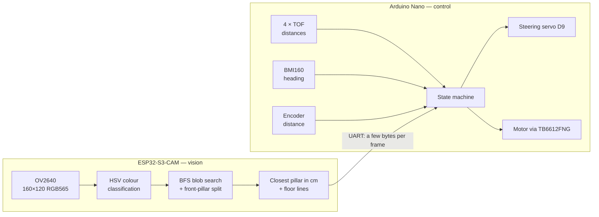

- **Camera board:** all image processing. It sends one short text line per picture (colour of the closest pillar, its distance ahead and to the side in cm, and where the orange and blue floor lines are), so the link stays fast.
- **Arduino Nano:** sensors, control loops and actuators. It never processes images, so its loop timing stays fast and predictable.

### 7.2 Modules

| Module | Board | What it does | Code |
|---|---|---|---|
| TOF driver | Nano | Address assignment through XSHUT (unique I²C address per sensor), continuous ranging, ROI 16 × 8 | [`tof_and_gyro_test`](src/hardware-tests/tof_and_gyro_test) (4 sensors); [`open_challenge`](src/open-challenge/open_challenge) (left and right, Long mode — filters by distance only: 0 mm or ≥ 4000 mm counts as "far/no wall", the sensor's own range-status flag is not checked) |
| Gyro driver | Nano | BMI160 read through I²C registers (no library), offset calibration, yaw integration (`yaw += rate × dt`) | [`tof_and_gyro_test`](src/hardware-tests/tof_and_gyro_test), [`open_challenge`](src/open-challenge/open_challenge), [`obstacle_challenge`](src/obstacle-challenge/obstacle_challenge) |
| Motor control | Nano | TB6612FNG forward / reverse / active brake with PWM, encoder pulse counting by interrupt | [`motor_encoder_test`](src/hardware-tests/motor_encoder_test) |
| Steering | Nano | `Servo.h` on the classic Nano (500–2500 µs at 50 Hz). Centre and limits are measured, not assumed | [`servo_test`](src/hardware-tests/servo_test) |
| Open Challenge program | Nano | Gyro heading hold with an integral term, fixed distance to the inner wall (or corridor centre), corner detection by a jump of the inner side TOF, 90° gyro turn, 12 turns, stop at the start position (§8.0) | [`open_challenge`](src/open-challenge/open_challenge) |
| Earlier Open sketches | Nano | Wall-following PIDs, corner and turn sketches that led to `open_challenge` | History: [`corner_turn_timed`](https://github.com/henryalejandrorieraloza-sudo/WRO-2026-Future-Engineers-Journal/tree/f5aa0e6825ab4aaec6edc42665a4e4d067a71765/src/open-challenge/corner_turn_timed), [`turn_left_90_pid_brake`](https://github.com/henryalejandrorieraloza-sudo/WRO-2026-Future-Engineers-Journal/tree/f5aa0e6825ab4aaec6edc42665a4e4d067a71765/src/open-challenge/turn_left_90_pid_brake), [`wall_follow_nearest_gyro`](https://github.com/henryalejandrorieraloza-sudo/WRO-2026-Future-Engineers-Journal/tree/f5aa0e6825ab4aaec6edc42665a4e4d067a71765/src/open-challenge/wall_follow_nearest_gyro) |
| Camera viewer | PC browser | Test page for the camera board: live picture, pillar mask, orange / blue line mask, rows ignored, per-line status, RGB / HSV of any pixel (§12.5) | [`camera_viewer.html`](src/tools/camera_viewer/camera_viewer.html) |
| Obstacle vision v3.2 | Camera | Locked camera, 160 × 120, 2 × 2 blocks, time filter, pillar position in cm (§9.3), red / magenta vote, orange and blue lines with the long-and-thin test and the floor-above check (§9.2); 14-field message to the Nano (the Nano reads 12) | [`obstacle_camera_v3_2`](src/obstacle-challenge/obstacle_camera_v3_2) |
| Obstacle driving program | Nano | Laps by floor lines (first line sets the direction, reverse 90° turns with gyro and front / rear ToF), pillar dodging on an odometry map (§9.4), wall centring with the side ToF (§9.5), stop after the last line (§9.6) | [`obstacle_challenge`](src/obstacle-challenge/obstacle_challenge) |
| Parking start | Nano | Leaves the parking space: side ToF, 45° gyro turn, counter-steer, timed reverse by encoder (§9.7). Not yet tested on the track | [`obstacle_go_out_of_parking`](src/obstacle-challenge/obstacle_go_out_of_parking) |
| Scenario Roulette | PC browser | Draws valid official track layouts to test on and scores Open Challenge attempts | [`index.html`](src/tools/scenario-roulette/index.html) |

**Why we wrote our own drivers:** the BMI160 library we tried only returned zeros without reporting any error (journal Problem 14), and the servo libraries of the first board (a Nano ESP32) did not work (journal Problem 6). On the classic Arduino Nano the standard `Servo.h` works, so steering uses it, and the BMI160 is read with our own register-level driver, which is short, fully understood and faster.

**Why our own vision code instead of OpenCV:** OpenCV does not run on a microcontroller without an operating system; a Raspberry Pi would add weight, a second battery and a long boot time to a 30 × 20 cm car; and colour detection does not need a neural network. The 320 × 240 pipeline ran at ~12.5 fps with pillars and floor lines (the 160 × 120 version is to be measured), and was verified pixel by pixel against its JavaScript copy. The full comparison (OpenMV, Pixy2, HuskyLens, Raspberry Pi) is in [journal §6.2](docs/ENGINEERING_JOURNAL.md#62-why-we-wrote-the-vision-ourselves-instead-of-using-opencv).

---

## 8. Open Challenge strategy

### 8.0 The Open Challenge program: `open_challenge` (20 November)

[`open_challenge`](src/open-challenge/open_challenge/open_challenge.ino) drives `LAPS` laps (3 = the full Open Challenge, 12 turns) and **stops at the position where it started**. The seven earlier sketches that led to it (§8.1–8.7 describe that design work) were removed from `main`; they stay in the git history (`git checkout f5aa0e6 -- src/open-challenge`).

**Hardware it uses:** left and right TOF (Long mode, ROI 16 × 8, 50 ms; addresses 0x2A / 0x2B), BMI160 gyroscope, encoder (9.27 ticks per cm, measured with the motor running; see the table below), TB6612FNG motor, steering servo, start button D10. The front and rear TOF stay soldered but are **held in reset (XSHUT LOW)**, so they never answer at 0x29 and cannot clash with the two sensors in use.

The states and transitions are drawn in [§8.2](#82-state-machine).

| Part | How it works |
|---|---|
| **Straight** | Hold the target heading (an exact multiple of 90°) with a P + I controller on the gyroscope (`KP_HEAD = 2.0`, `KI_HEAD = 4.0`); the integral learns the real straight servo angle (the car pulled left at the centre position) |
| **Lane in the corridor** | `LANE_MODE 1`: keep a fixed distance to the **inner** wall (`INNER_TARGET_MM`); `LANE_MODE 0`: drive in the centre of the corridor using both walls, shifted toward the inner wall by `CENTER_SHIFT_MM`. The lane error changes the target heading by at most 12°, and a wall closer than `SAFE_WALL_MM` is avoided at full correction |
| **Direction of the round** | At corner 1 the first side whose distance jumps is the **inner side** (left = counter-clockwise, right = clockwise). From then on only that side is watched |
| **Corner detection** | The inner TOF reads `JUMP_DELTA_MM` (250 mm) above its learned normal distance, or above `JUMP_ABS_MM` (1200 mm), `JUMP_CONFIRM` readings in a row. The normal distance is an average that is updated only while a wall is seen |
| **Turn** | Full steering toward the inner side until the **predicted** yaw (yaw + rate × `TURN_PREDICT_S`) reaches old heading ± 90°, then straight again without braking. The turn ends by angle, not by time |
| **No false corners** | Jumps are ignored for `IGNORE_AFTER_TURN_CM` (60 cm) after a turn, and the inner wall must be seen again (closer than `ARM_WALL_MM`, `ARM_READINGS` in a row) before the next corner counts |
| **Stopping at the start position** | `D1` = distance from the start to corner 1. With `LAPS ≥ 2`, on lap 2 the car drives the whole start straight and measures `LSTART` (end of turn 4 → corner 5). After the last turn it drives `LSTART − D1` and brakes, which is the start position. With `LAPS = 1` it estimates it from the opposite wall (less exact); if nothing was measured it stops `FALLBACK_CM` after seeing the inner wall |
| **Safety** | Wheels blocked (`STALLED`), no corner in 8 s, a turn longer than 4 s, a corner detected before the start position, or more than `MAX_FINAL_CM` after the last turn: active brake and stop |
| **Rules** | The gyro offset is measured by the program at power-on; the start button starts the run; nothing is entered by the team (rules 9.9, 9.11). The program prints its state every 100 ms for testing and does not depend on the Serial Monitor to drive |

The settings are grouped at the top of the file in three blocks: run settings (`LAPS`, `RUN_PWM`, `TURN_PWM`, lane mode, corner thresholds), tuning (controller gains, limits) and car constants (motor and encoder direction, `GYRO_SCALE = 1.007`, servo centre / limits, pins). Test it on Scenario Roulette layouts in both directions and with 600 mm and 1000 mm corridors, and record the results in the journal.

**Car constants of the two driving programs (checked 23 Nov against the code):**

| Constant | `open_challenge` (Open) | `obstacle_challenge` (Obstacle) | Note |
|---|---|---|---|
| Encoder `TICKS_PER_CM` | 9.27 | 9.27 | Measured with the motor running (190 ticks = 20.5 cm, 21 Nov) |
| `GYRO_SCALE` | 1.007 | 1.007 | From a 3-lap test. It is the only gyro scale used by the current programs. The earlier hand-turn value `1.06` (`gyro_90_test`, 21 Nov) belonged to an older sketch and is not used |
| Steering centre / limits | 85, left 10, right 170 | 85, left 10, right 170 | A smaller servo angle steers left |
| Run / turn speed (PWM) | `RUN_PWM` 150, `TURN_PWM` 90 | `RUN_PWM`, `TURN_PWM`, `REVERSE_PWM` all 70 | The Obstacle car is slower on purpose: the camera needs time |
| Gyro calibration | 300 samples after 0.7 s settling | same | LED blinks while it runs |

### 8.1 Idea (history: design of the earlier versions, superseded by §8.0)

> **History.** §8.1–§8.7 describe the wall-following design of October (decision window, timed waits, 12 turns by sudden jump). The program that runs today is `open_challenge` (§8.0): lane mode with `INNER_TARGET_MM = 100`, `RUN_PWM 150`, turns by gyro (odometry by encoder), stops at the start position with `LAPS = 3`. When a number in §8.1–§8.7 differs from §8.0 or from the code, the code wins.

**Finish the three laps safely first, then go faster.** The car drives along a side wall with a two-loop controller (wall distance → small target heading → gyroscope → steering). At the first corner it finds which side opens and fixes the direction of the round. At every corner it turns exactly 90° with the gyroscope, and at every straight the wall itself corrects the heading, so small errors cannot add up over 12 corners. After the last corner it drives a short straight and brakes actively.

How we got here: a sudden-jump detector (Sharp sensors, journal §2.4) → keeping both start distances (§4.2) → smooth gyro wall following (Phase 8) → one complete corner and the loop (Phase 9) → **simpler decisions once the sensor data became trustworthy** (Phase 10).

### 8.2 State machine

The sketch has four states, named `WAIT`, `STRAIGHT`, `TURN` and `DONE` (the names printed on the Serial Monitor). Four variables decide the transitions: `dir` (the inner side, 0 until corner 1), `corners` (turns done), `finalLeg` (all turns done, the car now looks for the start position) and `stopAtCm` (the odometry value where it stops).

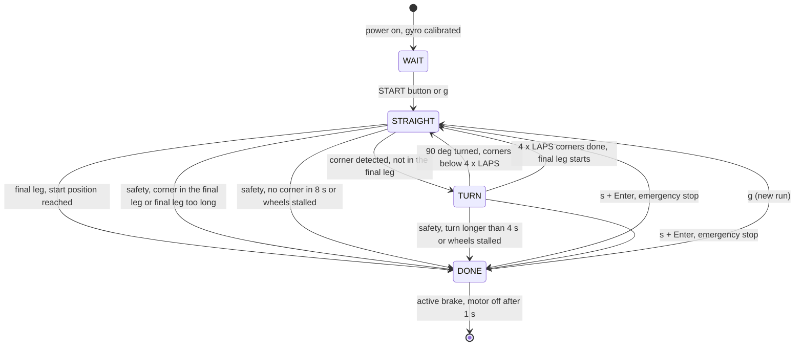

| State | What the car does |
|---|---|
| **WAIT** | Calibrates the gyro offset with the car still (the LED blinks, then stays on) and waits for START or `g` |
| **STRAIGHT** | Holds the target heading (a multiple of 90°) with the gyro and keeps its lane (`LANE_MODE`). **Corner 1** (`dir = 0`): the side that jumps while the other does not becomes the inner side and sets `dir`. **Later corners**: only the inner side is watched, and only after `ARM_READINGS` close readings of the inner wall. A corner sends the car to TURN, unless `finalLeg` is set. In the final leg it drives on until `stopAtCm` |
| **TURN** | Full steering toward the inner side until the predicted yaw reaches the old heading ± 90°. Then the target heading changes by 90°, `corners` goes up, the walls are forgotten and the car returns to STRAIGHT. When `corners` reaches `4 × LAPS`, `finalLeg` becomes true |
| **DONE** | Wheels straight and active brake (both TB6612FNG inputs HIGH). One second later the motor is switched off and the final report prints (yaw, heading, error, corners, D1, WALL, LSTART, time) |

**Where the car stops.** Corner 1 sets `D1`. With `LAPS ≥ 2`, `LSTART` is measured on lap 2 (end of turn 4 → corner 5). When the last turn ends, `stopAtCm` = turn end + (`LSTART − D1 + STOP_OFFSET_CM`). With `LAPS = 1` the stop is `WALL − D1` after the inner wall is seen, or `FALLBACK_CM` if nothing was measured.

### 8.3 Wall or no wall: how the side sensors are read

> **History (not in the current code).** This window is the October design. `open_challenge` uses the distance rule of §8.0: a jump above the learned normal distance or above 1200 mm, counted with `JUMP_CONFIRM`.

The side TOF sensors face the wall squarely and use ROI 16 × 8 (journal Phase 10). On the black wall each reading is either accurate or invalid, so the car does not try to measure distances it cannot see:

| Reading | Meaning |
|---|---|
| "Range valid" and ≤ 550 mm | **WALL**, distance reliable (±1–2 cm) |
| Anything else | **NO WALL** — the number is never used |

Decisions use the last **8** readings: **6 or more** WALL → WALL (distance = median); **2 or fewer** → NO WALL; **3–5** → NOT SURE (no decision yet). The thresholds are provisional and will be confirmed after remounting the sensors (30, 45, 60 cm test).

This made the algorithm **simpler**: no 2400–2600 mm "opening" threshold, no comparison of two noisy averages at ~2 m, no 165–185 cm close / far threshold, no jump threshold. The opening is the side without a wall; the corner is the moment the followed wall disappears.

### 8.4 Turning, and why errors do not add up

- The turn ends when the gyroscope says **90°**, not after a fixed time: a timed turn would change with battery voltage and speed. The end is predicted a little ahead (yaw + rate × `TURN_PREDICT_S`, 0.12 s). The steering is full toward the inner side during the turn. There is no PD and no brake-early in the current code (that version is `turn_left_90_pid_brake`, in the git history).
- Each turn sets the target to `previous heading ± 90°`, as in the code. A gyro scale error still builds up over the turns: the code corrects it on every straight with the wall-centring term (up to ±12°) and uses the calibrated `GYRO_SCALE = 1.007`. Using the wall as an absolute heading reference (journal Problem 43) is not in the current code.

### 8.5 Safety rules (always active)

Our priority is to **complete the three laps and stop correctly** — a crash loses the laps, a slower run only loses seconds.

| Rule | Why |
|---|---|
| One reading makes a corner (`JUMP_CONFIRM = 1`) | Fast reaction at speed; a false corner is not filtered further (tunable) |
| Turn side = the first side that jumps while the other does not (Open) | The decision is made while driving; a wrong side is not corrected in the code (§3.1) |
| Obstacle: the front ToF starts each turn at 40 cm; the rear ToF stops the back-up at 20 cm | Open: front and rear sensors are off (XSHUT LOW) |
| No undo or front/back check in the current code | A wrong first turn is followed (open question, §3.1) |
| Timeout for every straight and phase | The car never drives blind if a reading never comes |
| Camera silent for 0.5 s (Obstacle) | The car does not drive forward (`CAMERA_TIMEOUT_MS`) |
| Motor on, wheels not turning for 0.5 s | Stop: wall hit or blocked wheel (`STALL_MS`) |
| Lower speed in the turns (Open 90, Obstacle 70) | More time for the sensors and the camera |
| Wall corrects the heading every straight | A small gyro error cannot become a crash in lap 3 |
| Open: motor only forward. Obstacle: reverse turns are ramped (`RAMP_STEP`) and stop at the rear ToF (20 cm); active brake at the end | Drive gear skips on sudden reverse (journal Problem 34) |

### 8.6 Edge cases

| Case | Handling |
|---|---|
| Car starts at any position inside the starting section | Gyro wall following on the nearest wall; nothing about the position is assumed |
| Inner wall far away (1000 mm corridor) | A 4000 mm reading (no wall) is not used for lane control; the car keeps its heading and its learned bias until the inner wall is closer than `SIDE_MAX_MM` (1200 mm) |
| Right after a turn, the sensor sees the tip of the inner wall diagonally | No corner is counted for 60 cm after a turn (`IGNORE_AFTER_TURN_CM`), and the inner wall must be seen again (`ARM_WALL_MM`, `ARM_READINGS`) before the next corner counts |
| A single bad reading | Open: `JUMP_CONFIRM = 1`, one reading is enough; there is no 8-reading window in the current code (history, §8.3) |
| Gyro drift over 3 laps | Calibration at rest before every run + wall re-alignment every straight |
| Narrow corridor (600 mm) | The inner wall is close, its readings are valid from the start; the car follows it directly |
| Never touch the outer wall (rule 9.18) | Open: the car keeps `INNER_TARGET_MM` (100 mm) from the **inner** wall, and any wall closer than `SAFE_WALL_MM` (70 mm) forces a full correction |
| Wrong first turn | Not handled in the current code: there is no undo. A reverse inside the corner section is allowed (rule 9.21 / App. A.4, §3.1) |
| Stopping inside the starting section | After exactly **12** turns (3 laps × 4 corners) the car stops at the start position (Open, by encoder) or 0.45 s after the last line (Obstacle), then brakes for 1 s and switches the motor off (§10.4). A 13th turn would carry the car out of the starting section and lose the 3 stop points (rule 9.24.3) |

### 8.7 Decision tree with encoder delays (planned 25 October; history)

This is the algorithm we will build next. It keeps everything validated above (cascade controller, 90° gyro turn, active brake, WALL / NO WALL / NOT SURE window) and replaces the **timed** waits with **encoder distance**, because time-based waits changed with battery voltage (the car behaved differently on USB than on battery).

```
START
│  calibrate gyroscope → wait for start button
▼
══════════ PHASE 1: FIRST STRAIGHT (direction unknown) ══════════
│
├─ Follow the NEAREST wall (PID + gyroscope)
│
└─ Opening detected on one side?
   ├─ NO  → keep driving
   └─ YES → store that side as the TURN DIRECTION (fixed for the round)
             │
             ▼
          Delay: N encoder turns
             │
             ▼
          TURN toward that side until 90° (gyroscope)
          counter = 1
             │
             ▼
══════════ PHASE 2: FIND THE INNER WALL ══════════
│
├─ Follow the OUTER wall (PID + gyroscope)
│
└─ Inner wall detected?
   ├─ NO  → keep following the outer wall
   └─ YES → enable the opening search
             │
             ▼
══════════ PHASE 3: LOOP (always the same from here) ══════════
│
├─ Follow the INNER wall (PID + gyroscope)
│
└─ Opening detected on the inner side?
   ├─ NO  → keep following the inner wall
   └─ YES
       │
       ▼
    Delay: N encoder turns
       │
       ▼
    TURN toward the stored direction until 90°
    counter++
       │
       ▼
    counter == 12?
    ├─ YES → FINISH
    │         drive X encoder turns → active brake → stay still
    │
    └─ NO  → drive M encoder turns, NOT searching for openings
              │
              ▼
           back to "Follow the INNER wall"
```

| Element | Why |
|---|---|
| Delays measured in **encoder turns**, not milliseconds | Distance does not depend on battery voltage; a timed delay did |
| During both delays the car holds the **gyro heading** only | No wall is available there; with 1° of gyro error the car moves only ~3.5 mm sideways over 200 mm |
| **M** turns after every turn without searching for openings | Right after the turn the inner side sees the corner, which looks like an opening (journal Problem 44); M must be long enough to leave the corner section |
| Outer wall followed **only** in Phase 2 | After the first corner the car is always close to the inner wall, so it never needs the outer wall again |
| Exactly **12** turns, then X encoder turns and brake | Stops inside the starting section (rule 9.24.2); a 13th turn would leave it (rule 9.24.3) |
| Opening = the WALL / NO WALL / NOT SURE window of 8 valid readings (§8.3) | Single readings on the black wall caused wrong decisions (journal Problem 46) |

**To measure before coding:** encoder ticks per millimetre (push the car exactly 1 m), the steering turning radius at full lock, and where the opening appears for a 1000 mm and a 600 mm next corridor. With the side sensors reliable only up to ~45 cm (journal §12.4), Phase 2 must also be checked in a 1000 mm corridor, where the outer wall may be out of range right after the first turn — in that case the car holds the gyro heading until a wall is valid.

---

## 9. Obstacle Challenge strategy

### 9.1 Idea and status

The round has three parts: **three laps** of the track, dodging the **pillars** on the straights, and a **stop** inside the starting section. Starting inside the parking lot and parking at the end add points.

The program that drives the round is [`obstacle_challenge.ino`](src/obstacle-challenge/obstacle_challenge/obstacle_challenge.ino). It is explained in full, with every constant, in its [README](src/obstacle-challenge/obstacle_challenge/README.md). It does three things in one sketch:

- it follows the **floor lines**: the first line sets the direction of the round (blue = left, orange = right), and every later line of the same colour is a corner;
- it turns **90° in reverse** at each corner, using the gyroscope and the front and rear distance sensors;
- it **dodges pillars** on a map of the straight (red on the right, green on the left), and centres between the side walls when there is no pillar.

| Stage | Code | Status (23 Nov 2026) |
|---|---|---|
| Vision: pillars, magenta walls, orange and blue lines | [`obstacle_camera_v3_2`](src/obstacle-challenge/obstacle_camera_v3_2) | Used by the driving program. 160 × 120 pixels; the pixel constants were scaled from the 320 × 240 calibration and are to be re-checked on the track |
| Pillars on a map, and the steering law | `obstacle_challenge` (§9.4–9.5) | Same law as the straight-with-pillars tests of 27 Oct and 21 Nov (journal §18), now in the git history |
| Corners, laps and the stop after the last line | `obstacle_challenge` (§9.6) | Committed 23 Nov; the team reports it works. Lap times and stops to be recorded in the journal |
| Start from inside the parking lot | [`obstacle_go_out_of_parking`](src/obstacle-challenge/obstacle_go_out_of_parking) | Written 20 Nov; not yet tested on the track |
| Parking after the third lap | — | In design (§9.7) |

Flow of one round:

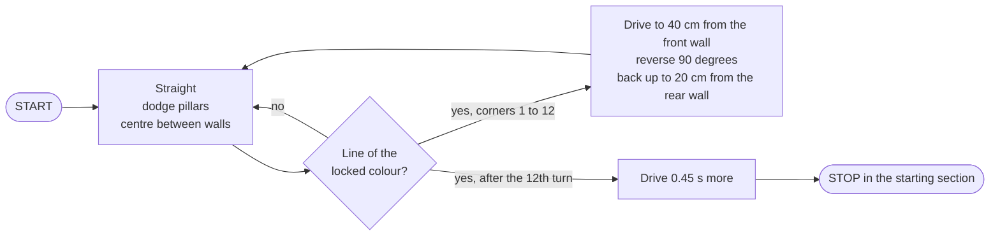

### 9.2 Vision (camera board, `obstacle_camera_v3_2`)

1. **Picture:** 160 × 120 RGB565, two frame buffers, newest frame only. Only rows 58–119 are searched for pillars and rows 70–119 for lines (the floor, not the room).
2. **Frozen camera:** 5 s after power on, white balance, exposure and gain are locked, so the colours of the pillars do not change during the round.
3. **HSV classification**, tested in this order: red → green → magenta → orange → blue. Current ranges (from the sketch):

| Colour | Hue (degrees) | Minimum saturation | Value (brightness) |
|---|---|---|---|
| Red pillar | 345 to 40 (wraps past 0) | 115 | 65 to 225 |
| Green pillar | 82 to 150 | 150 | 60 or more |
| Magenta (parking wall) | 328 to 353 | 84 | 84 or more |
| Orange line | 55 to 90 | 90 | 100 or more |
| Blue line | 165 to 215 | 80 to 200 | 40 or more |

The line ranges were measured on 19 Nov with the locked camera: the orange line at H 64–75, the blue line at H 191–208, and the floor at H 111–125, which is why blue starts at 165°. The ranges were measured, not yet validated on the track.

4. **Red or magenta?** Touching red and magenta pixels form one patch. If at least 70 % of it is magenta, it is a parking wall and never a pillar.
5. **Pillars:** pixels are grouped in 2 × 2 blocks, the blobs are found by flood fill, the front pillar of each blob is kept, and the blob must pass the plausibility checks: 5 to 40 cm ahead, at most 70 cm to the side, at least 75 % solid, and not touching the picture edge.
6. **Time filter:** a pillar is reported when 2 of the last 4 pictures show it, and dropped after 3 empty pictures.
7. **Floor lines:** the biggest patch of each colour below row 70 must be long (at least 20 px diagonal) and thin (average thickness at most 20 px), and must have white floor above it. The black wall's edge has dark wall above it, so it is rejected.
8. **Message to the Nano** (UART, 115200 baud, one line per picture):

```
$color,x,bottom,correct,blueFound,blueRow,seq,width,distCm,latCm,orangeFound,orangeRow,blueCenterRow,orangeCenterRow
```

The Nano reads the first 12 fields. The pillar is `color`, `distCm` (ahead) and `latCm` (to the side); the lines are `blueFound` and `orangeFound`; the row values are read but not used by the driving program.

### 9.3 From pixels to centimetres

The camera works like a **pinhole camera**: an object of real size *S* at distance *D* looks *f · S / D* pixels wide. A pillar is 5 cm wide, so its width in the picture gives its distance.

```
xc     = x − X_CENTER_OFFSET              pixels from the real straight-ahead line (6 px)
a      = atan(|xc| / f)                   angle between the car's direction and the pillar
seen   = 5 cm · (cos a + sin a)           width of the pillar as seen from that angle
ahead  = f · seen / width                 cm ahead of the camera (f = FOCAL_PX = 50)
side   = ahead · xc / f                   cm to the side (+ right, − left)
```

`cos a + sin a` accounts for the two faces of the square pillar that are visible when it is seen from an angle. `f = 50` is half of the value measured for the 320 × 240 camera (100), and the team confirmed on 23 Nov 2026 that 50 is the correct value for 160 × 120 (camera README: [`obstacle_camera_v3_2`](src/obstacle-challenge/obstacle_camera_v3_2/README.md)).

### 9.4 Odometry map and pillar dodging

The Nano keeps the camera position on a map of the current straight: **x = cm forward, y = cm to the left**, measured from where the straight started. The map is reset after every turn.

```
ds      = encoder distance since the last loop (9.27 pulses per cm)
carX   += ds · cos(yaw − heading)
carY   += ds · sin(yaw − heading)
```

Each pillar is placed on the map at its **centre** (distance ahead + 2.5 cm, side as measured). A pillar of the same colour seen again within 15 cm is the same pillar, and its stored position moves 30 % toward the new reading, which averages out the noise of single pictures. The map keeps two pillars: the **current** one and the **next** one.

The camera loses a pillar when it is close, but the pillar stays on the map, so the car knows where it is. A pillar is removed only when the car is 25 cm past its centre. This is why the map is used at all: a pillar that has left the picture is still known, and the car can plan **how much** to move, not only **which way** (the reasoning is in [journal Phase 11](docs/ENGINEERING_JOURNAL.md#13-phase-11--obstacle-challenge-from-pixels-to-centimetres-2627-october-2026)).

**Lateral goal.** The pillar centre must stay at least 17 cm from the car centre (half the car, 10 cm of gap, half the pillar). The goal never moves the car **toward** the pillar:

```
red   (pass on the right):  goalY = min(camY, pillarY − 17)
green (pass on the left):   goalY = max(camY, pillarY + 17)
```

**Heading toward the goal.** The car should be at its lateral goal 55 cm before the pillar:

```
look    = max(12 cm, (pillarX − 2.5) − camX − 55)
heading = atan2(goalY − camY, look)           limited to ±60°
steering = 2.0 · (heading − yaw) − 0.03 · yawRate      (P + D, plus integral in LANE mode)
```

After the camera passes the pillar centre, the car aims at the next pillar only, and it does not move back toward the pillar it has passed. Where there is no pillar, the car keeps its last heading for 50 cm after a pillar, then centres again (§9.5).

**Example:** car at (0, 0), red pillar centre at (40, +10). The goal is `min(0, 10 − 17) = −7` cm, the look distance is `max(12, 40 − 2.5 − 0 − 55) = 12` cm, so the heading is `atan2(−7, 12) ≈ −30°`: to the right.

### 9.5 Wall centring

On a straight with no pillar, the car centres between the side walls with the left and right ToF sensors:

```
latErr  = (left mm − right mm) / 2          positive = closer to the right wall
latI   += 0.02 · latErr · dt                limited to ±8
heading correction = 0.03 · latErr + latI   limited to ±12°
```

If one side is closer than 70 mm, the car steers fully away from that wall. A side reading above 1200 mm means the wall has ended, so that side is not used. This happens at the corners.

### 9.6 Lines, corners and laps

- **The first line sets the round.** The first floor line seen after 10 cm of driving locks its colour: **blue = left turn, orange = right turn**. The other colour is ignored for the whole run.
- **Each corner is a rising edge** of the locked colour. After a corner, lines are ignored for 4 s, so the second line of the same corner is not counted.
- **Turn:** the car drives on until the front ToF reads 40 cm, brakes, and reverses with the steering turned to the opposite side. When its predicted yaw has changed by 90°, the target heading changes by 90° (so the heading is always a multiple of 90°), and the car reverses straight until the rear ToF reads 20 cm.
- **Laps:** `LAPS = 3`, so 12 turns. After the 12th turn the next line is the **last line**: the car drives 0.45 s more and stops inside the starting section.

The gyroscope scale is `1.007` in both programs. The hand-turn value `1.06` from 21 Nov belonged to an older sketch and is not used. The yaw printed at the end of a run should be close to 90° per corner; that is the check to do on the track.

**Field geometry** (official mat): both lines of a corner start at the corner of the inner wall and reach the outer wall 42 cm from the corner. For a car in the middle of the corridor, the first line crosses its path about 71 cm before the wall ahead, and the second about 14 cm before it. The line is therefore a good marker of how far the corner is, and it is the only sure event on the track.

### 9.7 Parking

- **Start from inside the parking lot** (+7 points): [`obstacle_go_out_of_parking`](src/obstacle-challenge/obstacle_go_out_of_parking). Two ToF sensors measure the free space, the car turns 45° toward the open side by gyro, straightens, counter-steers, and reverses a fixed number of encoder ticks. It is written but not tested on the track, and `REVERSE_TARGET_TICKS` is a placeholder until it is measured.
- **Parking at the end** (+15 points): in design. After the third lap the car must find the magenta walls of the lot. The camera already detects them (they are never reported as pillars), but the message has no magenta field yet. Parallel parking needs reverse, and the drive gear once skipped on a sudden reverse (journal Problem 34), so the reverse must be gentle and tested alone first.

### 9.8 Camera viewer

The [camera viewer](src/tools/camera_viewer/camera_viewer.html) is the calibration tool we built: a web page that receives every picture over USB (Web Serial), draws the pillar mask and the accepted orange / blue floor lines on top, shows why each line was accepted or rejected, and prints the RGB / HSV of the pixel under the mouse. It turned threshold tuning from guessing into measuring.

### 9.9 Points and roadmap

**Points** in one Obstacle round (rules §10): sections 24 + laps 3 + stop in the starting section 3 + no pillar moved 10 (8 if moved) + start from the parking lot 7 + parking 15 (7 if partial) = **62**. Three clean laps and a correct stop already give 40. **Time:** a round is 3 minutes and three laps along the middle of the corridor are about 24 m, so the car must average at least about 13 cm/s to finish in time (24 m in 180 s).

| # | Step | Status (23 Nov 2026) |
|---|---|---|
| 1 | Camera detects both lines (long and thin, white floor above) | Done — 27 Oct |
| 2 | Lines without false detections | Done — 27–28 Oct; the colour ranges were measured again with the new camera on 19 Nov |
| 3 | Pillars on the map, steering law, dodge | Done in `obstacle_challenge` (§9.4). The same law was first validated on a straight with pillars on 27 Oct and 21 Nov with an earlier sketch (now only in the git history) |
| 4 | Wall centring between the pillars | Done in `obstacle_challenge` (§9.5); the team reports it works on the car (23 Nov), numbers not yet recorded |
| 5 | Corners by reverse 90° turns, first line sets the direction | Done in `obstacle_challenge` (§9.6); the team reports it works; to record in the journal |
| 6 | Three laps and stop after the last line | Done in `obstacle_challenge` (§9.6); to record in the journal, with lap times |
| 7 | Gyro scale checked on the full round (yaw per corner) | To do — `1.007` in both driving programs; check the yaw per corner (§9.6) |
| 8 | Camera sends the magenta walls to the Nano | To do — not in the message yet |
| 9 | Start from inside the parking lot | Written 20 Nov; to test on the track |
| 10 | Parallel parking after the third lap | In design |
| 11 | One final program, start button, battery only | `obstacle_challenge`: START button (D10), battery on first. The parking start has no button yet |

### 9.10 Limits and fallbacks in `obstacle_challenge` (from the code)

| Limit | Value | What happens |
|---|---|---|
| `CAMERA_TIMEOUT_MS` | 500 ms | No camera message for 500 ms: the car does not drive forward |
| `MIN_DRIVE_CM` | 10 cm | No line is counted in the first 10 cm after START |
| `IGNORE_LINE_S` | 4 s | After a line, all lines are ignored for 4 s |
| `MAX_PRE_TURN_MS` | 4 s | The front ToF never reaches 40 cm: stop |
| `LINE_WAIT_S` | 0.75 s | Without a front ToF, the turn starts after this time |
| `MAX_TURN_MS` | 4 s | A turn longer than this: stop |
| `REVERSE_CM` | 30 cm | Without a rear ToF, the back-up is made by encoder |
| `MAX_REVERSE_MS` | 3 s | The back-up is not finished in time: stop |
| `MAX_STRAIGHT_MS` | 8 s | No corner or line in 8 s: stop |
| `STALL_MS` | 0.5 s | Motor on, wheels not turning: stop |
| `MAX_STEER` | 70° | Limit of the steering command |

A side sensor silent for 0.5 s restarts all the sensors (`!!! TOF RESTART`) in both driving programs.

---

## 10. Systems thinking: constraints, trade-offs and risks

### 10.1 How the subsystems depend on each other

| Decision | Affects | Example |
|---|---|---|
| Camera on its own board | Software, power | The Nano does no image work, so its loop stays fast; the cost is a one-way UART link and the camera's power on the shared 5 V supply |
| PCB as chassis | Mechanics, electronics, time | Very compact and reliable, but each revision needs a new order and waiting time |
| TOF height on the chassis | Sensors, software | 1.5 cm higher fixed the readings over the wall without any code change |
| TOF mounting angle | Sensors, software, strategy | At 30° the black wall returned no light and every decision based on it failed; straight sensors made the data trustworthy and the algorithm simpler |
| Steering mechanism | Mechanics, electronics, software | Ackermann friction broke three servos; rack and pinion protects the servo and makes angle → wheel position linear |
| Car size and mass (17.5 × 9 cm, 248 g) | Mechanics, power, strategy | Light enough for a 1 : 1 drive and a 380 mAh battery; narrow enough to have room on both sides in a 60 cm corridor |
| TOF on the 5 V buck rail | Power, sensors | The Nano works with 5 V logic, so the sensors connect directly; they share the rail with the servo, which the 3 A buck margin covers |
| Servo mount angle | Mechanics, software | Steering centre must be measured in software after every mechanical change |
| Battery voltage directly to the motor | Power, control | Speed changes as the battery discharges, so turns are controlled by gyro angle, not time |

### 10.2 "We chose X instead of Y because…"

| We chose | Instead of | Because (data or test) |
|---|---|---|
| TOF400C (VL53L1X) | Sharp infrared | Sharp unreliable beyond 50–60 cm in our tests (journal Problem 3) |
| Binary "wall / open" and jump detection | Comparing left vs right distances | Comparing magnitudes beyond 50 cm gave false decisions (journal §2.3) |
| Side TOF **straight (0°)** | Angled 30° forward to see corners earlier | Black wall at 30 cm: ~198 cm (wrong) at 30°, 32.0 cm with 30/30 valid readings straight (journal Phase 10). Correct data over early data |
| ROI **16 × 8** | ROI 1 × 6 | 1 × 6 was invalid even on a white sheet; 16 × 8 measured 38.1 cm at 40 cm, spread < 1 cm; 16 × 16 read short because its tall cone sees the floor |
| Jump against the wall's learned normal distance (current code, §8.0) | Absolute distance thresholds at ~2 m | Beyond ~45 cm the black wall gives no valid readings, so "far wall" and "no wall" cannot be told apart by absolute distance (journal Phase 10) |
| Wall as heading reference every straight | Gyro-only absolute headings | Gyro scale error (~1.5° per turn) exceeded the ±8° the wall controller can correct after ~6 turns (journal Problem 43) |
| Moving reference for jump detection | Fixed reference | The fixed version tested worse on the track (journal Problem 4) |
| Following the outer wall at its start distance | Centring between the walls | The inner walls move every round, so the centre changes; the outer wall never moves |
| Floor lines for corners in the Obstacle Challenge | Side TOF jumps | Pillars near the walls could create false jumps; the lines are fixed by the rules |
| Pillar position in cm + odometry map of the straight (27 Oct) | "Correct third" of the image (our 7 Oct plan) | A pillar passed at a safe distance leaves the picture 15 cm before the car reaches it; with only the picture the car reacted too late (first test, 26 Oct). The map keeps the pillar while it is out of sight and says *how much* to move. Every straight-with-pillars case passed on the track |
| Floor line measured in cm and stored on the map | Turning when the line leaves the bottom of the picture | Leaving the picture happens only ~3–5 cm ahead, with few pixels, and later at higher speed because the camera message is ~0.2 s old; a map position does not depend on speed or delay |
| `BLUE_MAX_SAT = 120` (October light) | Only minimum thresholds | The locked camera saw the blue line grey-teal (S 48–103), the same hue as the green pillar (S ≥ 152): a maximum saturation separated them. Since the new camera (19 Nov) blue starts at 165° and `BLUE_MAX_SAT = 200`, so the hue separates it from the green pillar |
| Our own BMI160 driver | DFRobot library | The library returned only zeros, without errors (journal Problem 14) |
| Standard `Servo.h` (500–2500 µs) on the classic Nano | ESP32Servo / LEDC / hand-made pulse | Built into the AVR core and works at the first try; the ESP32 libraries did not work on the earlier Nano ESP32 (journal Problem 6) |
| MG90 metal-gear servo | SG90 | SG90 moved in its mount (journal Problem 8) |
| Parallel rack-and-pinion steering | Ackermann linkage | Ackermann friction stopped the servo and damaged three servos (journal Problems 17, 29, 33); the small slip of parallel steering is acceptable at our mass and speed |
| 1 : 1 differential | Extra gear reduction | The 248 g car needs only ≈ 8 mN·m at the wheel; 1 : 1 keeps top speed and uses identical, easy-to-print gears |
| Cast silicone tyres | Printed or O-ring tyres | More grip on the mat; repeatable recipe (B = ¾ A) gives four identical tyres |
| Screws on every joint | Tape and hand fixes | Geometry stays the same after crashes and disassembly |
| Classic Arduino Nano | New Nano ESP32 | Same footprint (no new PCB); standard `Servo.h` works; available immediately after the ESP32 was damaged |
| Own vision on ESP32-S3 | OpenCV on Raspberry Pi, Pixy2, HuskyLens | Weight, boot time, second battery, and we can explain and tune every step (journal §6.2) |
| Custom PCB | Perforated prototype board | Prototype board too bulky; PCB is cleaner and doubles as the chassis |
| Buck converter | Linear regulator | A linear regulator would waste ~3 W as heat |

### 10.3 Risks and mitigation

| Risk | Mitigation |
|---|---|
| Main board (Nano ESP32) lost during an upload with the robot powered and USB connected; the cause is not confirmed (journal Problem 31) | Battery only reaches VIN, VM and the buck; code is uploaded with the battery **off** |
| Servo peaks on the shared 5 V rail reach the TOF sensors | Measure the 5 V rail under servo stall with the sensors ranging; 3 A buck margin |
| Camera 3.3 V TX into the Nano RX | No divider: 3.3 V is read as HIGH by the ATmega328P at 5 V; the link is one-way (the Nano TX is not connected to the camera; `NANO_RX_PIN = -1` in the camera sketch) |
| Servo blocked by the steering mechanism | Rack and pinion with low friction; limits measured with 2–3° margin |
| Drive gear skips on a sudden reverse (journal Problem 34) | Open: forward only. Obstacle: reverse ramped with `RAMP_STEP`, stopped by the rear ToF; short brake at the end |
| Drive too slow for three laps in 3 minutes (about 13 cm/s needed) | Team report: one lap about 25 s with narrow corners, which is well above the need. Confirm with the stopwatch test over 1 m in `docs/TESTS.md` |
| I²C bus freezes and hangs the program (journal Problem 12) | Wire timeout of 25 ms (`Wire.setWireTimeout(25000, true)`, the value in the current sketches; 50 ms in October); check connectors; each sensor tested alone first |
| Loose sensor wire (journal Problem 30) | Locking connectors on the PCB; hardware tests before every session |
| Lighting at the venue differs from home | Colour thresholds re-tuned on site with the camera viewer in minutes |
| Camera sees objects outside the field | Search only a horizontal band of the image |
| Steering not centred after a mechanical change | Re-run `servo_test` after any change to the steering |
| Side TOF cannot see the black wall (journal Problem 46) | Sensors straight at ~5 cm, ROI 16 × 8; re-test with a tape measure after any change to the sensor mounts. The code checks distance only (no range status): check the readings on the track |
| Wrong turn side at the first corner | Decision on the first jump of the first side (Open); no undo or front/back check in the current code (§3.1, §8.5) |
| Gyro error accumulates over 12 turns | Wall re-alignment every straight |
| The camera sees the floor lines only up to ~22 cm (low camera) | Lines put on the map and confirmed with 2 messages; if not enough, raise / tilt the camera and recalibrate |
| Motor gear ratio and stall current not confirmed | Wrong speed, odometry or power estimates | Measure the ratio with 10 wheel turns and the stall current with a multimeter (`schemes/datasheets/N20_12V_1000RPM_specs.md`); until then the budget uses the stall value of the datasheet family |
| Motor held at stall for a long time | Gear damage and motor heating | The code stops the motor after `STALL_MS` (0.5 s) when the wheels do not turn; do not hold the wheel by hand |
| Steering travel not symmetric from the centre (75 servo units to the left, 85 to the right) | The car may turn better one way | Measure the wheel angle at both stops with a protractor (`docs/TESTS.md`, "Steering") and correct the centre if needed |
| Wheel diameter is a design value (41 mm) | Speed and encoder constants drift | Measure the four mounted wheels with a calliper |
| Parallel parking needs reverse, and the drive gear skipped on a sudden reverse | Gentle reverse only, tested alone before the parking manoeuvre. Parking is not in the competition code (§9.7) |

The complete list of the **68 problems** we found, with their causes and solutions, is in [journal §15](docs/ENGINEERING_JOURNAL.md#15-summary-of-problems-and-solutions).

### 10.4 Why each setting has its value

**Current values (from the code, 23 Nov):** `open_challenge`: `RUN_PWM 150`, `TURN_PWM 90`, `LANE_MODE 1` with `INNER_TARGET_MM 100`, side TOF ROI 16 × 8 and 50 ms budget, `GYRO_SCALE 1.007`, `TICKS_PER_CM 9.27`, steering 85 (10 / 170), gyro calibration 300 samples. `obstacle_challenge`: all speeds 70 PWM, front TOF 40 cm starts a reverse turn, rear TOF 20 cm ends the back-up, `TARGET_CM 17`, `PASS_CM 50`, `BLEND 0.3`, `FINAL_EXTRA_S 0.45`. The table below keeps the reasoning of the first design; rows whose number differs from the list above are historical.

The table describes the settings of the earlier Open Challenge design (§8.1–8.7); the current values of `open_challenge` are in the header of its file (§8.0). Every number in the Open Challenge code comes from a measurement, from the field geometry, or from the rules. Values marked *provisional* are confirmed in the next test after the side sensors are remounted.

| Setting | Value | Why this value | Evidence |
|---|---|---|---|
| Side TOF angle | **0°** (facing the wall) | At 30° the black wall reflects the laser away: a wall at 30 cm read ~198 cm. Straight: 32.0 cm, 30/30 valid | Journal §12.3 |
| Side TOF height | ~**5 cm** (centre) | Half of the 10 cm wall. With a 16×8 cone (≈ ±7° vertical) the beam at 50 cm covers ≈ −1 to +11 cm: almost all on the wall, little floor, nothing over the top | Journal §12.4, rule 13.3 (100 mm walls) |
| ROI | **16 × 8** | Wide and low: measured 38.1 cm at 40 cm (30/30). 16×16 reads short (floor in the cone), 1×6 is invalid even on white | Journal §12.4 |
| Timing budget | **50 ms** (*provisional*; 100 / 140 ms to be tested) | 33 ms gave invalid readings with narrow ROIs; more time = more light but fewer readings per second | Journal §12.2–12.4 |
| Readings used | any distance: 0 or ≥ 4000 mm = no wall; the range-status flag is not checked (code) | "Signal fail" gave believable but wrong numbers in the October tests (63 cm at 30 cm, 65.5 cm at 80 cm) | Journal §12.3–12.4 |
| `WALL_MAX_MM` (October design, not in the current code) | **550 mm** | 100 % valid at 400 mm, 0–27 % at 600 mm: the cut goes between | Journal §12.6 |
| Decision window (October design, not in the current code) | **8 readings: ≥ 6 WALL, ≤ 2 NO WALL, else NOT SURE** | Wall at 40 cm: 30/30 valid; no wall: 0/30; 60 cm: 0–27 %. The NOT SURE band avoids guessing on the edge | Journal §12.6 |
| Target distance to the inner wall | **100 mm** (`INNER_TARGET_MM`, the value of the 22 Nov 3-lap run) | The October value of 250 mm (provisional) is history. The car drives close to the inner wall, so the outer wall stays far away even in a 600 mm corridor (rule 9.18: never touch the outer wall). `SAFE_WALL_MM` (70 mm) forces a full correction from any wall | Rules 8 and 9.18, journal §12.4, code |
| Max correction while following the wall | **12°** heading correction (`LAT_MAX_DEG`); steering command limit 70° in `obstacle_challenge` (`MAX_STEER`) | The October value of 5–8° is history | Code |
| Heading correction limit | **±12°** per straight (`LAT_MAX_DEG`), integral limited to ±8° (`LAT_I_MAX`) | Largest correction the wall controller can command; a bigger gyro error is not corrected by the wall alone | Journal Problem 43, code |
| Gyro range / rate | **±500 °/s** (register 0x43 = 0x02). The output data rate is not set in the code: the program reads the sensor every loop and uses the measured time step `dt` | A 90° turn takes about 1 s (≈ 90–150 °/s peak), so ±500 °/s never saturates and gives 4× the resolution of ±2000 °/s (65.6 vs 16.4 LSB per °/s) | `open_challenge`, `obstacle_challenge` |
| Gyro calibration | **300 samples after 0.7 s of settling** (current code; an earlier plan was 1000) | Averaging more samples makes the offset more exact. It runs automatically when the run is started with the car still, and needs no input from the team (rule 9.9) | Rules 9.9, 9.11 |
| `GYRO_SCALE` | **1.007** (current code). The October hand-turn method (`YAW_SCALE`, see `docs/ENGINEERING_JOURNAL.md`) is history | 3-lap test (code comment); journal Problem 43 | `open_challenge`, `obstacle_challenge` |
| Turn end | **90° by gyroscope**, predicted `TURN_PREDICT_S = 0.12 s` ahead; `TURN_LEAD_DEG = 0` | A turn by time changes with battery voltage and speed. The earlier brake-early and PD version is `turn_left_90_pid_brake` (history) | Code: `open_challenge`, `obstacle_challenge` |
| Corner right after a turn | **60 cm** with no corner counted (`IGNORE_AFTER_TURN_CM`); the inner wall must be seen again (`ARM_WALL_MM = 900`, `ARM_READINGS = 5`) | A sensor that sees the tip of the inner wall right after a turn caused false corners (journal Problem 44) | Journal Problem 44, `open_challenge` |
| Start of the turn | Open: the turn starts at the jump of the inner wall, with no delay. Obstacle: the car drives until the front ToF reads 40 cm (`FRONT_TURN_CM`) | A fixed delay depended on speed and battery; the sensor-based start does not | Code |
| Speed | Open: `RUN_PWM 150`; Obstacle: 70 on every phase | The Obstacle car is slower on purpose: the camera needs time for each message (§8.0) | Code |
| Lower speed in the turn | Open `TURN_PWM 90`, Obstacle `TURN_PWM 70` | Lower values were too weak to turn the car (`open_challenge` comment) | Code |
| FRONT/BACK check after the first turn | — | Not in the current code (history, §8.5) | — |
| Turns before stopping | **12** | 3 laps × 4 corners; a 13th turn leaves the starting section (rule 9.24.3) | Rules 9.22, 9.24.3 |
| Final stop | **active brake for 1 s**, then the motor is switched off (`finish()` brakes; after 1 s `motorOut(0)`) | Stops the car at the end of the run; rule 9.24.2 asks for no movement after 15 s, so this is to be checked on the track | Rules, code |
| Motor direction | Open: forward only. Obstacle: reverse for each corner, ramped | A sudden reverse made a drive gear skip | Journal Problem 34 |

**The motor encoder is wired and used by `open_challenge`.** It is connected to D2 / D3 (the Nano's two interrupt pins). The program converts the counts to distance with `TICKS_PER_CM = 9.27` (measured 21 Nov with the motor running) and uses that distance for odometry. Distance-based delays for the straights before each turn (§8.7) are not in the code yet; the current program still uses time for those.

---

### 10.5 How one decision changed the next ones

The journal shows the design as a chain of decisions, each one changing the constraints of the next. These are the chains that shape the current code:

| Chain | What the journal shows | Effect on the current design |
|---|---|---|
| Sensor angle → data → strategy | A side sensor at 30° read about 198 cm for a 30 cm wall, so the decisions built on that data were wrong (journal §12.1–12.3) | Sensors are straight at about 5 cm with ROI 16 × 8. Beyond about 45 cm the black wall gives no valid reading, so the code reacts to jumps against the learned wall distance, not to absolute distance (§8.0) |
| Mechanics → servo → code | Ackermann friction destroyed three servos (Problems 29 and 33) | Parallel rack and pinion. Every steering constant (centre 85, limits 10 and 170) depends on this mechanism, so a change to the mount means measuring the centre again (§10.3) |
| Encoder → odometry → map | 19.6 ticks per cm made the pillar map 23 % short (Problem 54). The constant was measured again and changed twice | The code uses 9.27 ticks per cm, measured on 21 Nov with the motor running. The same odometry drives the pillar map, the lane logic of the Obstacle program and the final stop of the Open program, so one calibration error reaches all three |
| Power → sensors and servo | The TOF sensors and the servo share the 5 V buck rail. The TOF supply was moved back to 5 V on 17 Nov (Problem 67) | A voltage drop under servo load can show up as wrong distances, not as an error. The stall test on the rail is still open (§10.3) |
| Failures → schedule → what was tested | A dead N20 motor (Problem 63), a swapped TOF (Problem 64) and a damaged camera board (Problem 65) between 29 Oct and 20 Nov (journal §17) | The Open program was restarted and its three-lap run is recorded on 22 Nov. The full Obstacle program has no recorded lap on the track yet (§20.5), so its numbers are design values until it is tested |
| Sudden reverse → gear → speed | A sudden reverse made a drive gear skip (Problem 34) | Open drives forward only. Obstacle reverses at PWM 70 with ramping, so it is slower by design (§8.0) |

---

## 11. Testing workflow and metrics

Every component is tested alone before it is joined to the rest:

1. **Hardware tests** ([src/hardware-tests](src/hardware-tests)): one sketch per component (motor + encoder, steering servo, four TOF sensors + gyroscope), printing its readings to the Serial Monitor. Driving programs are then developed in [src/open-challenge](src/open-challenge) and [src/obstacle-challenge](src/obstacle-challenge).
2. **Hand tests:** the car or its sensors are moved by hand to check the decision logic before the car drives itself. This let us develop the algorithm while the chassis was still being built.
3. **Measured experiments** to choose parameters: TOF ROI and mounting angle with a tape measure and a control surface (journal §8.2 and Phase 10, [`tof_roi_budget_test`](https://github.com/henryalejandrorieraloza-sudo/WRO-2026-Future-Engineers-Journal/tree/06f5685ccd94ee9dd8e3f550c635fe16d0a5c412/src/hardware-tests/tof_roi_budget_test)), HSV thresholds in Pillar Vision Lab and in the [camera viewer](src/tools/camera_viewer/camera_viewer.html).
4. **Driving tests on realistic layouts** generated by Scenario Roulette with the official procedure.

| Metric | How we measure it |
|---|---|
| Vision frame rate | fps printed by the camera board (~12.5 fps measured at 320 × 240 with pillars and lines; the 160 × 120 value is to be recorded; lower while streaming pictures to the PC) |
| Vision correctness | Pillar and floor-line masks drawn by the camera board on its own picture, checked by eye in the camera viewer (the earlier JavaScript comparison is in the history, §9.8) |
| TOF quality | Reading vs tape-measure distance; valid readings out of 30; spread (p90 − p10) of repeated readings (`tof_roi_budget_test`) |
| Gyro drift | Heading change with the car at rest over time |
| Turn accuracy | Heading error after each 90° turn |
| Open Challenge score | Laps completed and official points, logged per attempt in Scenario Roulette |
| Scenario generator correctness | 600 generated scenarios checked automatically, 0 rule violations (journal §7) |
| Motor, steering, ToF, gyroscope, camera and car geometry | Planned measurements with a column for each value, the commit tested and the battery voltage: [docs/TESTS.md](docs/TESTS.md). Values not yet measured are left empty, not estimated |

---

## 12. How to build, compile and upload

### 12.1 Hardware

1. Order the PCB from the [OSHWLab project](https://oshwlab.com/edu560/project_ehytvvog) (1.6 mm).
2. Buy the components in the [BOM](schemes/README.md#1-bill-of-materials-bom).
3. Print the 26 printed parts in [models/stl](models/stl) (PLA) and cast the four silicone tyres ([recipe](models/README.md#4-custom-silicone-tyres)).
4. Assemble the drive train, the steering and the sensor brackets on the printed base following the [assembly order](models/README.md#5-assembly-order).
5. Solder headers and connectors on the PCB, mount it on its supports and wire the external components following the [wiring diagram](schemes/README.md#3-wiring-diagram).
6. Run the [hardware tests](src/hardware-tests) one by one (`motor_encoder_test`, `servo_test` to find the steering centre and limits, `tof_and_gyro_test`).

### 12.2 Software

- **Arduino IDE 2.x**
- **Compilation:** the competition sketches were compiled in Arduino IDE 2.x by the team on 23 Nov 2026, with no errors.
- Board packages (*Tools → Board → Boards Manager*): **Arduino AVR Boards** (built in) for the Arduino Nano; **esp32** (by Espressif) for the ESP32-S3-CAM.
- Library (*Sketch → Include Library → Manage Libraries*): **VL53L1X** by **Pololu**. `Servo.h` and `Wire.h` come with the IDE; the BMI160 needs no library (own driver).

### 12.3 Upload to the Arduino Nano

1. Open the sketch (*File → Open*, choose the `.ino`). Each sketch is in a folder with its own name, as the Arduino IDE requires.
2. *Tools → Board → Arduino AVR Boards → **Arduino Nano***; *Tools → Processor → **ATmega328P*** (choose **ATmega328P (Old Bootloader)** if the upload fails with `not in sync`); choose the port.
3. **Battery off**, USB connected. Click *Upload*.
4. Serial Monitor at **115200** baud.

### 12.4 Upload to the ESP32-S3-CAM

| Tools option | Value |
|---|---|
| Board | ESP32S3 Dev Module |
| USB CDC On Boot | Enabled |
| Flash Size | 8MB (64Mb) |
| Partition Scheme | 8M with spiffs (3MB APP/1.5MB SPIFFS) |
| PSRAM | **OPI PSRAM** (without it: `frame buffer malloc failed`) |

If the upload stays at `Connecting...`: hold **BOOT**, press and release **RESET**, release **BOOT**. Only one program can use the port at a time: close the Serial Monitor or the camera viewer before uploading.

### 12.5 Testing the camera: `camera_test` and the camera viewer

**Camera viewer** (the page we use to test the camera): upload [`camera_test`](src/hardware-tests/camera_test) (the vision code of the **v3.1** camera sketch, 320 × 240; the driving camera [`obstacle_camera_v3_2`](src/obstacle-challenge/obstacle_camera_v3_2) uses 160 × 120) to the camera board with `STREAM_TO_PC = true`, close the Serial Monitor, open [`camera_viewer.html`](src/tools/camera_viewer/camera_viewer.html) in **Chrome or Edge** (Web Serial is needed), press **Connect camera** and choose the camera port. It shows the picture, the pillar mask, the orange / blue line mask, the rows the car ignores, the status of each floor line, and the RGB / HSV of the pixel under the mouse. Set `STREAM_TO_PC = false` again before driving.

The *IGNORED top* slider of the page only moves the drawn line (the sketch keeps its own `IGNORE_TOP_ROWS`, 58 in v3.2, 115 in v3.1); after a RESET of the camera the page reconnects by itself.

---

## 13. Current status and next steps

| Part | Status |
|---|---|
| Custom PCB and wiring | Done — Manufactured and working |
| TOF sensors (×4), unique addresses, ROI, filtering | Done — Working |
| Gyroscope heading | Done — Working (own driver) |
| Drive motor through TB6612FNG | Done — Tested |
| Pillar detection | Done in the October tests (v3.1). The v3.2 constants are not validated on the track yet (§9.2) |
| Obstacle vision v3.2 (QQVGA, half resolution) | Used by the driving program since 23 Nov (`obstacle_camera_v3_2`); the pixel constants are not validated on the track yet |
| Live camera view over WiFi | Bench test only (`camera_webserver_emakefun`). The competition camera sketch has no Wi-Fi code (rule 11.6: no radio during rounds) |
| Chassis v3: printed base, rack-and-pinion steering, silicone tyres | Done — Built (28 STL files published: 26 printed parts including the front protrusion + 2 tyre moulds; full STEP assembly in `models/`) |
| Steering calibration on v3 | Done 21 Nov — centre 85, left 10 / right 170 (servo units). **Open check:** the midpoint of the two stops is 90, not 85; to re-measure with the wheels straight (`docs/TESTS.md`). Used by `obstacle_challenge`, `open_challenge`, the parking sketch and the tests since 22 Nov |
| Gyro wall following on v3 | Validated 20 Oct (`wall_follow_nearest_gyro`; code in the git history since 20 Nov) |
| 90° gyro turn with active brake | Validated 21 Oct (`turn_left_90_pid_brake`; in the git history) |
| One complete corner (decide, turn, check, follow inner wall) | Validated 21–24 Oct (`corner_turn_front_trigger`, `corner_turn_timed`, one-corner version; in the git history) |
| Side TOF data on the black wall | In progress — Cause found (30° angle + ROI 1 × 6); remounting straight at ~5 cm with ROI 16 × 8 |
| Open Challenge program (`open_challenge`, 12 turns, stop at the start position) | Three laps completed on the first attempt, stopping in the starting section near the same wall (journal §19.2). Program in the repository since 20 Nov (§8.0) |
| Encoder: delays in distance instead of time (§8.7) | Planned — the ticks per cm (9.27, 21 Nov) are now used in `open_challenge` too; the distance-based delays are not in the code yet |
| Videos: one per challenge (≥ 30 s autonomous) | Done — Open and Obstacle videos recorded (`video/video.md`, rule 7) |
| Gyroscope (Obstacle Challenge) | Both programs use `GYRO_SCALE = 1.007`; the 21 Nov hand turn (`1.06`) belonged to an older sketch and is not used. Check the yaw per corner on the track |
| Camera → Nano UART link | Done — Working (14-field message, the first 12 read by `obstacle_challenge`) |
| Obstacle: pillars on a map (steering law) | Validated 27 Oct and 21 Nov on one straight (earlier sketch, now in the git history); the same law is in `obstacle_challenge` since 23 Nov |
| Obstacle: stop after the last line | Written 23 Nov in `obstacle_challenge`: drives `FINAL_EXTRA_S` (0.45 s) after the last line, then stops. The team reports it works on the car; not yet recorded in numbers |
| Obstacle: orange and blue lines in cm | Validated 28 Oct: no false lines (floor, wall); orange from 16 cm, blue from 9 cm; row → cm formula measured |
| Obstacle: corners, 3 laps, stop | Written 23 Nov in `obstacle_challenge`: first line sets the direction, reverse 90° turns, 12 corners. The team reports it works; lap results to be recorded in `docs/TESTS.md` |
| Parking | Start from inside the lot written 20 Nov (`obstacle_go_out_of_parking`), not yet tested on the track. Parking at the end of the round: in design |
| Camera viewer page (`src/tools/camera_viewer`) | Done — Used to test the new camera board (picture, masks, floor-line status, pixel HSV) |
| Documentation review against the rubric | Done — 20 Nov: links repaired, rubric map, Obstacle flowchart, status tables updated (CHANGELOG v1.9) |

---

## 14. Versions and release notes

See [CHANGELOG.md](CHANGELOG.md) for the history of the repository and the car. The versions are tagged on GitHub and published as releases: [v1.9.16](https://github.com/henryalejandrorieraloza-sudo/WRO-2026-Future-Engineers-Journal/releases/tag/v1.9.16) (`bf83835`) and [v1.9.17](https://github.com/henryalejandrorieraloza-sudo/WRO-2026-Future-Engineers-Journal/releases/tag/v1.9.17) (`698cf5d`), then v1.9.18 (the scoring commit of 23 Nov, described in the changelog).

### 14.1 Submission checklist

International Final: **8–10 December 2026, San Juan, Puerto Rico**. Deadlines from rule 7, counted back from the first day of the competition (8 December): first commit 2 months before (8 Oct), second 1 month before (8 Nov), repository link 3 weeks before (17 Nov), third commit 2 weeks before (24 Nov).

| Requirement (rule 7) | Deadline | Status |
|---|---|---|
| First commit with ≥ 1/5 of the final code | ≤ 8 Oct 2026 | Met by `814ddcf` (4 Oct, 31.2 % of the final code). The first commit in the history, `f3a9770`, contains no code. Details in [docs/COMMITS.md](docs/COMMITS.md). The organisers should confirm this reading of the rule |
| Second commit | ≤ 8 Nov 2026 | Met by `06f5685` (5 Nov) |
| Link to the repository sent to the organisers | ≤ 17 Nov 2026 (exact date announced by the organisers) | Sent on 23 Nov 2026; receipt confirmed by the organisers (journal §22.1) |
| Third commit — **used for scoring**: all important information must be in the repository | ≤ 24 Nov 2026 | Committed on 23 Nov: the final Open and Obstacle programs, the AI disclosure (§15), the commit history, the checklist, the test log (with the turn sketch `src/hardware-tests/turn_measure_moving`) and the journal. Measured values are still missing; they can only be added in later commits, which the rules may not score |
| Motor data (gear ratio, stall current) for the power budget | — | Partly — the budget uses the stall current of a datasheet of the same family (0.7 A); the gear ratio and the stall current of this motor are to be measured ([schemes/datasheets/N20_12V_1000RPM_specs.md](schemes/datasheets/N20_12V_1000RPM_specs.md)). The 6 V datasheet `N20_motors.pdf` (a different motor) was removed on 23 Nov |
| Test log with runs, successes, times and stop positions | — | Template created in [docs/TESTS.md](docs/TESTS.md); rows are added after each run |
| AI tools disclosure | — | Done — [§15](#15-use-of-ai-tools) |
| README in English, ≥ 5000 characters, modules ↔ electromechanical components, build / compile / upload | — | Done — (§7, §12) |
| Code for **every** programmed component, with comments | — | In progress — Obstacle: `obstacle_challenge`, `obstacle_camera_v3_2` and `obstacle_go_out_of_parking`, each with its README (23 Nov); hardware tests in `src/`; the Open Challenge program is `open_challenge` and its earlier versions are in the git history; the three-lap run is recorded in the journal (§19.2) |
| Photos: front, back, left, right, top, bottom + team photo | — | Done — `v-photos/`, `t-photos/`. Printed photo of chassis v4 still pending |
| YouTube: **one video per challenge**, ≥ 30 s of autonomous driving | — | Done — one video per challenge (`video/video.md`) |
| 3D-printing files, wiring diagram, schematic | — | Done — `models/`, `schemes/` |
| Repository public until at least December 2027 | — | Done — public; do not delete or make private |
| Hard copy of the documentation at the International Final | 8 Dec 2026 | Planned — print README + journal |

---

## 15. Use of AI tools

Claude, an AI model made by Anthropic, helped with this project. Its main work was on the repository: making commits, organising files, writing and reviewing documentation, and checking documents against the code. It also helped write part of the code and the tests.

Of the 144 commits on `main`, 69 are authored by the Claude account (`noreply@anthropic.com`). The commits are not rewritten, so each change can be traced to its author.

- **What Claude did:** made commits and organised the repository; wrote and reviewed documentation; wrote part of the code (sketches, the pillar viewer and tests).
- **What the team did:** chose the strategy, decided the parameters, tested the code on the car, recorded the results in the engineering journal, and checked the final code and documents. The team can explain every line of the code.

---

<div align="center">
<sub>Team X67 · WRO 2026 Future Engineers · Colegio Americano de Guayaquil, Ecuador</sub>
</div>
