# Models — 3D-printed parts of *Enner Valencia*

This folder contains every printed part of the car, ready to slice and print, plus the CAD history of the chassis. With these files, the [custom PCB](../schemes/README.md) and the [BOM](../schemes/README.md#1-bill-of-materials-bom), another team can build the same car.

  
   <em>Full CAD assembly of the final car (chassis v3).</em>

| File / folder | Content |
|---|---|
| [`stl/`](stl) | **25 STL files**, one per printed part (chassis v3), in millimetres |
| [`images/`](images) | A render of each part, with the same name as its STL |
| [`iterations/`](iterations) | CAD screenshots of chassis v1, v2 and v3 |
| [`enner_valencia_cad.png`](enner_valencia_cad.png) | Render of the full assembly |
| Full assembly (STEP) | [ENNER VALENCIA.step on Google Drive](https://drive.google.com/file/d/1yGU0RHlYhKcYadzgk1v2613hTOdJLxKR/view?usp=sharing) — open in Fusion 360, Onshape, FreeCAD or any CAD program to modify the design |

---

## 1. Main dimensions

| | Value |
|---|---|
| Car length × width × height | **13 cm × 9.5 cm × 6 cm** (rule limit: 30 × 20 × 30 cm) |
| Mass (ready to run, with battery) | **270 g** (rule limit: 1.5 kg) |
| Printed base plate | 120 mm × 70 mm |
| Wheels | 36 mm printed hub + cast silicone tyre ≈ 41 mm outside diameter |
| Steering | 12-tooth pinion, module 1 mm, on a 68 mm rack |
| Differential | 1 : 1 between the motor gear and the differential gear (both 22 mm outside diameter) |

Dimensions in the table above were measured on the STL files and on the real car.

---

## 2. Part list

All parts are in [`stl/`](stl). The "Qty" column is the number of copies needed for one car.

### Chassis and supports

| Part | Render | Qty | Size (mm) | Function |
|---|---|---|---|---|
| [`base.stl`](stl/base.stl) | 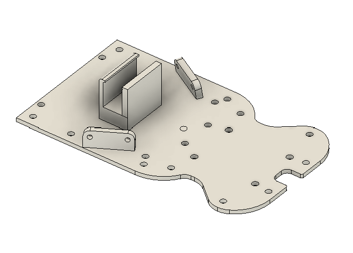 | 1 | 120 × 70 × 23 | Main printed plate: holds the steering at the front, the differential at the rear and the PCB on top |
| [`pcb_big_support_left.stl`](stl/pcb_big_support_left.stl) | 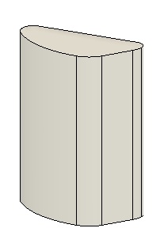 | 1 | 11 × 22 × 28 | Raises the PCB above the drive train (left side) |
| [`pcb_big_support_right.stl`](stl/pcb_big_support_right.stl) | 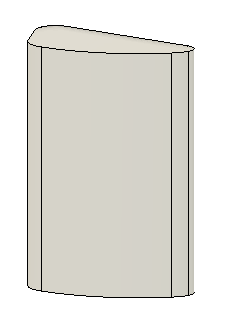 | 1 | 11 × 22 × 28 | Same, right side |
| [`pcb_front_support.stl`](stl/pcb_front_support.stl) | 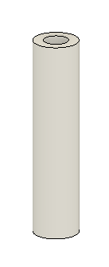 | 2 | 6 × 6 × 26 | Front standoffs for the PCB |
| [`front_spacer.stl`](stl/front_spacer.stl) | 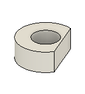 | 2 | 8 × 7 × 3 | Spacers between base and steering parts |
| [`rear_spacer.stl`](stl/rear_spacer.stl) | 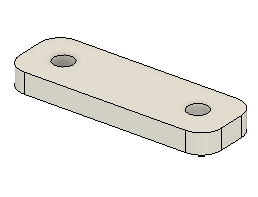 | 1 | 10 × 30 × 3 | Spacer between base and differential support |

### Steering (rack and pinion)

| Part | Render | Qty | Size (mm) | Function |
|---|---|---|---|---|
| [`servo_bracket.stl`](stl/servo_bracket.stl) | 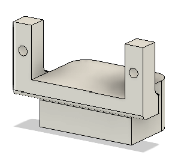 | 1 | 33 × 18 × 23 | Holds the MG90 servo with screws so its case cannot move (the problem of the first SG90 mount) |
| [`steering_gear.stl`](stl/steering_gear.stl) | 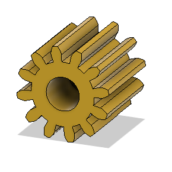 | 1 | Ø 14 × 13 | 12-tooth pinion, module 1 mm, mounted on the servo horn |
| [`gear_rack.stl`](stl/gear_rack.stl) | 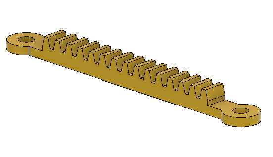 | 1 | 68 × 8 × 5 | Rack, module 1 mm; moves both knuckles together |
| [`left_steering_knuckle.stl`](stl/left_steering_knuckle.stl) | 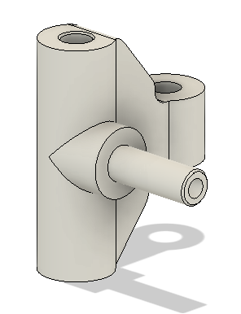 | 1 | 21 × 21 × 25 | Left front wheel pivot |
| [`right_steering_knuckle.stl`](stl/right_steering_knuckle.stl) | 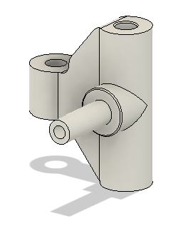 | 1 | 21 × 21 × 25 | Right front wheel pivot |

### Drive train (differential)

| Part | Render | Qty | Size (mm) | Function |
|---|---|---|---|---|
| [`motor_gear.stl`](stl/motor_gear.stl) | 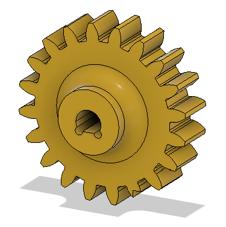 | 1 | Ø 22 × 8 | Gear on the N20 shaft |
| [`motor_restrain.stl`](stl/motor_restrain.stl) | 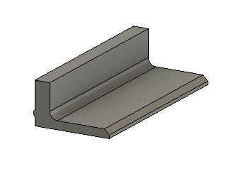 | 1 | 24 × 10 × 6 | Clamp that holds the N20 motor against the base |
| [`differential_support.stl`](stl/differential_support.stl) | 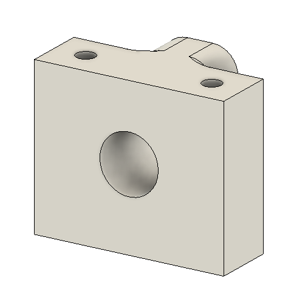 | 1 | 18 × 30 × 25 | Holds the differential and the rear axle |
| [`differential_gear.stl`](stl/differential_gear.stl) | 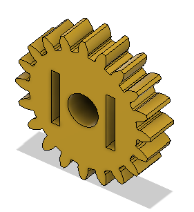 | 1 | Ø 22 × 5 | Ring gear driven 1 : 1 by the motor gear |
| [`differential_box.stl`](stl/differential_box.stl) | 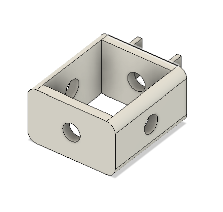 | 1 | 27 × 20 × 12 | Housing of the bevel gears |
| [`diff_bevel_gear.stl`](stl/diff_bevel_gear.stl) | 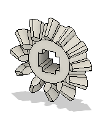 | 4 | Ø 13 × 4 | Bevel gears that let the rear wheels turn at different speeds in corners |
| [`diff_big_axle.stl`](stl/diff_big_axle.stl) | 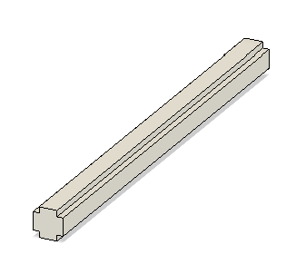 | 1 | 45 × Ø 3.3 | Cross axle of the differential |
| [`diff_small_axle.stl`](stl/diff_small_axle.stl) | 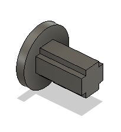 | 2 | 7 × 7 × 7 | Short axles of the spider gears |

### Wheels

| Part | Render | Qty | Size (mm) | Function |
|---|---|---|---|---|
| [`front_wheel.stl`](stl/front_wheel.stl) | 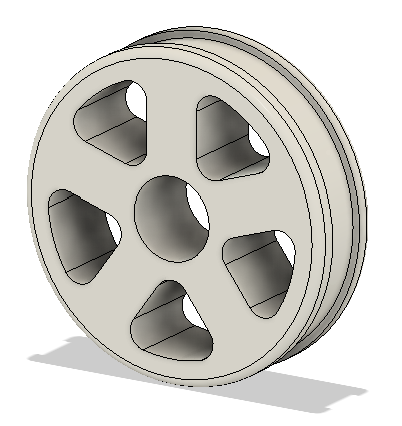 | 2 | Ø 36 × 10 | Front hub; the silicone tyre is cast on it (see [tyres](#4-custom-silicone-tyres)) |
| [`rear_wheel.stl`](stl/rear_wheel.stl) | 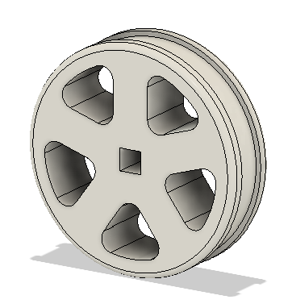 | 2 | Ø 36 × 11 | Rear hub, keyed to the differential output |

### Sensor and camera mounts

| Part | Render | Qty | Size (mm) | Function |
|---|---|---|---|---|
| [`front_sensor_bracket.stl`](stl/front_sensor_bracket.stl) | 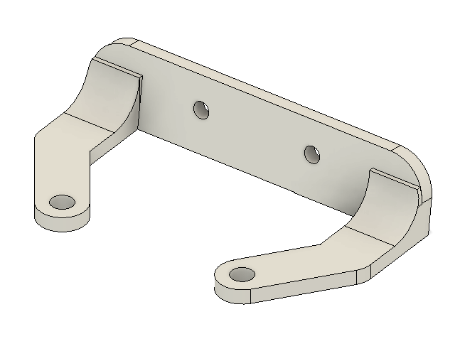 | 1 | 48 × 27 × 10 | Front TOF sensor |
| [`rear_sensor_bracket.stl`](stl/rear_sensor_bracket.stl) | 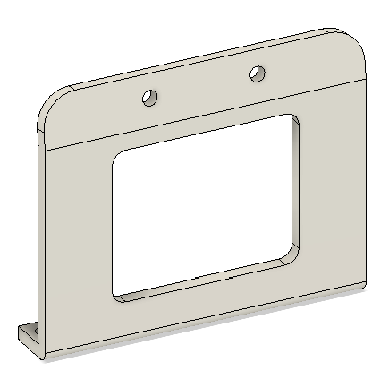 | 1 | 48 × 8 × 39 | Rear TOF sensor |
| [`sensor_bracket.stl`](stl/sensor_bracket.stl) | 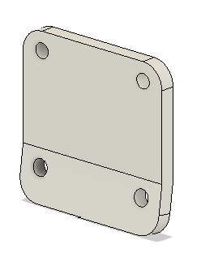 | 2 | 13 × 20 × 22 | Left and right TOF sensors, **1.5 cm higher** than on chassis 1 so the beam no longer passes over the 10 cm wall |
| [`camera_bracket.stl`](stl/camera_bracket.stl) | 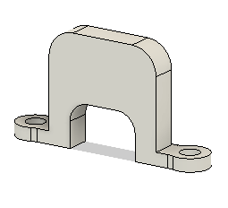 | 1 | 32 × 6 × 17 | OV2640 camera mount, facing forward and slightly down |

> Quantities of 2 or 4 come from the car's symmetry (two side TOF sensors, two front standoffs, four bevel gears in a differential). Check them against the [full CAD](#models--3d-printed-parts-of-enner-valencia) before printing.

### Printing notes

- **Material:** PLA (white and black parts in the photos).
- **Gears (pinion, rack, differential):** print flat on the bed, with a fine layer height so the teeth are clean; they were designed with module 1 mm so the pinion and the rack mesh without filing.
- **Tolerances:** chassis v3 has clearances adjusted so that moving parts (knuckles, rack, gears) turn freely without wobbling. If your printer over-extrudes, test the pinion on the rack before printing everything.
- **Fasteners:** every part of v3 is joined with **screws**; no tape or glue is needed.

---

## 3. Design iterations

| Version | CAD | Printed | Steering | What we learned |
|---|---|---|---|---|
| **v1** |  |  | Classic Ackermann with tie rods | First complete chassis; the SG90 servo moved inside its mount (journal Problem 8) |
| **v2** |  |  | Ackermann driven by a steering rack | Too much friction in the linkage: the servo could not complete its travel and **three servos were damaged** pushing against it |
| **v3 (final)** |  |  | **Parallel steering with rack and pinion** | Simple, reliable, prints well, nothing is held with tape |

  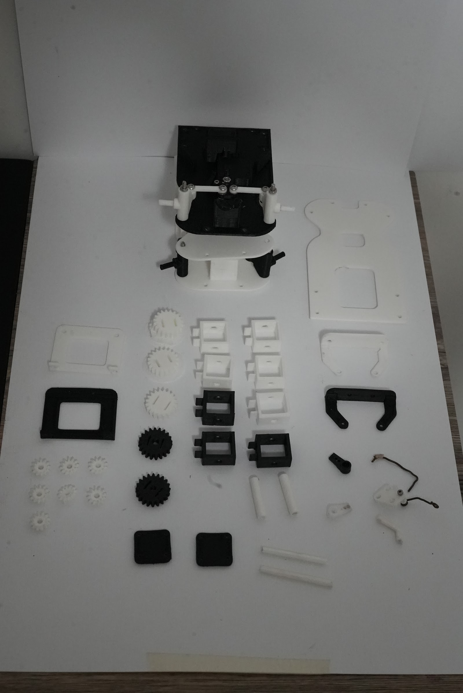
   <em>Parts from every iteration: bases, servo brackets, gears and knuckles that were replaced on the way to v3.</em>

**Changes from v2 to v3**

1. **Steering:** Ackermann with a steering rack → parallel steering with a **12-tooth, module 1 mm pinion** on the servo and a **module 1 mm rack**. The Ackermann linkage damaged three servos; the new mechanism has fewer joints and almost no friction. Details and trade-offs in the [main README §5.3](../README.md#53-steering).
2. **Tolerances** corrected so moving parts are neither loose nor stuck: just enough clearance to turn freely.
3. **Sizes adapted in the CAD** instead of improvised fixes on the printed parts: everything that was adapted by hand on v2 is now part of the v3 base.
4. **Better camera mount** and **better servo mount**, both screwed to the base.
5. **No tape:** in v2 some parts were held with tape, which showed that the design was not complete. In v3 every joint is a screw.

---

## 4. Custom silicone tyres

The tyres are cast in **printed moulds** with two-part silicone rubber, so they have more grip on the mat than printed plastic and we can make spares ourselves.

| Step | Photo | What we do |
|---|---|---|
| 1. Moulds |   | Print the tyre moulds (the hub sits in the middle, the silicone fills the ring around it) |
| 2. Material |  | **C25 silicone rubber**, part A (base) and part B (catalyst) |
| 3. Preparation | 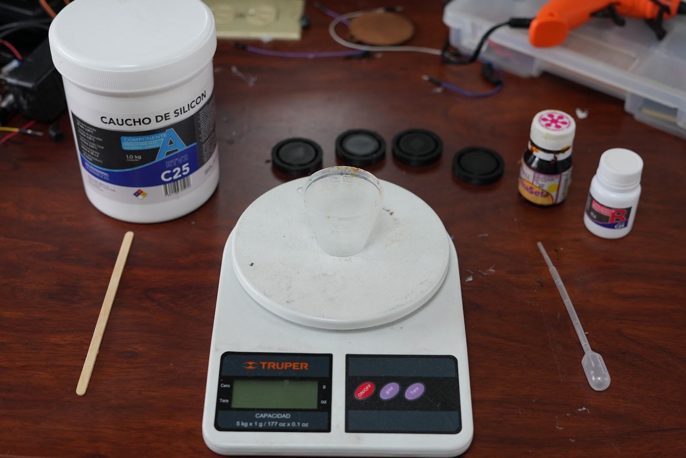 | Scale, cup, stirring stick, dropper and the moulds |
| 4. Weigh part A |  | **30 g** of part A on a gram scale |
| 5. Add part B | 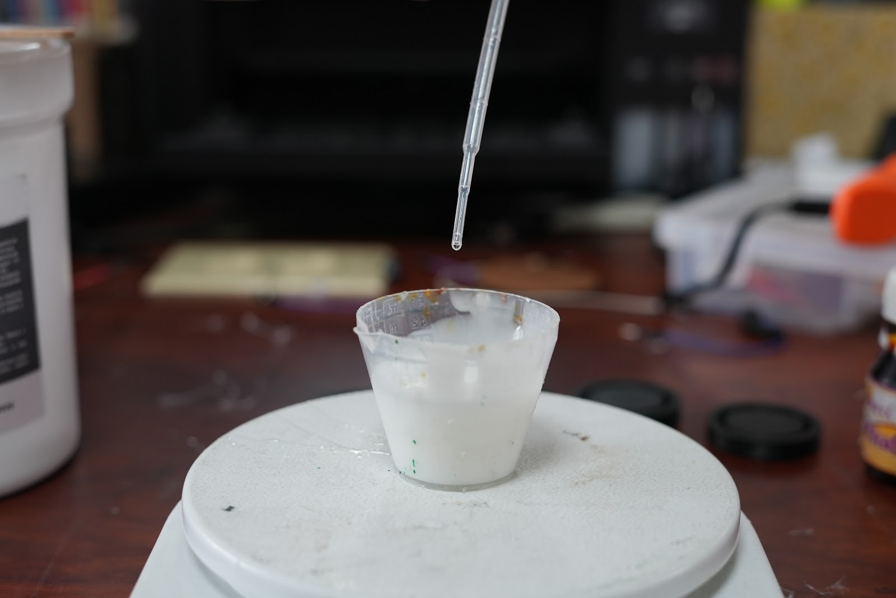 | **23 drops** of part B, from the formula below |
| 6. Mix and pour |  | Mix until most bubbles are gone, then pour into the moulds |
| 7. Cure | — | Wait **5–6 hours** until it is hard, then remove the tyres from the moulds |

**Catalyst formula**

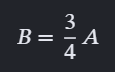

`B = ¾ · A`, where **A** is the mass of part A in grams and **B** the number of drops of part B. For A = 30 g, B = 22.5 → **23 drops**. Using a fixed formula makes every batch cure the same way, so all four tyres have the same hardness and grip.

---

## 5. Assembly order

1. Print all parts (section 2).
2. Cast the four tyres on the hubs (section 4).
3. Mount the N20 motor with `motor_restrain`, then the `differential_support`, the differential and the rear wheels.
4. Screw the `servo_bracket` and the MG90 to the front of the base; fit the pinion on the servo with the servo at its **centre**, then the rack and the two knuckles with the wheels straight.
5. Mount the four TOF brackets and the camera bracket.
6. Fix the PCB on its supports and connect everything following the [wiring diagram](../schemes/README.md#3-wiring-diagram).
7. Run [`servo_calibration`](../src/hardware-tests/servo_calibration) to measure the steering centre and limits before driving.
