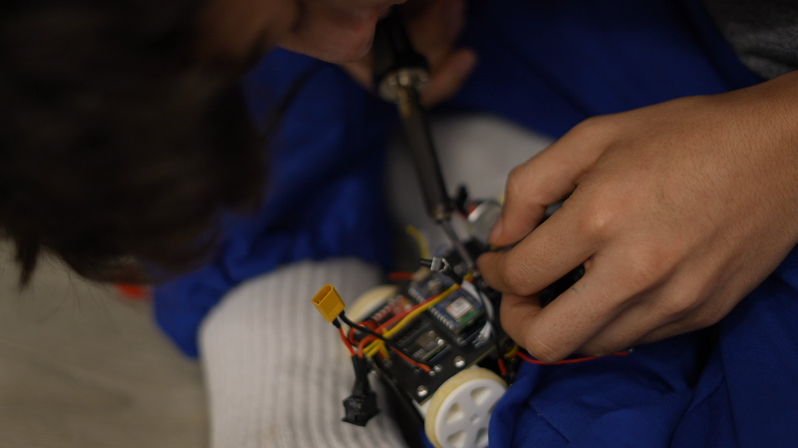
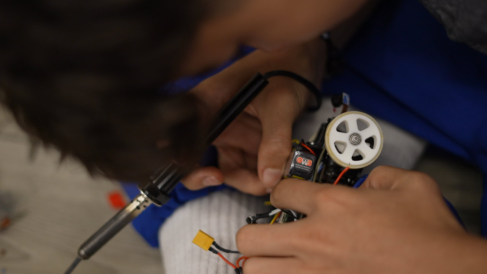
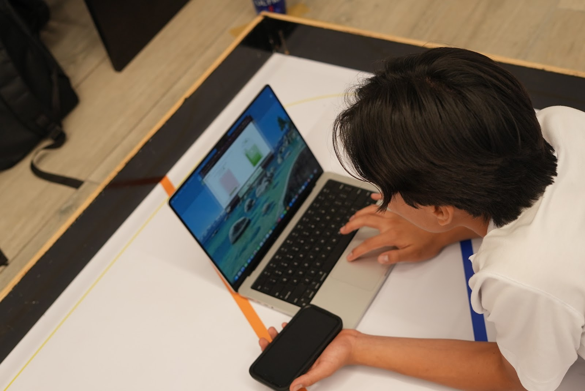
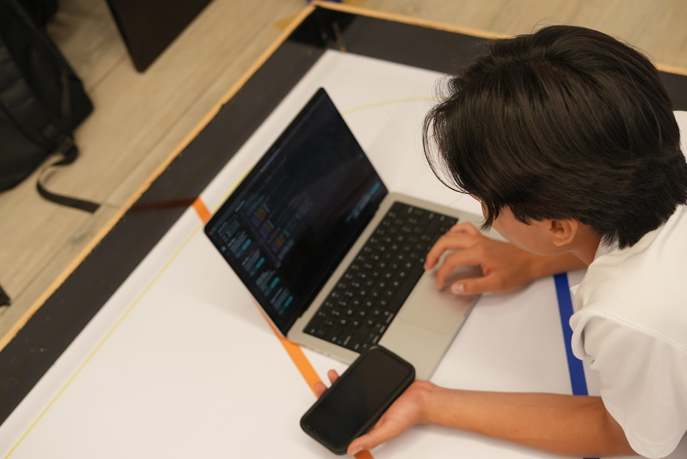
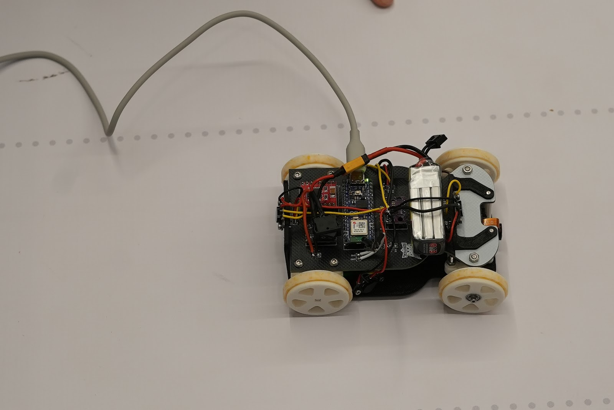
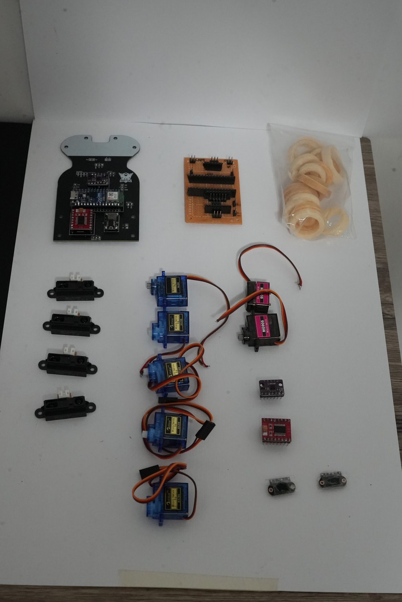

# Other resources

| Folder / file | Content |
|---|---|
| [`components/`](components) | Pictures of every electronic component, used in the BOM ([`../schemes/README.md`](../schemes/README.md)) |
| [`mechanical-iterations/`](mechanical-iterations) | Printed chassis v1, v2 and v3, and all the parts replaced along the way ([`../models`](../models/README.md#3-design-iterations)) |
| [`tyres/`](tyres) | Step-by-step casting of the silicone tyres ([`../models`](../models/README.md#4-custom-silicone-tyres)) |
| [`build-process/`](build-process) | Soldering, assembling and programming the car |
| [`failures/`](failures) | Components retired or damaged during development |
| [`pcb-manufacturing/`](pcb-manufacturing) | Screenshots of the PCB design and ordering process (EasyEDA → JLCPCB) |
| [`team-journey/`](team-journey) | Photos from the WRO 2026 Ecuador national final |
| [`team_logo.png`](team_logo.png) | Team X67 logo |

## Build process

| | |
|---|---|
|  |  |
| Soldering the sensor wires on the chassis | Soldering with the car assembled |
|  |  |
| Programming and tuning on the bench | |
|  | |
| The car connected by USB during a test | |

## What we retired

  

Every part on this table was replaced for a reason recorded in the [engineering journal](../docs/ENGINEERING_JOURNAL.md):

- **First PCB with the Nano ESP32** — the Nano ESP32 overheated and stopped working (journal Problem 31); the car now uses a classic Arduino Nano.
- **Perforated prototype board** — too bulky for the car; replaced by the custom PCB.
- **4 × Sharp infrared sensors** — unreliable beyond 50–60 cm (journal Problem 3); replaced by TOF400C.
- **SG90 and MG90S servos** — the SG90 moved inside its mount (Problem 8) and the Ackermann linkages of chassis 1 and 2 damaged three servos (Problems 17, 29 and 33). This led to the rack-and-pinion steering of chassis v3.
- **Early tyres** and spare modules that were replaced during testing.
