# Schemes — Electrical System, PCB and Power

This folder holds the complete electrical documentation of the Team X67 car: the PCB schematic, the wiring diagram, photos of the manufactured board, the power budget and the datasheets of every electronic component.

All the electronics are mounted on a **custom PCB that we designed in EasyEDA and had manufactured by JLCPCB**. The board is also part of the chassis: its custom outline is the base that the steering and drive supports are mounted to.

| File / folder | Content |
|---|---|
| [`schematic.png`](schematic.png) | Full PCB schematic (EasyEDA, rev 1.0, 8 July 2026) |
| [`wiring_diagram.png`](wiring_diagram.png) | Every external connection between the PCB and the components |
| [`pcb_front.jpeg`](pcb_front.jpeg), [`pcb_back.jpeg`](pcb_back.jpeg) | Manufactured PCB, both sides |
| [`pcb_soldered_top.jpg`](pcb_soldered_top.jpg), [`pcb_soldered_back.jpg`](pcb_soldered_back.jpg) | PCB with all modules soldered — **photos of the previous chassis (v3)**, kept because they are the clearest view of every component soldered in place; the board itself has not changed |
| [`pcb-blocks/`](pcb-blocks) | Close-ups of each functional block of the PCB layout |
| [`datasheets/`](datasheets) | Datasheets of all electronic components |
| Online PCB project | [OSHWLab — Team X67 PCB](https://oshwlab.com/edu560/project_ehytvvog) (open it to order or modify the board) |

---

## 1. Bill of Materials (BOM)

| Component | Image | Qty | Role | Why we chose it |
|---|---|---|---|---|
| **Arduino Nano** (classic, ATmega328P) | 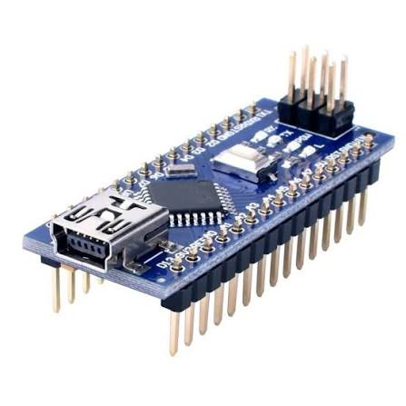 | 1 | Main controller: sensors, control loops, motor and servo | Same footprint and pinout as the board the PCB was originally designed for, so it drops into the same headers. 5 V logic, standard `Servo.h` and `Wire` libraries. It replaced our first main controller after that board was damaged (journal Problem 31) |
| **ESP32-S3-CAM** (emakefun) | 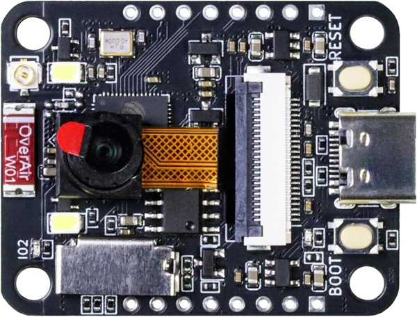 | 1 | Vision board | ESP32-S3 with 8 MB PSRAM (needed for camera frame buffers) and native USB. Keeps image processing off the main controller |
| **OV2640** camera | 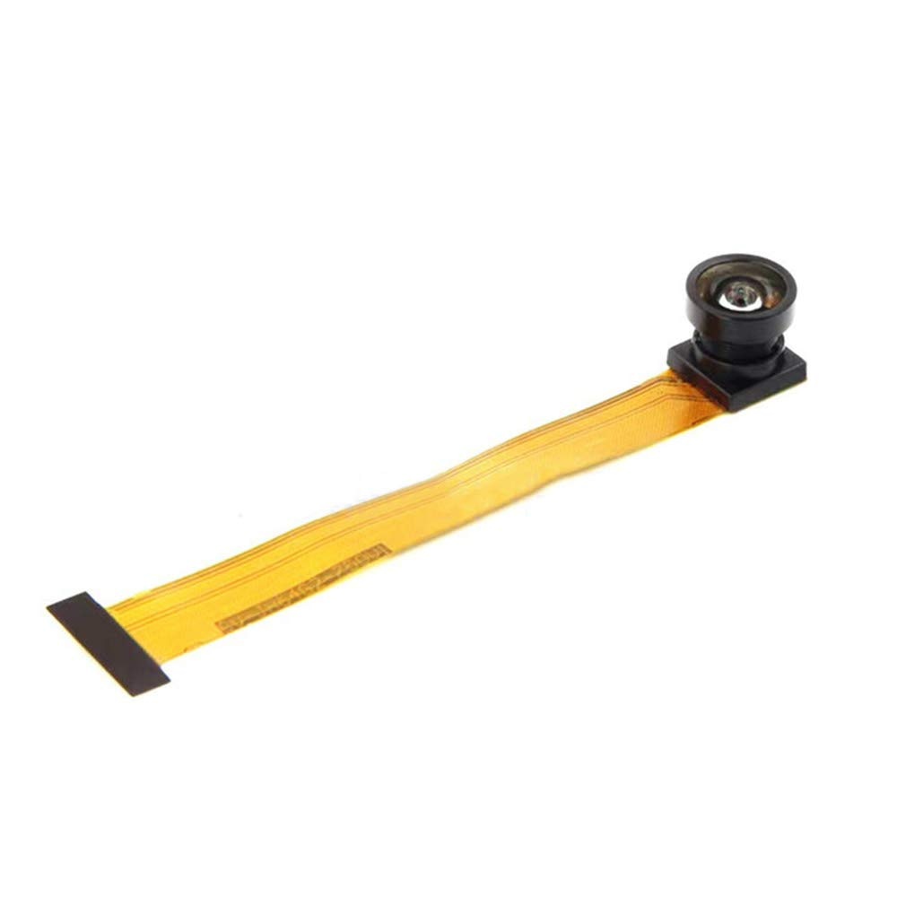 | 1 | Colour images for pillar detection | 2 MP CMOS sensor, 68° field of view, supported natively by the ESP32 camera driver |
| **TOF400C** (VL53L1X) | 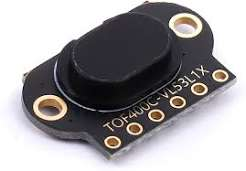 | 4 | Distance to the walls: front, back, left, right | Laser time-of-flight, up to 4 m, 27° field of view, programmable measurement area (ROI). Replaced Sharp infrared sensors (see section 5) |
| **BMI160** IMU | 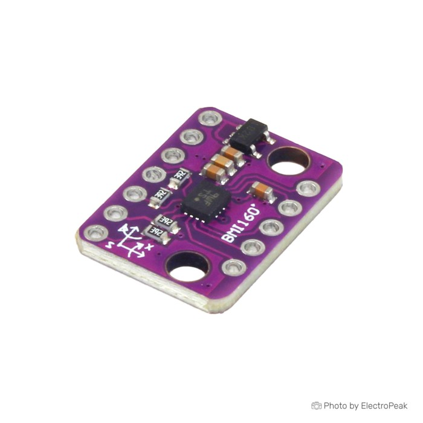 | 1 | Heading (yaw) from the gyroscope | 6-axis IMU on the same I²C bus as the TOF sensors; low noise and low current |
| **TB6612FNG** driver | 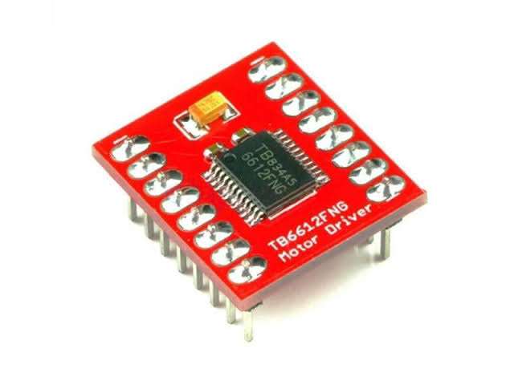 | 1 | Speed and direction of the drive motor | MOSFET H-bridge (much lower losses than an L298N), PWM control and an active short-brake mode for precise stops |
| **CN3903** buck converter | 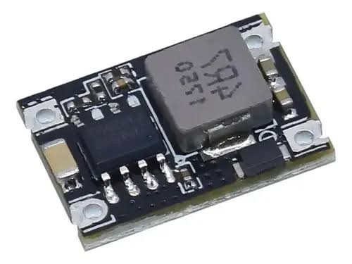 | 1 | 11.4 V → 5 V, up to 3 A | Switching regulator: far less heat than a linear regulator when dropping ~6 V |
| **Steering servo** (MG90, metal gear) | 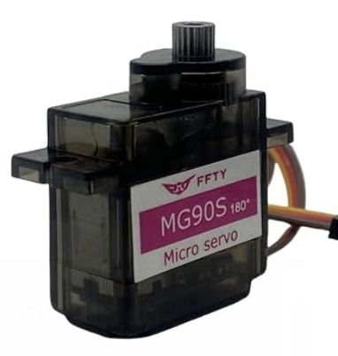 | 1 | Rack-and-pinion steering | The PCB was designed for an SG90; it was replaced by the pin-compatible MG90 (metal gears) because the SG90 moved inside its mount (journal Problem 8) |
| **N20 DC motor with Hall encoder**, 1000 rpm | 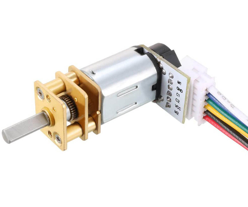 | 1 | Rear-wheel drive through a differential | Very small and light, 12 V, built-in encoder for distance/speed feedback |
| **GNB 3S 380 mAh HV LiPo** (11.4 V, 4.33 Wh, 90C) | 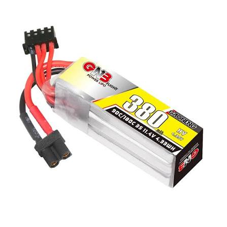 | 1 | Power source | Lightest pack that powers the 12 V motor directly with enough capacity for many rounds (see power budget) |
| **Start button** | 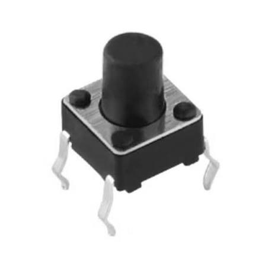 | 1 | Starts the run (rules require a single start button) | — |
| **Power switch** | 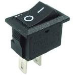 | 1 | Main power on/off (required by the rules) | Between the battery and the PCB |
| **Custom tyres** | 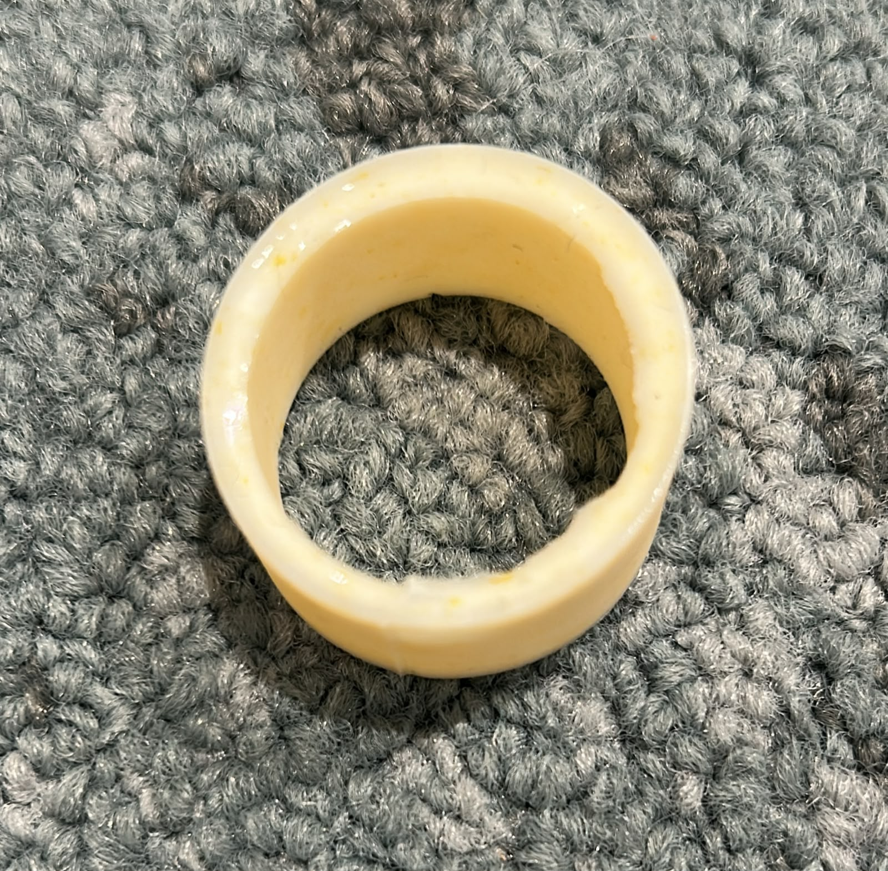 | 4 | Grip | 41 mm diameter, C25 silicone rubber cast in printed moulds ([how we make them](../models/README.md#4-custom-silicone-tyres)) |

---

## 2. Schematic

<div align="center">
  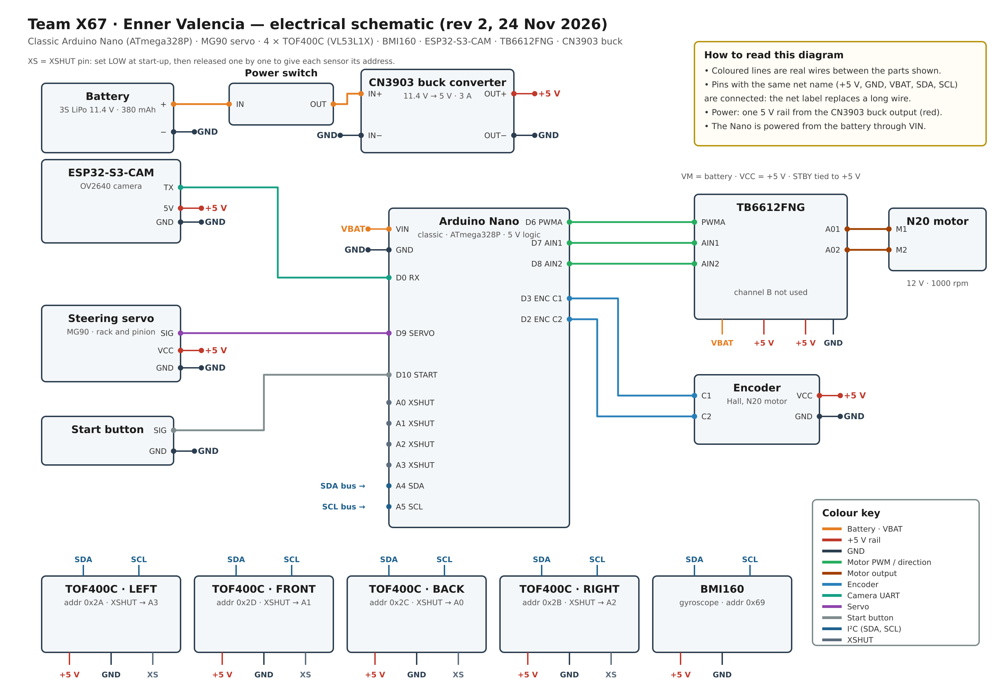
</div>

The schematic is organised in functional blocks. It was drawn for our first main controller board; the classic Arduino Nano now used has the same pin positions, so the board is unchanged.

| Block | Connections |
|---|---|
| **Arduino Nano** | VIN from the battery rail (VCC) · D0 = UART receive from the camera board (camera GPIO43 → D0; the Nano sends nothing to the camera) · D2/D3 = encoder C2/C1 · D6/D7/D8 = PWMA/AIN1/AIN2 · D9 = servo · D10 = start button · A4/A5 = I²C SDA/SCL · A0/A1/A2/A3 = XSHUT of the BACK/FRONT/RIGHT/LEFT TOF sensors |
| **Power stage** | Battery (VCC, 11.4 V) → power switch → CN3903 buck → +5 V rail |
| **Distance sensors** | 4 × 3-pin connectors (XSHUT, +5 V, GND); SDA/SCL of all TOF sensors share the I²C bus with the BMI160 |
| **TB6612FNG** | VM = battery, VCC = +5 V, **STBY tied to +5 V** (driver always enabled, no MCU pin needed), channel A only (single motor) |
| **Camera interface** | +5 V / GND power connector and TX connector (camera GPIO43 → Nano D0; GPIO44 not used) |
| **BMI160** | VIN = +5 V (module has its own regulator), SCL = A5, SDA = A4 |
| **Motor + encoder** | 6-pin connector: M1, M2 (motor), C1, C2 (encoder channels), +5 V, GND |
| **Servo** | Signal = D9, +5 V, GND |

---

## 3. Wiring diagram

<div align="center">
  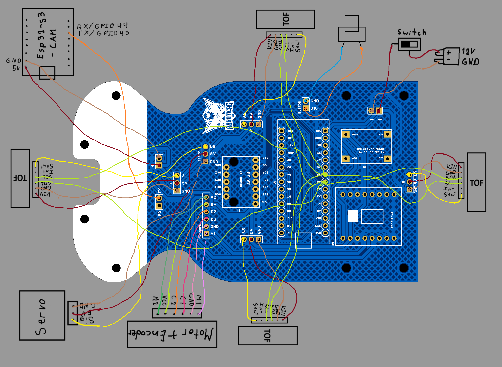
  <br>
  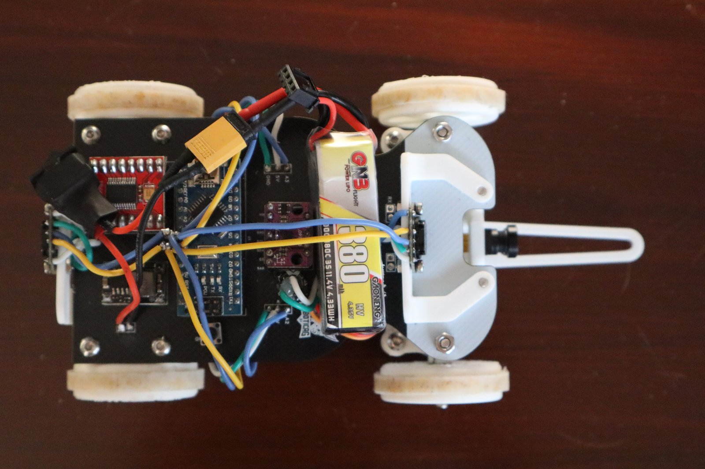
  <br>
  <em>Top: every external connection of the PCB. Bottom: the real car (top view) — our old physical-wiring photo was retired because it no longer matched the current parts.</em>
</div>

**Pin map summary (Arduino Nano)**

| Device | Signal | Pin |
|---|---|---|
| Camera board (ESP32-S3-CAM) | UART, one way | GPIO43 (TX) → Nano D0 (RX); GPIO44 not used |
| Encoder | C1 / C2 | D3 / D2 |
| TB6612FNG | PWMA / AIN1 / AIN2 | D6 / D7 / D8 |
| TB6612FNG | STBY | +5 V (hard-wired) |
| Servo | Signal | D9 |
| Start button | Input (to GND) | D10 |
| I²C bus (4 × TOF + BMI160) | SDA / SCL | A4 / A5 |
| TOF BACK / FRONT / RIGHT / LEFT | XSHUT | A0 / A1 / A2 / A3 |

Only the Nano's VIN pin receives the battery voltage. The classic Nano works with 5 V logic; the TOF400C modules are powered from the +5 V buck rail (section 4).

---

## 4. Power system

### 4.1 Architecture

```
 3S HV LiPo 11.4 V (380 mAh, 4.33 Wh)
        │
   [power switch]
        │
        ├────────────► TB6612FNG VM ─────► N20 drive motor
        ├────────────► Arduino Nano VIN ─► on-board 5 V regulator ─► Nano (5 V logic)
        │
        └─► CN3903 buck 5 V / 3 A ─► +5 V rail ─┬─► ESP32-S3-CAM (→ 3.3 V for OV2640)
                                                ├─► 4 × TOF400C
                                                ├─► BMI160
                                                ├─► TB6612FNG logic (VCC, STBY)
                                                ├─► Steering servo
                                                └─► Encoder
```

**Design reasoning**

- **The motor takes the battery voltage directly.** The N20 is rated for 12 V, so a second regulator would only add losses and weight.
- **The servo has the largest current peaks on the 5 V rail** (up to ~650 mA at stall). A 3 A buck leaves a wide margin, so a servo stall does not pull the rail down and reset the camera board or the sensors.
- **A switching (buck) regulator instead of a linear one:** dropping 11.4 V to 5 V at 0.5 A in a linear regulator would waste ~3.2 W as heat, more than all the electronics use.
- **The TOF sensors take 5 V from the buck rail.** The classic Nano works with 5 V logic, so 5 V sensors and their I²C lines match it directly, and their current no longer passes through the Nano's small on-board regulator. The cost is that they share the rail with the servo, so the 3 A buck margin has to keep that rail steady during servo stalls (see the budget and the failure points below).
- **One common ground** for all boards; the camera board and the Nano share it so the UART link has a clean reference.

### 4.2 Power budget

Values from the datasheets (typical = normal driving; peak = worst case, all at once).

| Load | Rail | Typical | Peak | Typical power | Peak power |
|---|---|---|---|---|---|
| N20 drive motor | 11.4 V | 50 mA (estimate, to measure) | 700 mA (stall, datasheet of the same family) | 0.57 W | 7.98 W |
| Arduino Nano (ATmega328P) | 11.4 V (VIN, linear regulator) | ~20 mA | ~30 mA | 0.23 W | 0.34 W |
| 4 × TOF400C | 5 V buck rail | 40 mA | 80 mA | 0.20 W | 0.40 W |
| ESP32-S3-CAM + OV2640 | 5 V | 100 mA | 310 mA | 0.50 W | 1.55 W |
| BMI160 | 5 V | 1 mA | 1.5 mA | 0.005 W | 0.008 W |
| TB6612FNG logic | 5 V | 2 mA | 10 mA | 0.01 W | 0.05 W |
| Steering servo | 5 V | 100 mA | 650 mA (stall) | 0.50 W | 3.25 W |
| **5 V buck rail total** | 5 V | **243 mA** | **1.05 A** | 1.22 W | 5.26 W |
| Buck losses (≈ 85 % efficiency) | — | — | — | 0.22 W | 0.93 W |
| **Total from battery** | 11.4 V | **≈ 0.20 A** | **≈ 1.27 A** | **≈ 2.2 W** | **≈ 14.5 W** |

The TOF row is on the 5 V buck rail, so its cost reaches the battery through the buck converter: 40 mA × 5 V ≈ 0.20 W at typical load, about 0.4 W at peak. Compared with the previous design, where the sensors ran from the Nano's 3.3 V pin, the total is about 0.3 W lower at typical load, because the Nano's regulator no longer carries the sensors' current.

**What the numbers tell us**

- **Run time:** usable energy ≈ 80 % × 4.33 Wh ≈ 3.5 Wh. At typical load that is ≈ 3.5 / 2.2 ≈ **1.6 h**; even at a continuous worst case (motor at stall) it is ≈ **14 min**. A round lasts at most 3 minutes, so one charge covers a full competition day of rounds and testing.
- **Discharge rate:** the ≈ 1.3 A peak (motor at stall) is ≈ 3.3 C, far below the battery's 90C rating. The motor is the largest load, so its voltage sag is the one to check on the car.
- **Buck margin:** the 5 V rail peaks at ~1.05 A of the CN3903's 3 A, so the regulator never runs near its limit.
- **Nano regulator heat:** the Nano's 5 V linear regulator now only feeds the Nano: (11.4 − 5) V × 20 mA ≈ **0.13 W** typical, ≈ 0.2 W at peak. It stays cool.
- **Charging:** ≈ 45–50 min with a balance charger (IMAX B6AC) at 0.4 A (≈ 1C).

### 4.3 Failure points we considered

| Risk | What could happen | Mitigation |
|---|---|---|
| Servo peaks on the shared 5 V rail reach the TOF sensors | A servo stall could glitch a distance reading or make a sensor reset | 3 A buck with large margin (see budget). Measure the 5 V rail with a multimeter while the servo stalls and the four sensors are ranging |
| Camera 3.3 V TX into the Nano RX | The ESP32-S3 drives 3.3 V; the ATmega328P reads 3.3 V as HIGH at 5 V (input-high threshold about 3.0 V) | No resistor divider. The link is one-way: the camera never listens to the Nano (`NANO_RX_PIN = -1`), so the Nano TX pin carries nothing to the camera |
| Battery voltage on a 3.3 V pin | Permanent damage to the main controller (it happened: journal Problem 31) | On the PCB the battery rail only reaches VIN, the TB6612FNG VM pin and the buck input. Journal Problem 31 led to a safety rule: **upload code with the battery off** |
| Servo stall pulls the 5 V rail down | Camera or sensors reset during a run | 3 A buck with large margin (see budget) |
| Motor held at stall for a long time | Gear damage; the motor heats quickly at 0.7 A stall | The code stops the motor after `STALL_MS`; stall tests use a short hold (< 0.5 s) |
| Loose sensor wires | A TOF stops answering, I²C bus freezes | Locking JST connectors on the PCB; `Wire.setTimeOut()` in code so a frozen bus does not hang the program (journal Problems 12 and 30) |
| All TOF sensors start with the same I²C address | Address conflict, no readings | XSHUT lines: sensors are switched on one at a time at start-up and each gets its own address (journal Problem 15) |
| Short circuit while handling | Burnt traces or battery damage | Power switch on the main line; XT30 connector on the battery so it can be unplugged quickly |

---

## 5. Sensor selection and placement

| Sensor | Placement | Reasoning (field geometry) |
|---|---|---|
| TOF FRONT | Front centre, facing forward | Safety brake when a wall is too close, and FRONT vs BACK check after the first turn; parking later. Corners are detected by the side sensors (Open) or the floor lines (Obstacle), not by the front sensor |
| TOF LEFT / RIGHT | Sides, **straight (0°), facing the wall**, centre ~5 cm from the floor | Measure the distance to the wall being followed; when it ends, the readings become invalid → corner. On the black wall an angled (30°) beam returns almost no light: 30 cm read as ~198 cm; straight it reads 32.0 cm (journal Phase 10). 5 cm is half of the 10 cm wall, so the ROI 16 × 8 cone stays on the wall and off the floor |
| TOF BACK | Rear centre | FRONT vs BACK check after the first turn (after a correct turn the back is near the corner's outer wall and the front faces the long straight) |
| BMI160 | Flat on the PCB, near the car's centre | Only yaw is used; mounting it flat makes the Z axis the turning axis |
| Camera | Front, facing forward and slightly down | Sees the pillars of the next section; only a horizontal band of the image is searched so objects outside the field are ignored (journal §6) |

**Why TOF instead of infrared or ultrasonic:** our first sensors were Sharp GP2Y0A21 infrared sensors. Their output is non-linear (distance ∝ V^-1.15), so the noise grows with distance and they were unreliable beyond 50–60 cm, less than one corridor width (journal Problem 3). Ultrasonic sensors have a wide cone that would see the floor and the neighbouring walls. The VL53L1X measures up to 4 m and its measurement area (ROI) can be narrowed in software; we chose the ROI and the mounting angle with measured experiments (journal §8.2, overturned by the better tests of Phase 10).

**Calibration methods**

- **Gyroscope:** 300 samples (≈ 1.5 s, after 0.7 s of settling) at rest when the run is started, with the LED blinking; the average is subtracted as offset (like taring a scale). The scale is `GYRO_SCALE = 1.007` (3-lap test).
- **TOF sensors:** ROI 16 × 8 and mounting angle chosen with tape-measure experiments on the black wall (`tof_roi_budget_test`, journal Phase 10); distance readings (0 or ≥ 4000 mm = no wall; the range status is not checked). The 8-reading window is October history (README §8.3).
- **Steering:** centre and limits measured on the real chassis with the `servo_test` sketch, with a 2–3° margin before each mechanical stop.
- **Camera colours:** HSV thresholds tuned live with the camera viewer under the real lighting.

---

## 6. PCB design and manufacturing

### 6.1 Why a custom PCB

We first planned a perforated prototype board (pertinax), but it was too bulky for a car limited to 30 × 20 cm. A custom PCB gives:

- **Clean, short connections** that do not come loose with vibration.
- **A structural base:** its custom outline holds the steering and drive supports, so the board is part of the chassis.
- **Reproducibility:** another team can order exactly the same board from the online project.

The trade-off was time: the boards are made in China and take about 2 weeks to arrive in Ecuador, so every change to the design costs weeks. We reviewed the schematic carefully before ordering to avoid a second revision.

### 6.2 Tools

We used **EasyEDA Pro** (web version) because its learning curve is shorter than KiCad or Proteus, it has a large library of ready footprints for our modules, and it exports directly to **JLCPCB** for manufacturing.

<div align="center">
  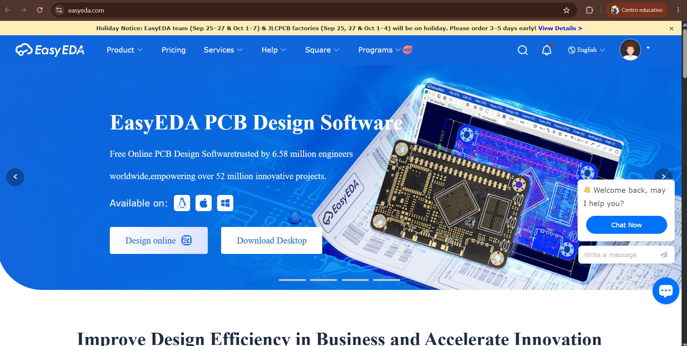
  
  <br><em>1) The board was designed in EasyEDA from the schematic. 2) We used the Pro edition for its extra layout features.</em>
  <br><br>
  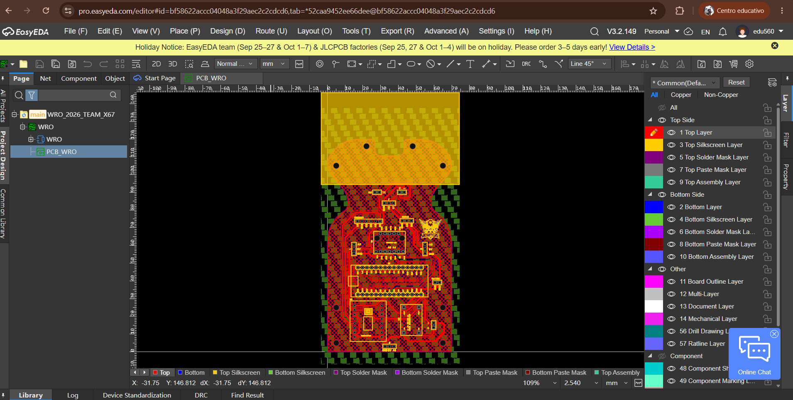
  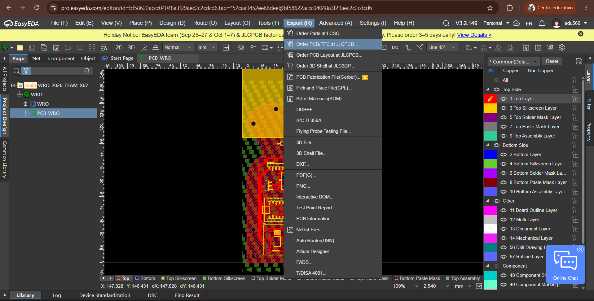
  <br><em>3–4) The finished layout is exported from the project directly to JLCPCB.</em>
  <br><br>
  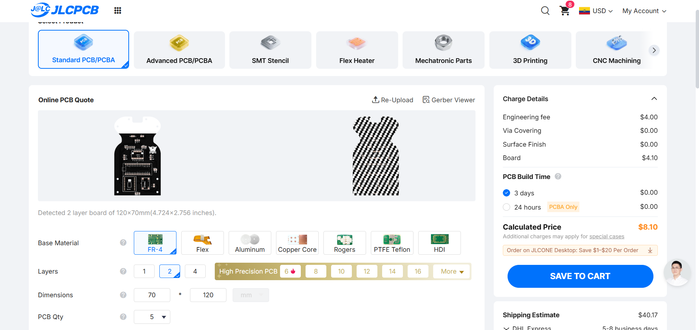
  <br><em>5) Order options: 1.6 mm board thickness; the colour is free to choose.</em>
</div>

### 6.3 Result

<div align="center">
  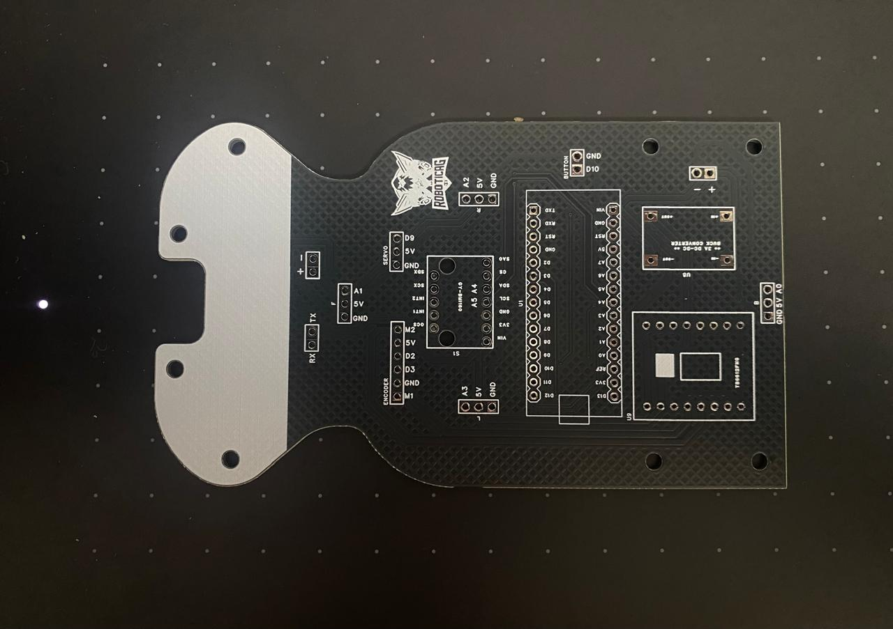
  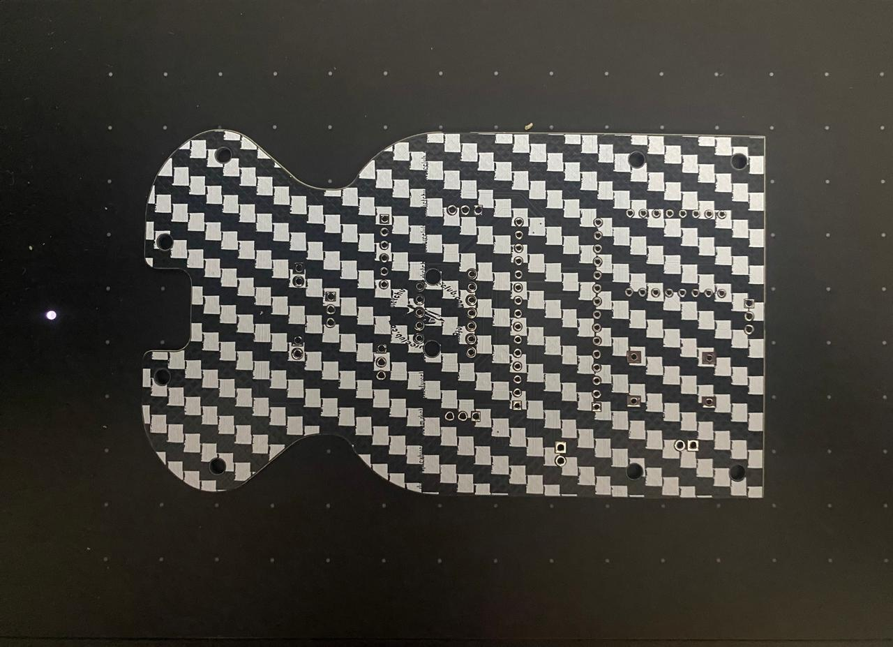
  <br><em>Manufactured PCB, front and back.</em>
  <br><br>
  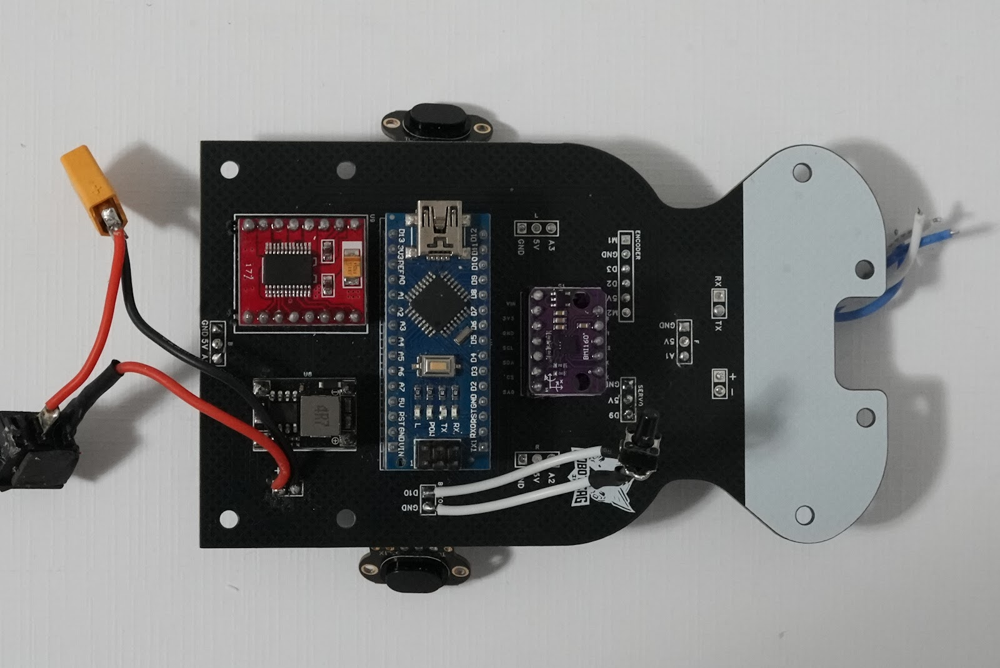
  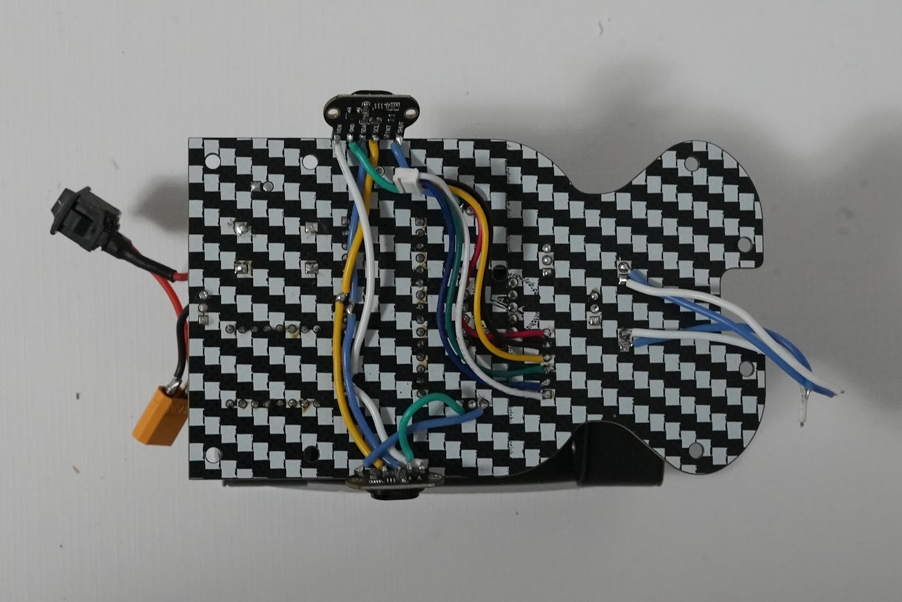
  <br><em>The same PCB with every module soldered (top) and the wiring on the back. These two photos are from the <strong>previous chassis (v3)</strong>; the board itself has not changed, and they are kept because they are the clearest view of every component soldered in place.</em>
</div>

The boards arrived in under two weeks and have worked without a single failure since. To reproduce them: open the [OSHWLab project](https://oshwlab.com/edu560/project_ehytvvog), choose *Order PCB*, keep 1.6 mm thickness, then solder female headers for the Arduino Nano, the BMI160, the TB6612FNG and the buck converter, and JST connectors for the external components.

### 6.4 PCB blocks

| Block | Layout |
|---|---|
| Arduino Nano | 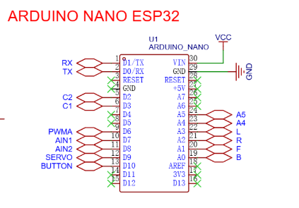 |
| Camera board connectors | 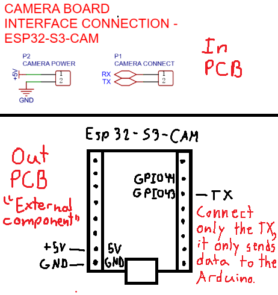 |
| TOF sensor connectors | 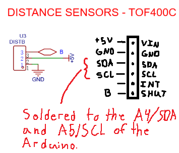 |
| BMI160 | 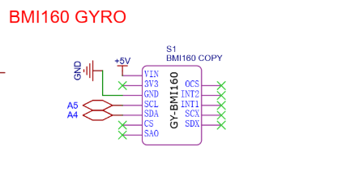 |
| TB6612FNG | 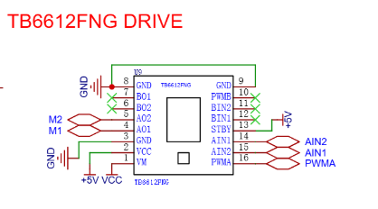 |
| Motor + encoder connector | 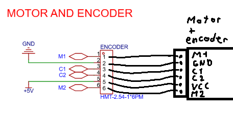 |
| Servo connector | 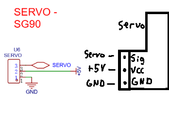 |
| Buck converter | 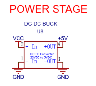 |

---

## 7. Datasheets

| Component | File | Key data used |
|---|---|---|
| Arduino Nano (classic) | [Arduino Nano documentation](https://docs.arduino.cc/hardware/nano/) | Pinout, VIN range, 3.3 V pin limit |
| ESP32-S3-CAM | [GitHub: nulllaborg/esp32s3-cam](https://github.com/nulllaborg/esp32s3-cam) | Camera pin layout, PSRAM, flash size |
| OV2640 | [OV2640DS.pdf](datasheets/OV2640DS.pdf) | Resolutions, RGB565 output |
| VL53L1X (TOF400C) | [DS_vl53l1x.pdf](datasheets/DS_vl53l1x.pdf) | Range, timing budget, ROI, I²C address change |
| BMI160 | [BMI160.pdf](datasheets/BMI160.pdf) | Gyroscope registers, ranges, sensitivity |
| TB6612FNG | [TB6612FNG.PDF](datasheets/TB6612FNG.PDF) | Truth table (forward, reverse, coast, short brake), current limits |
| CN3903 buck | [CN3903.PDF](datasheets/CN3903.PDF) | Input range, 3 A output |
| N20 motor (12 V, 1000 rpm, on the car) | [N20_12V_1000RPM_specs.md](datasheets/N20_12V_1000RPM_specs.md) | Speed, current, encoder; gear ratio and stall current still to be measured. The old 6 V datasheet was removed on 23 Nov (different motor; it stays in the git history) |
| SG90 servo (original choice, not on the current car) | [SG90.PDF](datasheets/SG90.PDF) | Kept for the history only |
| MG90 metal-gear servo (steering on the current car) | [MG90 / MG90S datasheet (external PDF)](https://www.tinytronics.nl/product_files/000263_Data_Sheet_of_MG90S_Analog_Servo_Motor.pdf) | Pulse range, torque, gear type. Linked, not copied into this folder, because the file is not from the team. The MG90 and MG90S are the same family with the same pulse range |
