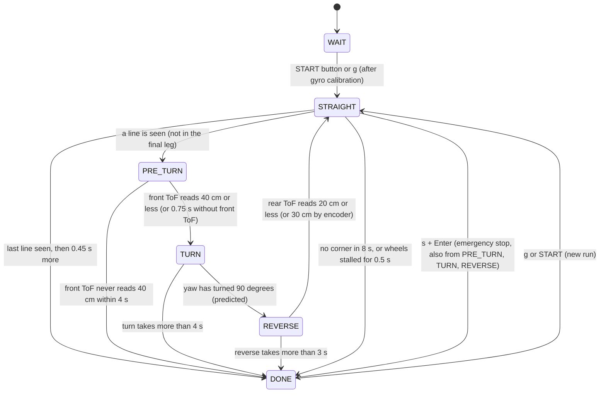
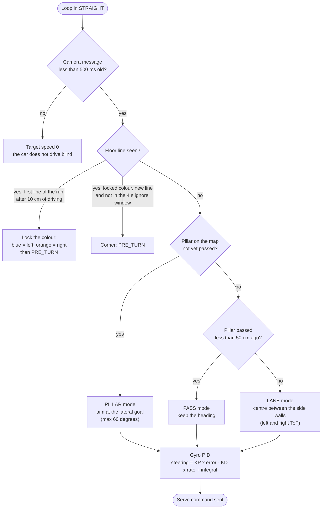

# Obstacle Challenge program (`obstacle_challenge.ino`)

Arduino Nano sketch that drives the car through the **Obstacle Challenge** of WRO 2026 Future Engineers. It does three things in one program:

1. **Laps.** It follows the track by counting the floor lines the camera sees. The first line tells it which way the round goes (blue = turn left, orange = turn right). Every corner is a **90° turn in reverse**, measured with the gyroscope.
2. **Pillars.** When the camera reports a red or green pillar on the straight, it steers around it: red pillars are passed on the **right**, green pillars on the **left** (traffic rules). Pillar positions are stored on a small odometry map so the car still knows where a pillar is after it has left the picture.
3. **Wall centring.** On straights without pillars, the car keeps the same distance to both side walls, using the left and right ToF sensors.

It is the **driving half** of the Obstacle Challenge. The vision half is [`obstacle_camera_v3_2`](../obstacle_camera_v3_2/README.md), which sends the pillar and floor-line messages over UART. The round finishes with a stop in the starting section after the last line. The start from inside the parking lot is in [`obstacle_go_out_of_parking`](../obstacle_go_out_of_parking/README.md).

| | |
|---|---|
| Board | Arduino Nano (classic, ATmega328P) |
| Libraries | *VL53L1X* by Pololu, `Servo.h` (built in) |
| Companion sketch | `obstacle_camera_v3_2` on the ESP32-S3-CAM, connected TX (GPIO43) → Nano D0 |
| Status | Code committed 23 Nov 2026, the version the team reports as working on the car, including its edge cases; the Obstacle video is in [`video/video.md`](../../../video/video.md). Lap times, stops and pillar passes are to be logged in [`docs/TESTS.md`](../../../docs/TESTS.md) |

## 1. Hardware it uses

| Part | Pin or address | Notes |
|---|---|---|
| Drive motor (TB6612FNG) | PWMA **D6**, AIN1 **D7**, AIN2 **D8** | Reverse is done by swapping the two direction pins |
| Motor encoder | **D3** (C1, interrupt), **D2** (C2, direction) | 9.27 pulses per cm |
| Steering servo | **D9** | Centre 85, left limit 10, right limit 170 (servo units) |
| Start button | **D10** | Active LOW, input pull-up |
| Status LED | D13 | Blinks during the gyro calibration, on when ready |
| Gyroscope (BMI160) | I²C address **0x69** | Yaw is integrated from the Z rate |
| Left ToF (VL53L1X) | XSHUT **A3**, address **0x2A** | Side distance, used for wall centring |
| Right ToF (VL53L1X) | XSHUT **A2**, address **0x2B** | Side distance, used for wall centring |
| Rear ToF (VL53L1X) | XSHUT **A0**, address **0x2C** | Stops the reverse at the end of each turn |
| Front ToF (VL53L1X) | XSHUT **A1**, address **0x2D** | Decides when to start a corner turn |
| Camera link | RX **D0** | 115200 baud, text lines starting with `$` |

The four ToF sensors are given their addresses one at a time, because all of them start at the default address 0x29. If the front or rear sensor is missing, the program still runs with a fallback (see §6.4). If a side sensor is missing, the wall centring has less information (see §6.4).

## 2. Upload and run

1. Power the car **with the battery switched off**, upload the sketch, then switch the battery on. Close the Serial Monitor before running.
2. Put the car on the start straight, pointing along the lane, with **the wheels straight and the car still**. Do not touch it during start-up.
3. Press **START (D10)** or send `g` + Enter in the Serial Monitor (115200 baud). The program calibrates the gyroscope (about 2 s, LED blinking) and starts.
4. Emergency stop: send `s` + Enter at any time. The car brakes and prints the final report.

After a finished or stopped run, `g` + Enter or the START button starts a new run. The gyroscope is calibrated again each time.

## 3. Settings (constants at the top of the sketch)

The sketch groups its constants in five blocks. The most important ones are below. All distances in cm unless the unit is written, and all speeds are PWM values from 0 to 255.

**Block 1: run settings**

| Constant | Value | Meaning |
|---|---|---|
| `LAPS` | 3 | Laps to drive. One lap is four corners, so `LAPS = 3` means **12 corners** |
| `RUN_PWM` | 70 | Motor speed on straights |
| `TURN_PWM` | 70 | Motor speed during the reverse turn |
| `REVERSE_PWM` | 70 | Motor speed for the reverse after each turn |
| `FRONT_TURN_CM` | 40 | After the line, drive until the front ToF reads this or less, then start the turn |
| `MAX_PRE_TURN_MS` | 4000 | Safety: stop if the front ToF never reaches `FRONT_TURN_CM` |
| `REAR_STOP_CM` | 20 | After the turn, reverse until the rear ToF reads this or less |
| `REVERSE_CM` | 30 | Fallback: reverse this far by encoder if the rear ToF is not working |
| `MAX_REVERSE_MS` | 3000 | Safety: stop if the reverse takes longer |
| `ONLY_LOCKED_COLOR` | true | Only the colour of the first line counts as a corner for the rest of the run |
| `LINE_WAIT_S` | 0.75 | Fallback when there is no front ToF: drive this long after the line, then turn |
| `FINAL_EXTRA_S` | 0.45 | After the last line, drive this long, then stop |

**Block 2: pillars and lines**

| Constant | Value | Meaning |
|---|---|---|
| `TARGET_CM` | 17 | Wanted distance from the pillar centre to the car centre when passing it (4.5 cm half car + 10 cm gap + 2.5 cm half pillar) |
| `MAX_AIM_DEG` | 60 | Largest heading change the program asks for to dodge a pillar |
| `LOOK_MIN_CM` | 12 | Minimum look-ahead distance used for the aiming angle, so it never explodes next to a pillar |
| `ARRIVE_BEFORE_CM` | 55 | The car should be on the safe side this far before the pillar |
| `RETURN_AFTER_CM` | 25 | A pillar counts as passed when the car is this far past its centre |
| `PASS_CM` | 50 | After a pillar is passed, keep the same heading for this distance |
| `SAME_PILLAR_CM` | 15 | A new detection closer than this to a stored pillar of the same colour is the same pillar |
| `BLEND` | 0.3 | How much each new detection moves the stored position (30 %) |
| `MAX_SIDE_CM` | 60 | Pillars further to the side than this are ignored as noise |
| `PILLAR_CM` | 5 | Real width of a pillar |
| `CAM_FWD_CM` | 11.7 | Distance from the rear axle (where the encoder is) to the camera lens |
| `IGNORE_LINE_S` | 4.0 | After a corner, ignore all lines for this long, so the second line of the same corner is not counted |
| `MIN_DRIVE_CM` | 10 | No line is accepted in the first 10 cm after START |

**Block 3: steering and wall centring**

| Constant | Value | Meaning |
|---|---|---|
| `KP_HEAD` / `KD_HEAD` / `KI_HEAD` | 2.0 / 0.03 / 4.0 | Gyro PID: proportional, damping on the yaw rate, integral (only in lane mode, learns the real straight servo angle) |
| `I_MAX` | 25 | Limit of the integral term |
| `MAX_STEER` | 70 | Largest steering command, in servo degrees |
| `K_LAT` / `KI_LAT` / `LAT_I_MAX` | 0.03 / 0.02 / 8 | Wall centring: degrees of heading per mm of error, integral gain, integral limit |
| `LAT_MAX_DEG` | 12 | Largest heading correction from the wall centring |
| `SIDE_MAX_MM` | 1200 | A side reading above this means "no wall" and is not used |
| `SAFE_WALL_MM` | 70 | A side wall closer than this forces a full correction away from it |
| `TURN_PREDICT_S` | 0.12 | The turn is ended this much early, to absorb the momentum of the car. Raise it if the car turns more than 90° |

**Block 4: car constants** (the same values as `open_challenge`)

| Constant | Value | Meaning |
|---|---|---|
| `TICKS_PER_CM` | 9.27 | Encoder pulses per cm, measured with the motor running (21 Nov) |
| `GYRO_SCALE` | 1.007 | Gyro scale factor, same as `open_challenge` (the earlier `straight_pillars` sketch used 1.06; see §9) |
| `STEER_CENTER` / `STEER_LEFT_MAX` / `STEER_RIGHT_MAX` | 85 / 10 / 170 | Servo angles. A smaller angle steers **left** |
| `MOTOR_REVERSED` / `ENCODER_REVERSED` | true / true | Wiring polarity, measured on this car |

**Block 5: timeouts**

| Constant | Value | Meaning |
|---|---|---|
| `MAX_TURN_MS` | 4000 | A turn longer than this stops the program |
| `MAX_STRAIGHT_MS` | 8000 | No corner within this time on a straight stops the program |
| `STALL_MS` | 500 | Motor on but wheels not turning for this long stops the program |
| `CAMERA_TIMEOUT_MS` | 500 | No camera message for this long: the car does not drive |

The constants `MAX_FINAL_CM`, `STOP_OFFSET_CM` and `FALLBACK_CM` were removed: they were declared but not used by this program (`open_challenge` still uses them).

## 4. Program flow

### 4.1 States

The program is a small state machine. The state names are printed on the Serial Monitor.



| State | What the car does | Leaves when |
|---|---|---|
| **WAIT** | Motor off, servo centred. Waits for START or `g` | START or `g` |
| **STRAIGHT** | Drives forward, steers with the priorities of §4.2, counts lines | A new corner line is seen, or the final line is passed, or a safety stop |
| **PRE_TURN** | Keeps driving straight on the same heading until the front wall is close | Front ToF reads `FRONT_TURN_CM` (40 cm) |
| **TURN** | Brakes, then reverses with the steering turned to the **opposite** side, so the rear swings into the turn. Ends when the predicted yaw has changed by 90° | Predicted yaw ≥ 90° |
| **REVERSE** | Steering centred, reverses on the new heading | Rear ToF reads 20 cm or less |
| **DONE** | Brakes, centres the steering, and after 1 s switches the motor off and prints the report | `g` or START starts a new run |

### 4.2 What the program does on every loop in STRAIGHT

The loop runs on every pass of `loop()`. It checks the three priorities in this order: **line first, then pillar, then wall centring**. A line always wins, so a corner is never missed because of a pillar.



### 4.3 One corner, step by step

1. A line is seen in the locked colour (for the first corner, either colour). The program enters PRE_TURN and records the corner.
2. The car drives straight until the **front ToF** reads 40 cm. With no front ToF, it drives for 0.75 s instead.
3. The car brakes, and the motor is switched to reverse. The steering turns to the **opposite** side from the turn direction, so the rear of the car swings toward the corner.
4. The car reverses while it watches its yaw. When the predicted yaw (current yaw plus 0.12 s of yaw rate) is 90° from the old heading, the program adds ±90° to the target heading and increases the corner counter.
5. The car brakes, centres the steering and reverses straight until the **rear ToF** reads 20 cm (or 30 cm by encoder if there is no rear sensor).
6. The odometry map is reset (the new straight starts at x = 0, y = 0) and the car drives forward again on the new heading. The 4 s line-ignore window started when the line was seen (step 1), so the second line of the same corner is not counted.

Because the target heading is always a multiple of 90° (0, 90, 180, 270…), the error of one turn is corrected on the next straight instead of adding up. The wall centring also keeps the car away from the inner wall on every straight.

## 5. Dodging pillars

### 5.1 Odometry map

Inside each straight, the program keeps the position of the camera on a map. **x** is cm forward and **y** is cm to the left, measured from the start of the straight.

```
ds      = encoder distance since the last loop (cm)
carX   += ds · cos(yaw − heading)
carY   += ds · sin(yaw − heading)
```

Each stored pillar has a position on this map. A pillar on the map is **the current pillar** (the one being passed) or **the next pillar** (already seen farther ahead). The map holds at most these two.

### 5.2 Placing a pillar

The camera gives the pillar's distance ahead (`distCm`) and its side distance (`latCm`, + right, − left). The program puts the pillar **centre** at:

```
fwd  = distCm + 2.5 cm          to the centre, not the front face
left = −latCm                   map coordinates, + = left
pillarX = camX + fwd·cos(h) − left·sin(h)
pillarY = camY + fwd·sin(h) + left·cos(h)     where h = yaw − heading
```

When the same colour is seen again within `SAME_PILLAR_CM` (15 cm) of a stored pillar, it is the same pillar. Its stored position moves by `BLEND` (30 %) toward the new reading, which averages out the noise of single pictures.

### 5.3 Lateral goal

The program chooses on which side to pass, and how far from the pillar, so that it never moves **toward** the pillar:

```
red   (pass on the right):  goalY = min(camY, pillarY − 17)
green (pass on the left):   goalY = max(camY, pillarY + 17)
```

`camY` is the sideways position of the camera lens on the map (the lens is `CAM_FWD_CM` = 11.7 cm ahead of the rear axle, where the encoder distance is measured). Once the camera is level with the pillar or past its centre, the program aims at the next pillar only, and it never turns back toward the pillar it is passing.

### 5.4 Heading toward the goal

```
look    = max(12 cm, (pillarX − 2.5) − camX − 55)     look ahead, 55 cm before the pillar
heading = atan2(goalY − camY, look)                    limited to ±60°
steering = 2.0 · (heading − yaw) − 0.03 · yawRate      P + D (+ integral in LANE mode), limited to ±70°
```

The car starts moving sideways about 55 cm before the pillar, so it is already on the safe side when it reaches it. At 25 cm past the pillar's centre, the pillar is cleared and the program aims at the next pillar, or back at the centre of the lane.

**Example:** car at (0, 0), red pillar centre at (40, +10). The goal is `min(0, 10 − 17) = −7` cm, the look distance is `max(12, 40 − 2.5 − 0 − 55) = 12` cm, so the heading is `atan2(−7, 12) ≈ −30°` (to the right).

## 6. Driving details

### 6.1 Start-up

`setup()` starts the serial port, the TB6612FNG, the encoder interrupt and the servo. It starts the four ToF sensors (retrying up to 5 times until the two side sensors answer), the BMI160, and prints a status line for each one. Then it calibrates the gyro offset (about 1.5 s with the car still) and prints `Ready`.

`startRun()` calibrates the gyro again, resets the encoder, the map, the counters and the line lock, and starts STRAIGHT.

### 6.2 Priorities in STRAIGHT

| Priority | Who | Why it is first |
|---|---|---|
| 1 | **Line** | A corner must never be missed. The line is also the only sure event on the track |
| 2 | **Pillar** (PILLAR mode, then PASS mode) | A pillar must be dodged before the car reaches it |
| 3 | **Wall centring** (LANE mode) | Keeps the car in the middle of the lane when there is nothing else to do |

Pillars are not used during a turn (`newCamData` is cleared), nor during the reverse, so a pillar seen while turning does not change the target.

### 6.3 Lines and laps

- Lines are seen through the camera message: `blueFound` / `orangeFound` (fields 5 and 11). A corner is a **rising edge** of the locked colour (it was not visible in the previous message and is visible now).
- The first line of the run locks the colour: **blue = left turn, orange = right turn**. Once locked, the other colour is ignored for the whole run (`ONLY_LOCKED_COLOR`).
- After each corner, all lines are ignored for 4 s (`IGNORE_LINE_S`), so the second line of the same corner (the far end of the corner) is not counted as a new corner.
- After the 12th turn (`4 × LAPS`), the program sets the **final leg**: the next line is the last one. The car drives `FINAL_EXTRA_S` (0.45 s) more and stops inside the starting section.

### 6.4 Fallbacks

| Missing sensor | What the program does |
|---|---|
| Front ToF | PRE_TURN lasts `LINE_WAIT_S` (0.75 s) instead of until 40 cm |
| Rear ToF | The reverse ends after `REVERSE_CM` (30 cm) of encoder distance |
| Left or right ToF | Centring needs both side readings. With one of them missing or above 1200 mm, the centring keeps its last integral value. A side closer than 70 mm still forces a full correction away from that wall, if that sensor works |
| Camera messages stop | No drive target for the loop (`CAMERA_TIMEOUT_MS` 500 ms) |
| A side ToF with no data for 500 ms | All four ToF sensors are restarted (`!!! TOF RESTART` is printed) |

## 7. Safety stops

Every stop prints a reason and the final report (yaw, heading, corners, D1, time).

| Message | Cause | Look at |
|---|---|---|
| `FRONT never reached FRONT_TURN_CM -> STOP` | The car did not get close to the front wall within 4 s | Front ToF, lighting, the line that was seen too early |
| `TURN TOO LONG -> STOP` | The reverse turn took longer than 4 s | Battery, wheels blocked, `TURN_PREDICT_S` |
| `REVERSE TOO LONG -> STOP` | The reverse took longer than 3 s | Rear ToF, wall behind the car |
| `NO CORNER in 8 s -> STOP` | No line in 8 s on a straight | Camera, lines out of view, the final leg |
| `STALLED: wheels not turning (hit a wall?) -> STOP` | Motor on for 0.5 s without encoder movement | Wheels against a wall, encoder wires on D2/D3 |
| `LAST LINE + extra drive -> STOP` | Normal end: the last line was seen and `FINAL_EXTRA_S` passed | Nothing to fix |
| `STOPPED (s)` | Emergency stop with `s` + Enter | Nothing to fix |

## 8. Camera message

The camera sends one line per picture:

```
$color,x,bottom,correct,blueFound,blueRow,seq,width,distCm,latCm,orangeFound,orangeRow,blueCenterRow,orangeCenterRow
```

This program reads the **first 12 fields** (`sscanf` with 12 values). The last two (`blueCenterRow`, `orangeCenterRow`) are sent by the camera for the viewer and the older sketches but are not used here.

| Used field | Used for |
|---|---|
| `color` (1 red, 2 green, 0 none) | Which side to pass the pillar on |
| `x`, `width` | Kept in the message, not used for steering (the distance and side are used) |
| `bottom`, `correct` | Read but not used in the steering law |
| `blueFound`, `orangeFound` | The floor lines (corners). Their rows (`blueRow`, `orangeRow`) are read but not used |
| `seq` | Message counter (printed as a number, not checked) |
| `distCm`, `latCm` | Position of the pillar: how far ahead and to the side (cm) |

A message without a pillar sends `color = 0` and `distCm = -1`. A pillar already on the map **stays there** while the camera does not see it, and is removed only when the car has passed its centre by 25 cm. That is what lets the car keep avoiding a pillar that has left the picture.

## 9. Known differences and things to measure

- **Gyro scale.** Both driving programs use `GYRO_SCALE = 1.007`. A hand-turn measurement of 21 Nov (`gyro_90_test`) gave `1.06` for an earlier sketch and is not used. Check the yaw of a 90° turn in the final report (`yaw` should be about 90 per corner).
- **Pillar distances.** The pillar distances come from the camera v3.2, which uses a focal length of 50 px (half of the 100 px measured at 320 × 240; confirmed by the team on 23 Nov 2026).
- **Turn point.** The turn starts at 40 cm from the front wall. Changing `FRONT_TURN_CM` changes where every corner starts, so measure it on the real field after changing the camera or the chassis.
- **Lines.** The lines are used only as events (they are not converted into distances). The camera sees the floor lines only up to about 22 cm, so a line must be in view when the car reaches the corner. The corner is a rising edge, so a line that stays in view for a long time counts once.
- **Walls that end.** A side reading above 1200 mm means the wall has ended (at a corner, or behind a missing wall), so that side is not used for centring. On those straights the car relies on the pillar logic and on its gyro heading.

## 10. Related files

| File | What it is |
|---|---|
| [`obstacle_camera_v3_2`](../obstacle_camera_v3_2/README.md) | Vision sketch for the camera board that sends the messages read here |
| [`obstacle_go_out_of_parking`](../obstacle_go_out_of_parking/README.md) | Leaves the parking space at the start of the round (not yet tested on the track) |
| [`open_challenge`](../../open-challenge/open_challenge/README.md) | The Open Challenge program. It shares the car constants (encoder, steering centre, gyro scale) and the gyro / ToF drivers with this sketch, but follows the inner wall instead of the floor lines |
| [Root README §9](../../../README.md#9-obstacle-challenge-strategy) | Strategy, status and roadmap of the Obstacle Challenge |
| [Engineering journal](../../../docs/ENGINEERING_JOURNAL.md) | Measurements, tests and decisions, in date order |
