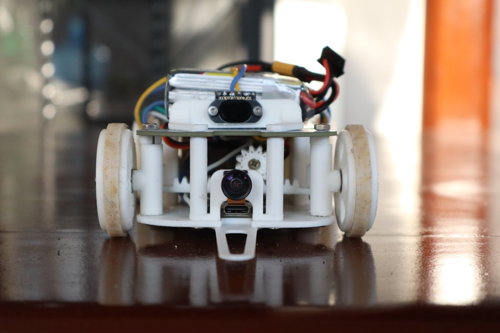
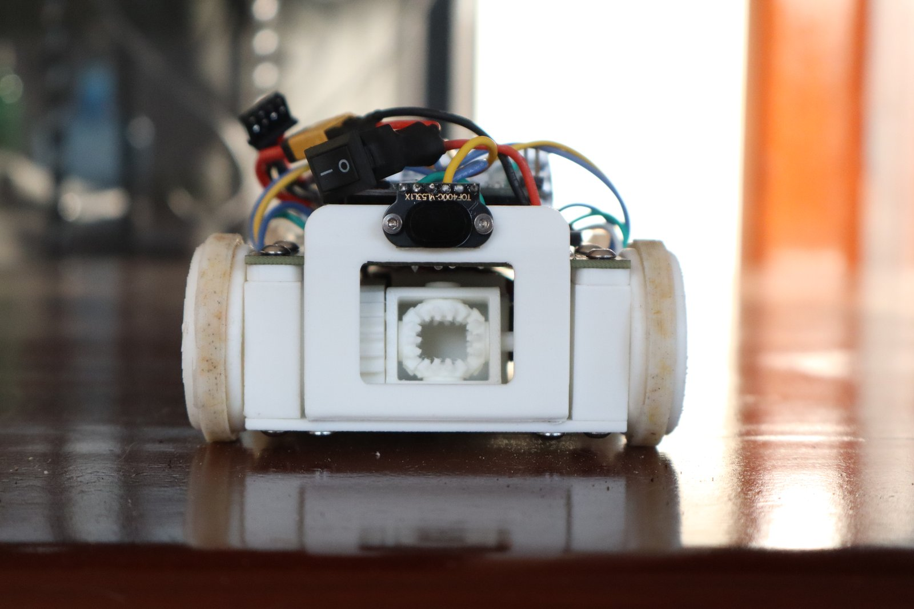
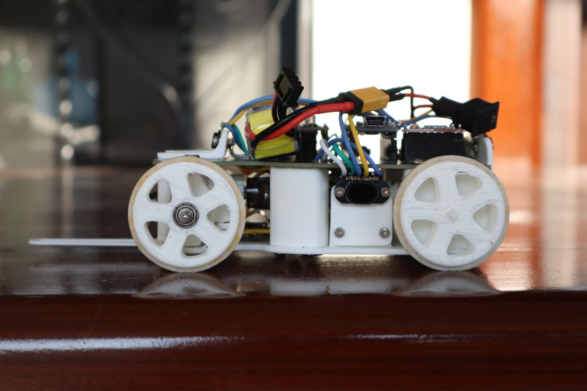
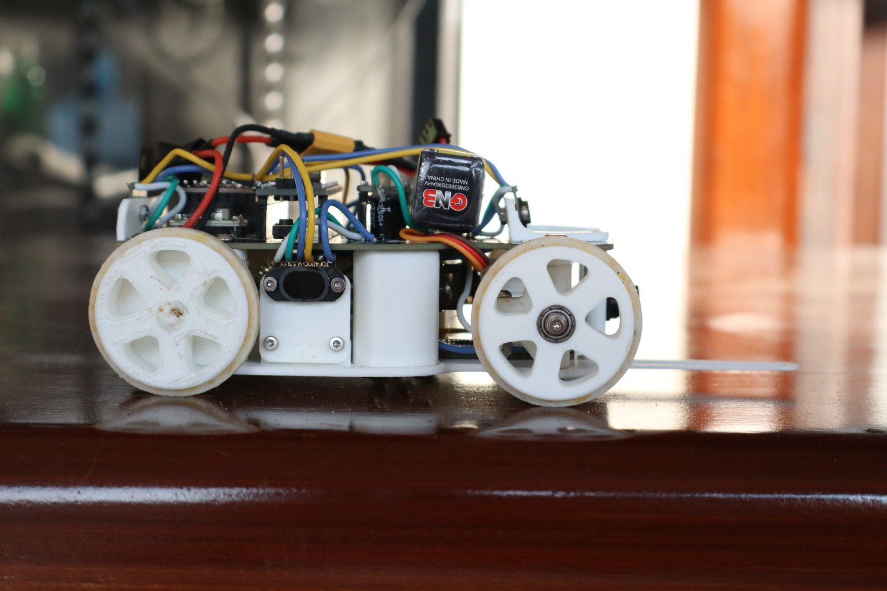
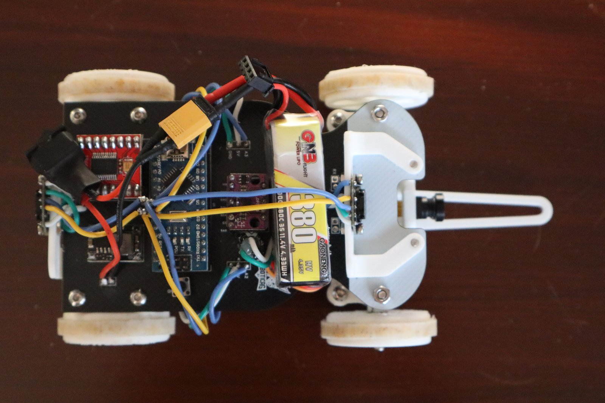
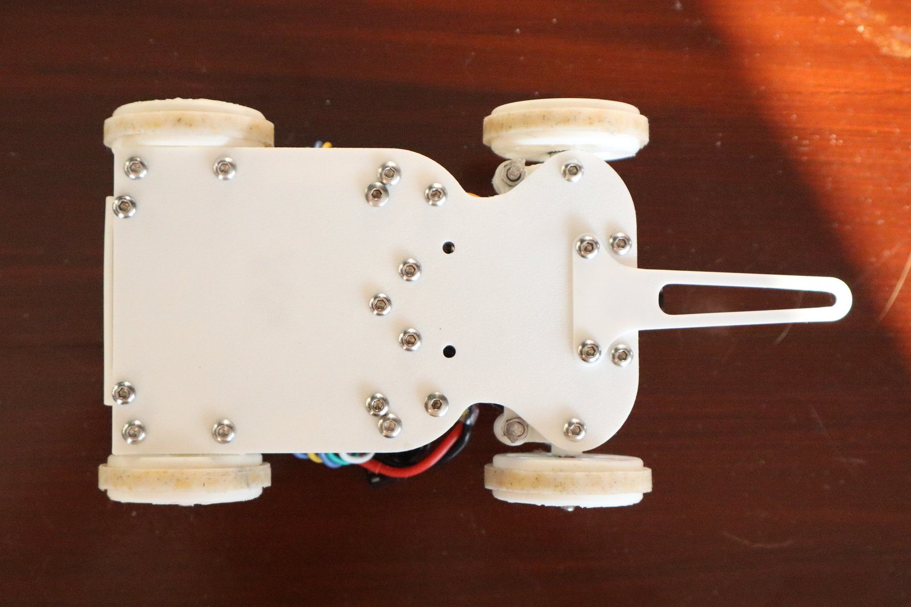
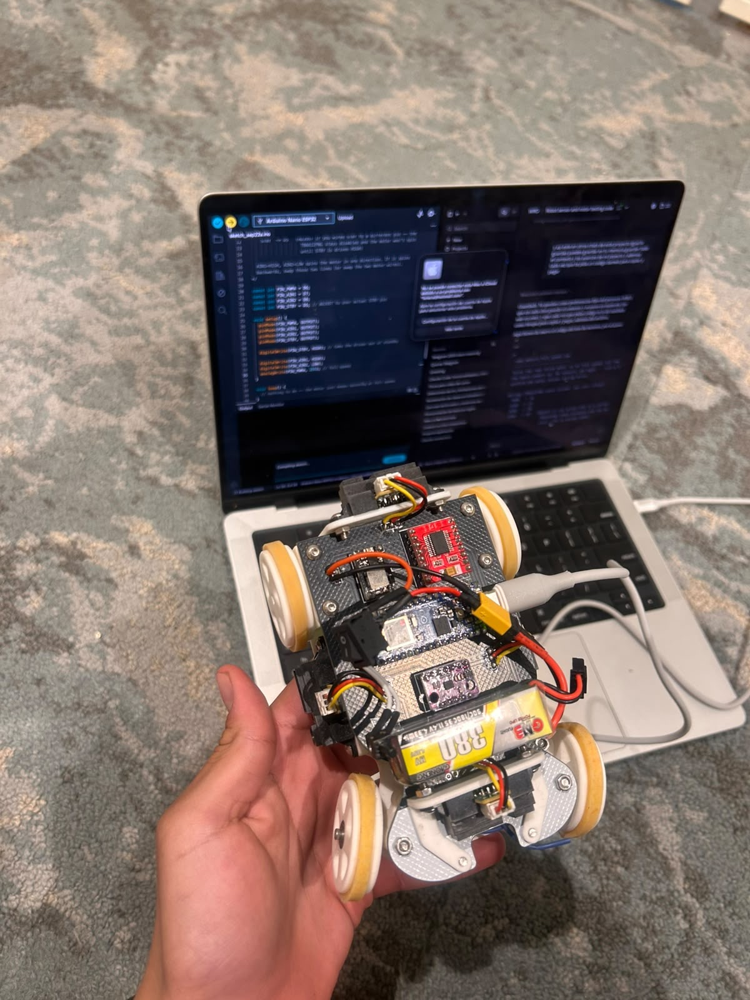

# Vehicle photos — *Enner Valencia* (chassis v4)

The six views required by the rules, of the final car: **17.5 cm long, 9.5 cm wide, 6 cm high, 248 g**.

| Front | Back |
|---|---|
|  |  |
| Front TOF sensor at the edge of the PCB, OV2640 camera low between the front wheels, steering pinion behind it | Rear TOF sensor on its bracket, with the differential gears visible below it |

| Left | Right |
|---|---|
|  |  |
| Side TOF sensor on its bracket between the wheels; battery, power switch and XT30 connector on top | CN3903 buck converter and the other side TOF sensor; PCB on its printed supports above the drive train |

| Top | Bottom |
|---|---|
|  |  |
| Custom PCB with the Arduino Nano (blue), TB6612FNG (red) and BMI160; 3S 380 mAh battery across the front | Printed base: every part is held with screws, no tape; camera lens at the front |

## During development

  
   <em>Chassis 2 on the bench while uploading code.</em>

> The earlier "all parts laid out" and "physical wiring" photos were retired: we changed the model of several parts (§3 of [`models/README.md`](../models/README.md#3-design-iterations)), so those photos no longer match the current car. The [top view](top.jpg) above is used instead wherever the wiring photo was referenced.

The printed parts are in [`../models`](../models/README.md) and the electronics in [`../schemes`](../schemes/README.md).
