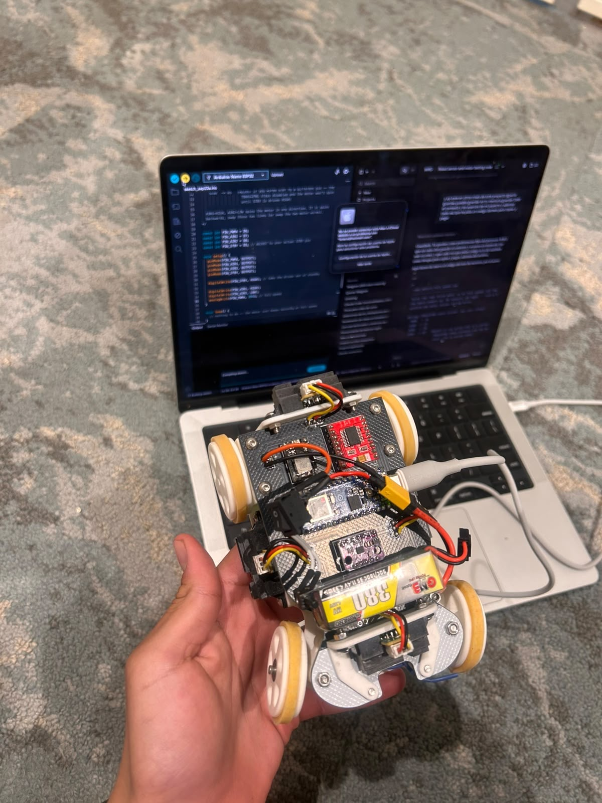
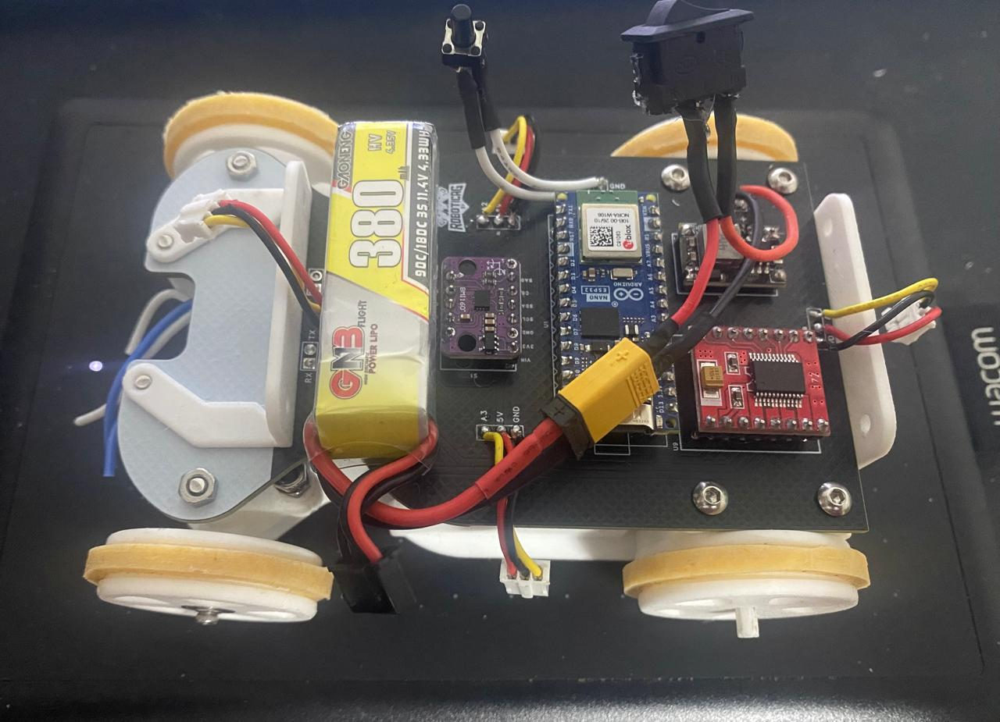

# Vehicle photos — *Enner Valencia* (chassis v3)

The six views required by the rules, of the final car: **13 cm long, 9.5 cm wide, 6 cm high, 270 g**.

| Front | Back |
|---|---|
|  |  |
| Front TOF sensor at the edge of the PCB, OV2640 camera low between the front wheels, steering pinion behind it | Rear TOF sensor on its bracket, with the differential gears visible below it |

| Left | Right |
|---|---|
|  |  |
| Side TOF sensor on its bracket between the wheels; battery, power switch and XT30 connector on top | CN3903 buck converter and the other side TOF sensor; PCB on its printed supports above the drive train |

| Top | Bottom |
|---|---|
|  |  |
| Custom PCB with the Arduino Nano (blue), TB6612FNG (red) and BMI160; 3S 380 mAh battery across the front | Printed base: every part is held with screws, no tape; camera lens at the front |

## All the parts of the car

  
   <em>Every printed part, tyre, electronic module and fastener of one car, laid out before assembly.</em>

## During development

| | |
|---|---|
|  |  |
| Chassis 2 on the bench while uploading code | Wiring detail of chassis 2 |

The printed parts are in [`../models`](../models/README.md) and the electronics in [`../schemes`](../schemes/README.md).
