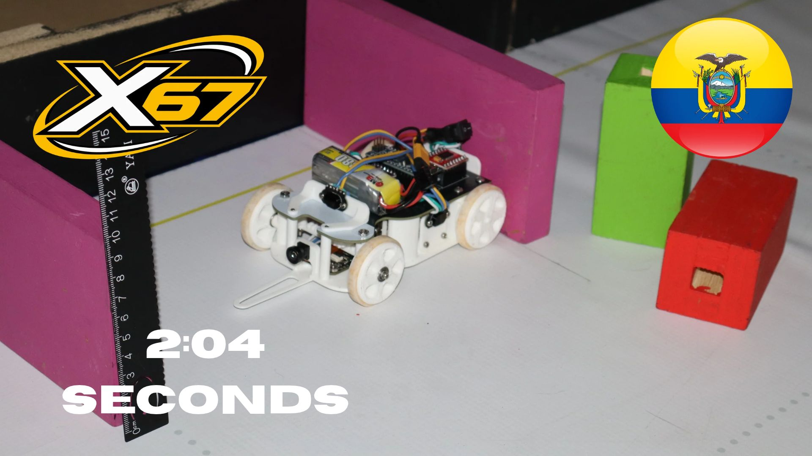
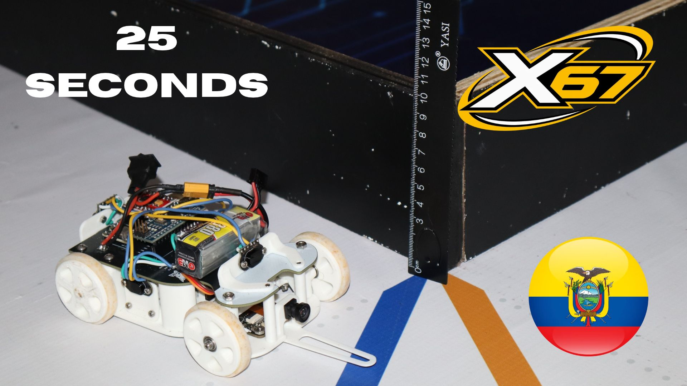

# Performance videos

Rule 7 of the WRO 2026 Future Engineers General Rules asks for **one YouTube video for each challenge** (public or accessible by link), where the part showing the vehicle **driving autonomously lasts at least 30 seconds**.

| Challenge | Video | Status |
|---|---|---|
| Open Challenge (3 laps, random inner walls, stop in the starting section) | https://www.youtube.com/watch?v=4p94mWkXhsk | Done — Open Challenge run with the current `open_challenge` program |
| Obstacle Challenge (3 laps obeying red / green pillars, stop in the starting section) | https://www.youtube.com/watch?v=ccAdp2c7_7Y | Done — run with the `obstacle_challenge` program, which the team confirms is the current version |
| Earlier videos (superseded): previous Open Challenge run `ISvP-OZAk6c`, earlier demonstration | https://www.youtube.com/watch?v=J5yrJuZZ5P8 | Kept for history |

### Thumbnails

<table>
<tr>
<td align="center"> <em>Obstacle Challenge (2:14)</em></td>
<td align="center"> <em>Open Challenge (34 s)</em></td>
</tr>
</table>

**Recording checklist:** one continuous take; show the car switched off in the starting zone, the power switch, the start button and then the whole run without touching the car; at least 30 s of autonomous driving; say the driving direction and the date in the video description.

Team channel: https://www.youtube.com/@SJVL67
